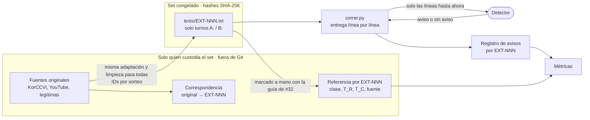

# Relevamiento de fuentes para el corpus externo

Pasos 1 y 2 de [#144](https://github.com/Corchets/bitacora_tesis/issues/144): qué conversaciones
externas sirven para probar si el sistema generaliza fuera de nuestro generador. Relevado el
**2026-11-06**. No arma el set (paso 3), no marca referencias (paso 4) y no corre detectores.

> **Estado: propuesta sin discutir.** La elección y los descartes de este documento son una
> recomendación para el equipo. El tamaño y la composición del set siguen abiertos en
> [D08](../gestion/MAPA-DECISIONES.md#d08--congelar-protocolo-experimental).

## 1. Resultado en breve

- **Ninguna fuente trae a la vez estafas y legítimas parecidas a una estafa en llamadas reales.**
  Las dos fuentes elegidas aportan solo estafas. Faltan legítimas difíciles (ver §5.1); sin
  ellas no se puede armar el set balanceado del paso 3.
- **Elegidas (propuesta):** las estafas reales de KorCCVi v2 (coreano, publicadas por el FSS de
  Corea) y un subconjunto de las 20 llamadas de *scambaiters* de YouTube. El filtro de KorCCVi
  (§3.1.1) deja 13 llamadas con comienzo y pedido, y 12 más con pedido pero sin comienzo.
- **Descartadas:** PIX Scam BR, porque la conversación no define la clase, y el multi-agente de
  BothBosu y sus parientes sintéticos, porque son demasiado fáciles. También tres fuentes sin
  procedencia o sin ficha.
- **Pendientes, sin muestra:** el honeypot de Traister et al., ES-Port (legítimas reales en
  español) y TeleAntiFraud. No se pudieron abrir desde esta sesión (§4).
- **Formato del set:** todas van como conversaciones con identificador neutro y en la misma
  carpeta. La clase y las marcas quedan en una referencia aparte que el detector no ve (§5.4).

## 2. Qué se miró y cómo

> **Actualización del 2026-11-07:** ES-Port ya se pudo descargar y se prepararon lecturas
> locales en tres idiomas. La situación «pendiente, sin muestra» de §1 y §4 describe el
> relevamiento inicial. La continuación, sus límites y el bloqueo de la entrega coreana
> quedan en [§7](#7-continuación-lecturas-exploratorias-2026-11-06-a-2026-11-07).

Para cada fuente se leyó la ficha y se registraron idioma, tamaño, origen real o sintético,
licencia, presencia de legítimas y tipos de estafa. Después se leyó una muestra de unos 10
diálogos con cuatro preguntas del issue:

1. ¿Es creíble como llamada?
2. ¿Las legítimas son realistas o triviales?
3. ¿La estafa se construye distinto que en nuestro corpus (más lenta, más sutil)?
4. ¿Los tipos de estafa tienen equivalente en Argentina? Se compara con las familias del
   [catálogo](CATALOGO-ESCENARIOS.csv): banco, organismo previsional, premio, soporte,
   familiar, WhatsApp y policial/judicial.

Se agregó una pregunta propia del proyecto: **¿se puede marcar `T_R`?** La conversación tiene
que contener el pedido de alto riesgo y algo de construcción antes de él. Si la estafa ya
empezó cuando arranca la transcripción, no hay margen para medir el aviso anticipado
([`METRICAS.md`](../evaluacion/METRICAS.md)).

Muestreo: semilla 144 en Python (`random.sample`). Los datos crudos se bajaron al espacio
temporal de la sesión, fuera de Git. Este documento no copia diálogos.

## 3. Fuentes revisadas con muestra

### 3.1. KorCCVi v2: estafas reales del FSS coreano (elegida, solo estafas)

| Campo | Dato |
|---|---|
| Fuente | [selfcontrol7/Korean_Voice_Phishing_Detection](https://github.com/selfcontrol7/Korean_Voice_Phishing_Detection), commit `93b5b07a9a73b20d2e686f82e5115ba850e21b9c`, `Multimodal/data/transcripts/` |
| Idioma | Coreano |
| Tamaño | 706 llamadas de vishing y 711 legítimas. Transcripción automática (Naver CLOVA) con hablante por segmento |
| Origen | **Real.** Grabaciones que víctimas compartieron con el regulador financiero coreano (FSS) y que este publica como material de prevención |
| Licencia | **No redistribuible.** [`DATA.md`](https://github.com/selfcontrol7/Korean_Voice_Phishing_Detection/blob/93b5b07a9a73b20d2e686f82e5115ba850e21b9c/DATA.md) §2 y §5: los autores no pueden licenciar los datos, las transcripciones son obra derivada y piden no redistribuir el original ni derivados. El uso permitido se confirma con el FSS |
| Legítimas | Llamadas de AI Hub (educación, servicios públicos, comercio) elegidas a propósito **lejos de lo financiero**. Exigen aprobación individual y no se pueden redistribuir. El propio `DATA.md` §4 avisa que la fuente predice la clase |
| Tipos | Por palabras clave sobre las 706: 351 suplantan a fiscalía o policía, 154 son de préstamo o refinanciación y 201 son otras |

Duración de las estafas: mediana 92 s; el 10 % de las más largas pasa los 543 s. Hay **141 llamadas
de 4 minutos o más, con 2 hablantes o más y 20 turnos o más** (101 de fiscalía o policía, 33 de
préstamo, 7 otras). En 232 llamadas el reconocimiento detectó un solo hablante.

Muestra (10 estafas y 4 legítimas): `vishing_512`, `vishing_131`, `vishing_518`, `vishing_174`,
`vishing_255`, `vishing_465`, `vishing_180`, `vishing_75`, `vishing_477`, `vishing_557`; legítimas
`d04j18s004207`, `d02j05s001066`, `d02j10s006589`, `d04j18s021884`.

- **Creíble como llamada:** sí; es la única fuente revisada con estafas reales entre estafador y
  víctima. Pero muchas son **recortes**: el FSS publica fragmentos y varios arrancan en medio de
  la maniobra (`vishing_131`, `vishing_477`, `vishing_518`). La atribución de hablantes falla en
  algunos turnos (`vishing_180` mezcla tres).
- **Legítimas:** triviales para esta prueba (consultas de envíos o de trámites). No se proponen.
- **Construcción:** en las llamadas largas, **más lenta que en nuestro corpus,** que es lo que
  busca el issue. El falso fiscal o policía arma un expediente (una cuenta a nombre de la
  víctima, la banda detenida, el número de causa), aísla a la persona (la llamada «se graba» y
  no puede haber otra voz, no se corta, `vishing_174`, `vishing_180`, `vishing_557`) y amenaza
  con congelar todas sus cuentas. En `vishing_512` (208 s) y `vishing_557` (730 s) **no aparece
  todavía un pedido explícito** de dinero o credenciales: las grabaciones terminan antes. Que
  una llamada sea larga no garantiza que tenga `T_R`.
- **Equivalente local:** la suplantación de fiscalía o policía corresponde a
  `SC-POLICIA-RESGUARDO-01` («resguardo de fondos por una causa judicial»). El préstamo
  preaprobado o la refinanciación no tiene fila en el catálogo; habría que decidir si se acepta
  sin semilla local.
- **`T_R`:** marcable solo en las llamadas que contienen el pedido. En los recortes cortos suele
  faltar la construcción; en algunas largas falta el pedido. El filtro de §3.1.1 revisa las 141.

**Propuesta:** tomar las estafas del grupo A del filtro y, si hacen falta más, del grupo B. Como
no se puede redistribuir, versionar solo los identificadores (`vishing_N.json` y el commit) y
el procedimiento, como indica el issue. Adaptar del coreano al rioplatense es el cambio más
grande de todas las fuentes (ver §5.2).

#### 3.1.1. Filtro de las 141 llamadas largas (2026-11-06)

Resultado por llamada: [`FILTRO-KORCCVI.csv`](FILTRO-KORCCVI.csv). Solo trae identificadores,
duración, grupo, etiqueta y tiempo aproximado del primer pedido y una nota breve; no copia texto.

**Cómo se hizo.** [`filtrar_korccvi.py`](../../experiments/laboratorio/filtrar_korccvi.py) toma las
llamadas de 4 minutos o más, con 2 hablantes o más y 20 turnos o más. Busca pedidos candidatos
por palabra clave, agrupados por las etiquetas del [manual](MANUAL-ANOTACION.md#2-cómo-ubicar-las-marcas-y-resolver-dudas),
y descarta las advertencias del tipo «no le vamos a pedir la clave». Marca 91 con algún candidato
del hablante que más habla. Después se leyó cada llamada: el comienzo, el contexto de los
primeros candidatos y, si no había ninguno, el final. En las dudosas hubo una segunda búsqueda
(cuentas virtuales, «cuentas seguras», visitas, archivos para descargar).

| Grupo | Criterio | Llamadas |
|---|---|---:|
| **A** | Incluye el comienzo de la llamada (o de esta llamada de la serie) y un pedido de alto riesgo del llamante | 13 |
| **B** | Tiene pedido, pero la transcripción arranca en medio de la maniobra | 12 |
| Dudosa | Puede haber pedido, pero no está claro en el texto | 19 |
| C | Sin pedido observable, pedido sin construcción previa, víctima que se burla o corta, o cumplimiento anterior al fragmento | 97 |

Lo que muestra el grupo A:

- **Tipos:** 6 de fiscalía o policía, 4 de préstamo, 1 de falso banco (`vishing_540`), 1 de app
  de «seguridad» (`vishing_281`) y 1 de empleo, donde la víctima termina como intermediaria
  (`vishing_298`; `vishing_538`, de alquiler de cuentas, quedó en el grupo B). Esta última modalidad
  no tiene fila en el catálogo.
- **Pedido:** en 8 de 13 el primer pedido es `REQUEST_SECURITY_ACTION`. En las de fiscalía casi
  siempre es entrar a un sitio falso del organismo y cargar datos. En el catálogo,
  `SC-POLICIA-RESGUARDO-01` usa la misma suplantación pero termina en mover el dinero: es
  parecida, no igual.
- **Margen antes del pedido:** en 10 el primer pedido llega a los 2 minutos o más (hasta unos
  27 minutos en `vishing_617`). En 3 llega antes del minuto (`vishing_540`, `vishing_577`,
  `vishing_657`); dos de ellas son la segunda llamada de una serie y la construcción quedó en
  la primera.

Con 13 del grupo A y unas 7 de YouTube hay 20 estafas, la mitad de un set de 40 diálogos.
Para llegar al mínimo de 50 del issue hacen falta algunas del grupo B; con las 12 se llega a
32 estafas, la mitad de un set de 64.

Límites del filtro: el tiempo es el comienzo del turno que contiene el pedido según la
diarización automática, no `T_R`. `T_R` se marca a mano en el paso 4 con la [guía de #32](MANUAL-ANOTACION.md).
Lo leyó una sola persona (asistente de IA); las 19 dudosas y los grupos A y B necesitan una
segunda lectura humana, idealmente de alguien que lea coreano. La lectura completa del piloto de
traducción (§5.2) ya corrigió dos filas: en `vishing_260` el primer pedido es pagar un
«depósito» de garantía, no la copia del documento; `vishing_334` es una segunda llamada que pide
la clave de la cuenta a los 117 s, con una formulación que el filtro no reconoce, y pasó al
grupo B. La traducción completa del grupo A (§5.2) corrigió cinco filas más: en `vishing_448`
el pago ya se había hecho antes de la grabación (pasó al grupo C); `vishing_538` arranca después
del saludo (pasó al grupo B); y en `vishing_300`, `vishing_617` y `vishing_637` el primer pedido
llega antes de lo que había marcado el filtro.

### 3.2. YouTube scam conversations, BothBosu (elegida en parte, solo estafas)

| Campo | Dato |
|---|---|
| Fuente | [BothBosu/youtube-scam-conversations](https://huggingface.co/datasets/BothBosu/youtube-scam-conversations), commit `d0b94f1e2a9522af4703154c805d02d5c596110d` |
| Idioma | Inglés (EE. UU.) |
| Tamaño | 20 conversaciones, 208 a 1301 palabras (media 482) |
| Origen | **Real** del lado del estafador; transcripción de videos de *scambaiters* (13 de Scammer Jammer, 3 de Rinoa Poison, 2 de scambait tv, 1 de Scammer Payback, 1 de Lewis's Tech) |
| Licencia | La ficha solo declara Apache 2.0, sin texto ni procedencia. Quien subió el dataset no es dueño de los videos: **los derechos de redistribución no están claros** |
| Legítimas | Ninguna (las 20 tienen `labels = 1`) |
| Tipos | 7 premio, 5 soporte técnico, 4 reintegro, 4 seguridad social (`ssn`) |

Muestra: se leyó el comienzo de las 20 (hasta unos 1600 caracteres cada una).

- **Creíble como llamada:** a medias. El estafador es real, pero la «víctima» actúa: se hace la
  confundida, inventa historias o confronta (`#10`, `#17`, `#19`). 18 de 20 son llamadas
  `outgoing`: el *scambaiter* devuelve la llamada y el estafador atiende «gracias por llamar a…».
  En nuestro corpus llama el estafador. En 11 diálogos hay 87 cambios de hablante pegados en la
  misma línea, y en `#0` hay turnos atribuidos al hablante equivocado.
- **Construcción:** más larga y con más rodeos que en nuestro corpus. El pedido llega tarde
  (soporte: guiar paso a paso hasta instalar AnyDesk o TeamViewer).
- **Equivalente local:** soporte y reintegro → soporte (`SC-SOPORTE-REMOTO-01`); premio → premio
  (`SC-PREMIO-01`); seguridad social → organismo previsional (`SC-ORG-BENEFICIO-01`), con la
  diferencia de que en EE. UU. el número de seguridad social es el dato pedido.
- **`T_R`:** marcable en las que la víctima colabora hasta el pedido.

**Propuesta:** quedarse con las que no se vuelven parodia y donde el pedido aparece; a primera
lectura, `#3`, `#4`, `#7`, `#11`, `#13`, `#14` y `#15`. Corregir la atribución de hablantes
antes de adaptar. Por los derechos dudosos, tratarla como no redistribuible: versionar índice
de fila y commit. Los nombres y teléfonos que aparecen los inventaron los *scambaiters*, pero se
tratan como datos identificables y no van al repo.

### 3.3. PIX Scam Challenge BR (descartada)

| Campo | Dato |
|---|---|
| Fuente | [ai-safety-brazil/pix-scam-challenge-br-synthetic](https://huggingface.co/datasets/ai-safety-brazil/pix-scam-challenge-br-synthetic), commit `acdc964b67fea50300fa82033af2ca9db86fbe4d`, versión 1.0.0 (2026-10-28) |
| Idioma | Portugués de Brasil |
| Tamaño | 3000 casos en 1000 grupos de tres; conversaciones de 4 a 6 turnos (media 124 palabras) |
| Origen | Sintético (`Qwen3.6-35B-A3B`), filtrado por otro modelo; sin revisión humana según la ficha |
| Licencia | CC BY 4.0 (datos) y MIT (código), con atribución obligatoria |
| Legítimas | Sí: 1000 `legitimate` y 1000 `insufficient_evidence` |
| Tipos | 10 familias: identidad familiar, factura de proveedor, origen de un reintegro, comprobante, QR, intermediario de marketplace, colecta, seña de un servicio, reserva de alquiler, contacto del banco |

Muestra: un grupo por familia (30 casos), por ejemplo `b87dcd6c3c30c83372dd7a21` (contacto del
banco) y `e24a2dc7241413744ff93451` (identidad familiar); la lista completa está en §6.

- **La conversación no define la clase.** Se verificó en los 1000 grupos: los tres casos de un
  grupo tienen **la misma conversación** y solo cambia un párrafo de «evidencia» externo (lo que
  dice el sistema del banco, el comprobante o la verificación de la clave). La ficha lo dice: un
  clasificador que solo mira la conversación no supera 1/3 de aciertos. Nuestro detector solo ve
  la conversación, así que cualquier resultado mediría la evidencia inventada y no la llamada.
- **No son llamadas.** Casi todos son chats (`mensagem` aparece en 127 contextos y `chat` en 97,
  frente a 35 `ligação`). Solo la familia de contacto del banco se parece a una llamada.
- Seis turnos no dejan construcción antes del pedido; no se puede medir anticipación.

### 3.4. Multi-agent scam conversation y parientes sintéticos de BothBosu (descartadas)

| Campo | Dato |
|---|---|
| Fuente | [BothBosu/multi-agent-scam-conversation](https://huggingface.co/datasets/BothBosu/multi-agent-scam-conversation), commit `709db2b6c37f424c3070f29138abb33971e21ab9` |
| Idioma | Inglés (EE. UU.) |
| Tamaño | 1600 diálogos (800 y 800), 3 a 20 turnos (media 12), 527 palabras de media |
| Origen | Sintético: dos agentes (Autogen y Together), con 8 personalidades de receptor |
| Licencia | Apache 2.0 |
| Legítimas | Sí: entrega, venta de seguro, turno, número equivocado (200 de cada uno) |
| Tipos | Seguridad social, reintegro, soporte técnico, premio (200 de cada uno) |

Muestra (filas de `agent_conversation_all.csv`): estafas 459, 36, 465, 83, 739; legítimas 973,
1206, 890, 1479, 1219.

- **Demasiado fácil.** «social security» aparece en el 60,8 % de las estafas y en el 0,3 % de las
  legítimas; «suspicious», en el 32,8 % y el 0,7 %. En 193 de las 200 estafas de seguridad
  social, el primer turno del llamante ya nombra o pide el número.
- **Legítimas triviales:** entregas y números equivocados; ninguna se parece a una estafa. Las de
  seguros son lo más cercano.
- Tanto el issue como [S006 en la síntesis](../investigacion/SINTESIS-ESTADO-DEL-ARTE.md) anticipan
  el problema: modelos que dan F1 = 1 sobre BothBosu caen a 0,02–0,40 en llamadas reales.

Por diseño y por ficha se descartan también, **sin leer muestra**,
[scam-dialogue](https://huggingface.co/datasets/BothBosu/scam-dialogue) y
[single-agent-scam-conversations](https://huggingface.co/datasets/BothBosu/single-agent-scam-conversations)
(mismas clases, generadas con Llama 3), [Scammer-Conversation](https://huggingface.co/datasets/BothBosu/Scammer-Conversation)
(tabular, generada con Gretel) y
[shakeleoatmeal/phone-scam-detection-synthetic](https://huggingface.co/datasets/shakeleoatmeal/phone-scam-detection-synthetic)
(Llama 8B; soporte, seguridad social y reintegro).

## 4. Otras fuentes encontradas

Búsqueda en el buscador de Hugging Face (`scam`, `vishing`, `fraud-call`, `phone-scam`, `estafa`,
`golpe`, `fraude`, `scambait`, `voice-phishing`, `telecom-fraud`) y en la literatura ya
registrada en la [síntesis §2.3](../investigacion/SINTESIS-ESTADO-DEL-ARTE.md#23-datasets-y-límites-de-reutilización-recuperación-de-43).

| Fuente | Qué es | Situación |
|---|---|---|
| Honeypot de voz, [Traister et al. 2026](https://arxiv.org/abs/2609.29528) | 1000 llamadas reales de estafa y spam, largas (mediana 19,8 min), en inglés; responde un agente LLM; CC BY-NC | **Pendiente, alto interés.** Se distribuye por `scam.ai/research`, que no está habilitado en esta sesión. Limitación: la «víctima» es un agente, no una persona. Sin legítimas |
| [ES-Port](https://github.com/Vicomtech/esport-corpus) | 1170 llamadas reales a soporte técnico de una operadora española, anonimizadas; CC BY-SA 3.0 ES | **Pendiente.** Única fuente de **legítimas reales en español** del relevamiento, cercana a la familia soporte. La descarga (`datasets.vicomtech.org`) no está habilitada en esta sesión |
| [TeleAntiFraud-28k](https://huggingface.co/datasets/JimmyMa99/TeleAntiFraud) y [TeleAntiFraud 2.0](https://arxiv.org/abs/2609.18748) | Chino. 28k mezcla llamadas reales regeneradas con TTS y sintéticas. 2.0 publica sets mensuales congelados con legítimas del mismo dominio | **Pendiente.** En Hugging Face pide cuenta y aceptar condiciones. Lo interesante son las legítimas cercanas de 2.0, aunque son sintéticas |
| [HyaDoo/ko-voicephishing-binary-classification](https://huggingface.co/datasets/HyaDoo/ko-voicephishing-binary-classification) | 8725 fragmentos en coreano, sin turnos ni hablantes | Descartada: parece derivada del FSS sin procedencia; conviene ir al original (§3.1) |
| [BaekRok/vishing_data_3](https://huggingface.co/datasets/BaekRok/vishing_data_3) | Unos 80 GB de audio coreano con segmentos | Descartada: sin ficha ni procedencia |
| [sumitkant/scam-nonscam-youtube-calls](https://huggingface.co/datasets/sumitkant/scam-nonscam-youtube-calls) | Dos `.tar.gz` (1,3 GB) | Descartada por ahora: sin ficha ni licencia; no se abrió |
| [menaattia/phone-scam-dataset](https://huggingface.co/datasets/menaattia/phone-scam-dataset) | 4000 diálogos en inglés de 2 o 3 turnos | Descartada: sin procedencia ni licencia (ya registrado en la síntesis) y demasiado cortos |
| [ScamBench](https://huggingface.co/datasets/Shouninger/ScamBench) y [AmSpotNot1221/scam-call](https://huggingface.co/datasets/AmSpotNot1221/scam-call) | Sin ficha pública | No inspeccionadas: acceso restringido |

## 5. Lo que bloquea el paso 3

### 5.1. Faltan legítimas difíciles

El paso 3 pide 50 a 80 diálogos balanceados, con legítimas parecidas a una estafa. Ninguna
fuente revisada las trae en llamadas: KorCCVi y AI Hub son triviales y no redistribuibles, y las
de BothBosu y PIX son triviales o no son llamadas. Opciones, para decidir en equipo:

1. **ES-Port** para legítimas de soporte, reales y en español. Cubre una sola familia y hay que
   bajarla y revisarla.
2. **Set solo de estafas** para medir detección y adelanto `L_R`, y medir falsas alarmas aparte
   con legítimas propias. Pierde la comparación en igualdad de condiciones.
3. **Legítimas escritas por el equipo** sobre los mismos temas. Dejan de ser «externas»: tendría
   que hacerlas alguien que no desarrolló el detector y habría que declararlo como límite.

### 5.2. Traducción y adaptación

Las estafas elegidas están en coreano e inglés. El issue pide adaptarlas sin cambiar la
estructura. Con KorCCVi hay que decidir qué se hace con las instituciones (fiscalía de Seúl →
¿fiscalía federal?), los montos y los procedimientos que no existen acá (cuentas «seguras» del
FSS), sin volverlas más explícitas.

**Piloto del 2026-11-06.** Se tradujeron tres conversaciones completas: `vishing_260` (préstamo),
`vishing_334` (falso fiscal) y la fila 3 de YouTube (soporte técnico). El texto queda fuera de Git
por los derechos de §5.3; tampoco entran al set final, porque ya las leyó gente del equipo. Los
criterios aplicados, que hacen de *prompt* a registrar:

1. Mismos turnos, mismo orden y mismo contenido. No agregar ni sacar información ni volver más
   explícito el pedido.
2. Rioplatense oral, con «usted» donde el original usa trato formal.
3. Errores evidentes del reconocimiento de voz: se corrigen por contexto. Lo que no se entiende se
   traduce por lo más probable y se marca solo en la hoja de revisión.
4. Respuestas de la otra persona pegadas en un turno: se separan en su propio turno.
5. Regulador financiero coreano → «Banco Central»; fiscal coreano → «fiscal»; bancos, financieras
   y programas → nombres ficticios.
6. Montos: misma cifra, de wones a pesos (orden de magnitud parecido en dólares).
7. Nombres y teléfonos ficticios; las marcas que usa la maniobra (Microsoft, TeamViewer) se dejan.
8. `A` es quien habla primero; la persona protegida queda solo en la custodia.

**Traducción del grupo A y de YouTube (2026-11-06).** Con los mismos criterios se tradujeron las
otras 12 del grupo A y 6 de YouTube (filas 4, 7, 11, 13, 14 y 15): junto con el piloto, 22
conversaciones. En las de KorCCVi con diarización mezclada se unificaron los hablantes (víctima,
investigador y falso fiscal) y se marcaron los turnos reatribuidos. La fila 14 de YouTube no
llega a un pedido de alto riesgo: sirve para medir detección, no `L_R`. Las traducciones quedan
fuera de Git, como el piloto, en formato de set (§5.4) con identificadores de trabajo y su hoja
de revisión.

Dudas abiertas para la revisión humana: «usted» o «vos» (el corpus propio usa casi siempre
«vos», y esa diferencia también puede delatar el origen); si corregir o mantener los errores de
reconocimiento; montos o tasas que en Argentina no son creíbles (una tasa de 5,4 % anual en
`vishing_260`); y llamadas en las que llama la víctima, como la de YouTube.

### 5.3. Derechos

KorCCVi no se puede redistribuir y la fuente de YouTube tiene derechos dudosos. En los dos casos
al repo van solo identificadores, commit y procedimiento; el texto adaptado tampoco se versiona
mientras no esté claro que el derivado está permitido. Esto es más estricto que lo que pide el
issue («al repo sube solo el texto adaptado»), porque el `DATA.md` de KorCCVi pide no distribuir
derivados.

### 5.4. Formato: todas son conversaciones

Pedido del equipo (2026-11-06): el detector tiene que recibir solo la conversación, como si
fuera una llamada cualquiera que está llegando, sin nada que se pueda relacionar con si es o no
una estafa.

**Lo que ya está resuelto.** El circuito de `experiments/slm-directo` ya separa las dos cosas: el
detector recibe, en cada paso, solo las líneas de una llamada que llegaron hasta ese momento. No
recibe el `case_id`, la clase, el escenario ni las marcas ([`detectores.py`](../../experiments/slm-directo/detectores.py),
encabezado). La referencia la lee el resto del circuito, no el detector. Si el set externo usa el
mismo formato (`casos/texto/` y `casos/referencia/`), se corre igual que la reserva sin tocar el
código.

**Reglas del set:**

- **Una carpeta y un formato para todas.** Nada de carpetas por clase como `vishing/`,
  `legitima/` y `dificiles/` en [`experiments/laboratorio/casos`](../../experiments/laboratorio/casos).
- **Identificadores neutros**: `EXT-001`, `EXT-002`, …, asignados por sorteo con semilla
  registrada. Sin prefijos que delaten clase, fuente o tipo. Los del corpus propio sí los tienen
  (`CV2-D-L-…` para legítimas y `CV2-D-V-…` para estafas). Hoy no llegan al detector, pero se ven
  en los registros y en las carpetas: para el set externo conviene que ni eso sugiera la clase.
- **El archivo de cada conversación tiene solo los turnos**, `A:` y `B:`, una línea por turno.
  Sin encabezados, comentarios ni metadatos. Quién es la persona protegida va en
  `roles-protegida.json`, que usa el circuito y no el detector.
- **La referencia, la correspondencia con el original y este documento quedan del lado de la
  custodia.** [`FILTRO-KORCCVI.csv`](FILTRO-KORCCVI.csv) es material de curaduría y no entra al set.

**Lo que puede seguir delatando la clase está en el texto mismo**, no en los archivos. Separar
los archivos no alcanza si las estafas y las legítimas se distinguen por su forma:

| Indicio | Cómo reducirlo |
|---|---|
| Rótulos de la fuente: YouTube usa `Suspect` e `Innocent` | Reemplazarlos por `A` y `B` y revisar que no queden dentro de las líneas |
| Huellas de cada fuente: errores de diarización de KorCCVi, frases cortadas | La misma limpieza para todas; corregir la atribución antes de adaptar |
| Estilo de la traducción: si solo se traducen las estafas, «suenan traducidas» | Pasar las legítimas por el mismo proceso, idealmente desde otro idioma también |
| Largo: las estafas de KorCCVi duran minutos | Elegir legítimas de largo parecido y comparar la distribución por clase |
| Cómo empieza: las estafas arrancan en medio de la maniobra, las legítimas con el saludo | Que todas arranquen igual, o que en las dos clases haya de las dos formas |
| Orden: todas las estafas juntas, o la estafa siempre en el mismo lugar | Sorteo de IDs y de orden de corrida |

**Prueba de fuga antes de congelar.** Quien custodia el set entrena clasificadores triviales que
no entienden de estafas: uno solo con el largo y el número de turnos, y otro con TF-IDF y
regresión logística, con validación dejando una conversación afuera. Si alguno acierta la clase
bastante más que el azar, hay un atajo de forma: se busca y se corrige antes de congelar. Es lo
mismo que hizo PIX Scam BR con sus líneas de base (§3.3). Con 50 a 80 conversaciones la prueba
detecta solo atajos gruesos, y conviene declararla como límite.

**Quién ve qué.** Quien desarrolló el detector no ve las conversaciones ni la referencia antes
de la corrida ([protocolo, ceguera previa](../evaluacion/PROTOCOLO-EXPERIMENTAL.md)). La custodia
adapta, marca, prueba la fuga, congela y corre.

## 6. Reproducibilidad

| Fuente | Revisión | Cómo se obtuvo |
|---|---|---|
| KorCCVi v2 | `93b5b07a9a73b20d2e686f82e5115ba850e21b9c` | `git clone --sparse`, carpeta `Multimodal/data` |
| YouTube scam conversations | `d0b94f1e2a9522af4703154c805d02d5c596110d` | `youtube_scam_conversations.csv` |
| Multi-agent scam conversation | `709db2b6c37f424c3070f29138abb33971e21ab9` | `agent_conversation_all.csv` |
| PIX Scam Challenge BR | `acdc964b67fea50300fa82033af2ca9db86fbe4d` | API de filas de Hugging Face (`datasets-server`), splits `development` y `test` |
| ES-Port | README `b575ec6d7925ea4f83ef00a302682a6f58ad788d`; ZIP SHA-256 `0017a2d6bbbf57d2971872c7a8eb7c1bf266c76dfb8ba2736c17086a948f1f2c` | [ZIP del proveedor](https://datasets.vicomtech.org/di01-esport-corpus/esport-corpus.zip); extracción de los JSON fuera de Git |

Grupos de PIX leídos, uno por familia: `b87dcd6c3c30c83372dd7a21`, `e24a2dc7241413744ff93451`,
`0308cae0b082b846d4a240ad`, `451ea20c17d71a1eed595778`, `64240fb870a4bc4eebee0f05`,
`c41f9f8d146df4ff6719215c`, `1ffe1cc7176b9ba7e2328c66`, `fe0388a91d3cc551419a883d`,
`808eee95db323ac22a12d518`, `d587a4ea65fe008f50090893`.

Los conteos por palabra clave (tipos de KorCCVi, atajos léxicos de BothBosu) son una búsqueda
de cadenas sobre el texto, no una anotación; sirven para describir la fuente, no como referencia.

## 7. Continuación: lecturas exploratorias (2026-11-06 a 2026-11-07)

### 7.1. Antecedente aprovechado y entrega solicitada

Se revisaron el issue [#144](https://github.com/Corchets/bitacora_tesis/issues/144), sus
comentarios y las ramas remotas antes de preparar nuevos archivos. El cuerpo actualizado del
issue atribuye a Evaristo el trabajo de `corpus/144-corpus-externo`, hasta
`80fbc909088446deb8cd28c4ba379e29c540692b`. Ese relevamiento y sus correcciones del filtro ya
estaban integrados en `laboratorio-luciano` (`e467c7c`); se reutilizaron. Las traducciones
registradas en §5.2 no se localizaron en las rutas locales revisadas y el issue no indica una
ruta de custodia. No se afirma que se hayan perdido ni que se hayan leído sus archivos.

Luciano pidió primero leer dos casos de modalidades distintas por fuente. Para esta lectura
se conserva el contenido de origen, sin adaptar instituciones, montos ni procedimientos al
contexto argentino. Inglés presenta el texto fuente y después el español, con turnos
alineados; portugués se entrega solo en español; ES-Port conserva el español de España.
Las observaciones son de IA y los campos para conservar, descartar o revisar quedan vacíos.
No hay anotación humana nueva ni ejecución de detectores.

Se coordinó un worker por idioma: GPT-6.1 Terra High para coreano y Gemini 3.8 Flash High
para los otros tres. Las entregas locales editables usan el nombre
`ISSUE-144-{INGLES,PORTUGUES,ESPORT,COREANO}-2026-11-06.md`, con un archivo
`-PROCEDENCIA.json` por idioma, en `~/Downloads/`, fuera del worktree. Esos JSON registran
fuente fijada, IDs, hashes de entrada, instrucciones, modelo, sustituciones y comprobaciones.
Los nombres conservan la fecha de inicio de esta preparación.

| Lectura | Identificadores de origen | Límite que debe verse al leerla |
|---|---|---|
| Inglés / YouTube | Filas 3 y 4, índice desde cero del CSV fijado en §6 | Soporte y reintegro; ambas llamadas son salientes según `call`. El texto completo de una fila no demuestra que contenga la llamada audiovisual completa. En la fila 4 no se observa entrega de credenciales, toma de control ni transferencia. |
| Portugués / PIX | Grupos `b87dcd6c3c30c83372dd7a21` y `e24a2dc7241413744ff93451`, con todas sus variantes | Son sintéticos. Se comprobó la igualdad del diálogo entre las variantes de cada grupo; las evidencias externas se muestran separadas. La recomendación de §3.3 sigue siendo propuesta, no una decisión nueva. |
| Español / ES-Port | `esport/esport_dialogue.119349.json` y `esport/esport_dialogue.120967.json` | Soporte real según la fuente. Son llamadas iniciadas por el cliente; hay habla simultánea y, en el primer caso, dictado de claves que se sustituye por marcadores. Procedencia de soporte no equivale a conducta segura ni adjudica por sí sola la alerta. |
| Coreano / KorCCVi | `vishing_540` y `vishing_281` | Entrega incompleta: solo procedencia y ficha vacía, sin conversación traducida. Se detuvo la reproducción por las restricciones de §5.3 hasta verificar con el FSS condiciones aplicables. No se obtuvo permiso ni se contactó al proveedor. |

### 7.2. ES-Port accesible y alcance vigente

La descarga de ES-Port que estaba bloqueada en §4 se obtuvo fuera de Git. El
[README fijado](https://github.com/Vicomtech/esport-corpus/blob/b575ec6d7925ea4f83ef00a302682a6f58ad788d/README.md)
declara llamadas reales transcritas y anonimizadas, licencia CC BY-SA 3.0 ES y atribución a
García-Sardiña, Serras y del Pozo (2018). Los JSON conservan intervenciones por hablante en
`speakers`; `filtered-text` puede mezclarlas dentro de un solapamiento. Agruparlas para leer
no permite inventar la cronología interna del habla simultánea. Las claves se sustituyen
también cuando el otro hablante repite sus caracteres.

El equipo ya decidió el alcance de llamadas entrantes de números no agendados, según
[#151](https://github.com/Corchets/bitacora_tesis/issues/151); ese issue registra su
documentación pendiente. Las lecturas salientes se conservan como contraste y se informan
aparte: no se transforman en entrantes para hacerlas encajar. El trato familiar tampoco
demuestra por sí solo que el número esté agendado. No se modifica aquí D03 ni se resuelven
D07 o D08.

### 7.3. Exclusión de exploración y trabajo que sigue pendiente

Por el acuerdo de esta preparación, las conversaciones leídas o discutidas quedan fuera
del futuro test final. Se excluyen también las variantes que comparten conversación con
los grupos PIX leídos; no basta con excluir una fila de cada grupo. Las lecturas previas
de §3 y §5.2 siguen contando: en particular, §3.2 ya registra la lectura del comienzo de
las veinte filas de YouTube, por lo que no se presentan las filas restantes como reserva
ciega nueva.

En ES-Port, la exploración previa a esta entrega también leyó los casos `120770`, `119116`,
`120798`, `119321`, `119715`, `120561`, `119349`, `120620`, `120967` y `119941` (selección
con `Random(144).sample(sorted(nombres_del_zip), 10)`). Quedan fuera del futuro test.
Esta lista no certifica la ceguera de otros datos ni designa quién custodia la evaluación.

El issue #144 sigue abierto: estas lecturas no constituyen el set congelado, no tienen
referencia humana adjudicada ni resultados. Siguen pendientes los derechos de uso coreanos,
la composición y custodia del set, su separación respecto de toda exploración, la revisión
humana y el congelado previo a cualquier detector. La corrida final sigue dependiendo de
[#143](https://github.com/Corchets/bitacora_tesis/issues/143) y
[#51](https://github.com/Corchets/bitacora_tesis/issues/51).

### 7.4. Revisión de las 20 llamadas de inglés (YouTube) y armado del set local (2026-11-07)

> **Estado: propuesta sin discutir.** Luciano decidió destinar al test externo las llamadas revisadas con ficha humana (revirtiendo la exclusión de §7.3 para lo revisado con ficha) y mantener separada la entrada para el detector de la referencia con sus fichas para comparar luego sin filtrarla al detector (§5.4). La referencia cuenta por ahora con un solo revisor (Luciano Grosso); sigue pendiente el segundo revisor en casos dudosos previsto en #144 y revisar con el equipo si las cuatro filas donde su juicio difiere de la etiqueta de la fuente se conservan con su etiqueta o se reevalúan.

Luciano completó las fichas de las 20 filas de [BothBosu/youtube-scam-conversations](https://huggingface.co/datasets/BothBosu/youtube-scam-conversations) (revisión `d0b94f1e2a9522af4703154c805d02d5c596110d`): las filas 3 y 4 sobre la primera tanda (`ISSUE-144-INGLES-2026-11-06.md`, traducida con Gemini 3.8 Flash High) y las 18 restantes sobre la segunda tanda (`ISSUE-144-INGLES-18-2026-11-07.md`, traducida por Claude sin argentinizar y conservando marcas de turnos pegados o rótulos invertidos en la fuente).

De las 20 filas se conservaron **16** y se descartaron **4**:

| Fila CSV | Lectura | Canal y tipo (`call`) | Motivo de descarte en la ficha |
|---|---|---|---|
| 7 | `EN-06` | Trilogy Media · `support` (`outgoing`) | Parte 2 de la misma serie que la fila 6 (`EN-05`); descartada por ser casi igual a la anterior. |
| 12 | `EN-11` | Scammer Payback · `support` (`outgoing`) | Descartada por calidad/recorte. |
| 15 | `EN-14` | Scammer Payback · `refund` (`outgoing`) | Descartada; repite el mismo personaje de quien atiende que la fila 13 (`EN-12`). |
| 19 | `EN-18` | Trilogy Media · `prize` (`outgoing`) | Descartada porque ya hay una llamada igual en la fila 8 (`EN-07`, mismo alias «Peter Anderson» de PCH). |

A pedido de Luciano se revisaron también en las 20 filas el perfil de edad de quien atiende (en casi todas un *scambaiter* que actúa, muchas veces haciendo de adulto mayor o jubilado) y las repeticiones de personajes o alias entre videos:

| Cruce / serie | Filas involucradas | Observación |
|---|---|---|
| Serie en partes (*PART 1* / *PART 2*) | Filas 6 (`EN-05`, conservada) y 7 (`EN-06`, descartada) | Continuación del mismo caso; se conserva solo la fila 6 (`EXT-154`). |
| Serie en partes (*PART 4*) | Fila 10 (`EN-09`, conservada como `EXT-320`) | La estafa ya venía de partes anteriores del video. |
| Mismo alias de estafador («Peter Anderson», PCH) | Filas 8 (`EN-07`, conservada como `EXT-750`) y 19 (`EN-18`, descartada) | El apellido Anderson también aparece en las filas 9 (`EN-08`, `EXT-623`) y 16 (`EN-15`, `EXT-074`). |
| Mismo nombre de quien atiende | Filas 9 (`EN-08`, `EXT-623`, camionero) y 16 (`EN-15`, `EXT-074`, jubilado viudo) | Nombre común en la fuente; los perfiles son distintos. |
| Mismo personaje de quien atiende («Grandma» / «Granny») | Filas 13 (`EN-12`, conservada como `EXT-223`) y 15 (`EN-14`, descartada) | Mismo nombre y apellido en ambos videos. |

Por §5.3 (derechos de YouTube) y §5.4 (custodia de la referencia del test), ni los textos ni las fichas con referencia se suben a Git. Quedaron armados localmente en `laboratorio-luciano/data/private/issue-144/set-ingles/` (ignorado por Git) en dos partes separadas:

1. **Entrada para el detector (sin las fichas de Luciano):** `texto/EXT-NNN.txt` (16 archivos con IDs sorteados con `Random(20261107)` entre `001` y `999`: `EXT-036`, `EXT-074`, `EXT-154`, `EXT-223`, `EXT-250`, `EXT-319`, `EXT-320`, `EXT-390`, `EXT-453`, `EXT-571`, `EXT-579`, `EXT-623`, `EXT-677`, `EXT-705`, `EXT-750` y `EXT-828`) y `roles-protegida.json` (SHA-256 `390a92f136c2fd8a452fcafe970dbb8094d6d7946e95d92f20aefd252e80c705`). En cada archivo quien abre la llamada es `A:` y quien responde es `B:`; los turnos pegados en la fuente se separaron por hablante, se quitaron las notas entre corchetes y los marcadores de anonimización se reemplazaron por datos ficticios consistentes por caso. Los hashes de los 16 `.txt` están en `MANIFIESTO-TEXTO.json` (SHA-256 `117e34185262db29b545ae9f6b62af0f57dfc876596b033a24b774989b8417d3`).
2. **Referencia y fichas de Luciano (para comparar después contra la salida del detector):** `FICHAS-LUCIANO-INGLES.md` (SHA-256 `0ce3610e78ad656d9ea43f485d7a18f6be6967d3c684b7b55d4914173ea111d6`, con las 20 fichas tal cual las completó más las columnas de perfil y repeticiones), `referencia/EXT-NNN.json` (16 archivos con `clase`, `t_r_linea`, `t_c_linea`, `sospecha_linea` y `ficha_original`) y `correspondencia.json` (SHA-256 `280a53425ebdf55eb7522a635882715c169455b0d3b119d89aa6b85ff75a1f5d`, mapa entre fila del CSV, código `EN-NN`, `EXT-NNN` y número de turno a línea de `texto/`).

Las lecturas de portugués (`ISSUE-144-PORTUGUES-10-2026-11-07.md`), ES-Port (`ISSUE-144-ESPORT-10-2026-11-07.md`) y coreano (`ISSUE-144-COREANO-TRADUCCION-2026-11-07.md`), junto con las dos primeras de portugués y ES-Port ya completadas en la tanda del 2026-11-06, quedan en `data/private/issue-144/` para continuar su revisión en otro momento.
