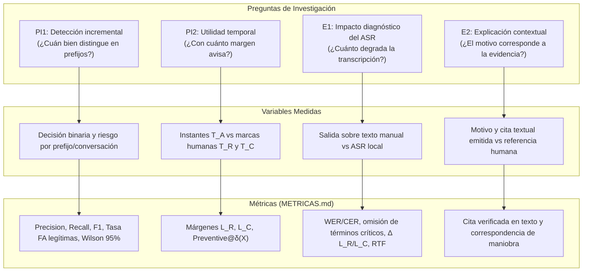
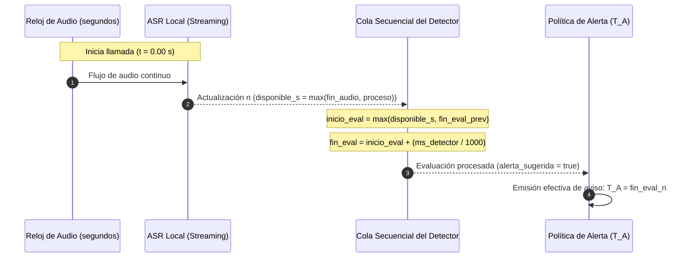
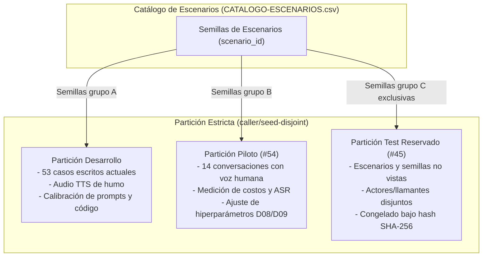
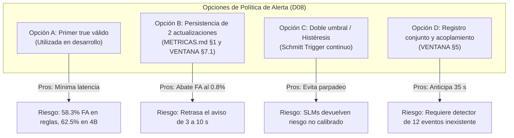

# Protocolo experimental propuesto para la evaluación de detección incremental de vishing

**Fecha:** 2026-10-17  
**Ámbito:** Evaluación experimental del prototipo de detección incremental de vishing  
**Issue de referencia:** [#33](https://github.com/Corchets/bitacora_tesis/issues/33) — Congelar el protocolo y la configuración antes del test (D08)  
**Decisiones vinculadas:** [D06](../gestion/MAPA-DECISIONES.md#d06--definir-corpus-y-piloto), [D07](../gestion/MAPA-DECISIONES.md#d07--aprobar-taxonomía-y-evento-crítico), [D08](../gestion/MAPA-DECISIONES.md#d08--congelar-protocolo-experimental), [D09](../gestion/MAPA-DECISIONES.md#d09--elegir-asr-y-detector), [D11](../gestion/MAPA-DECISIONES.md#d11--análisis-lingüístico-o-también-acústico)  

> **Estado: propuesta sin discutir.**
> Este documento formula la propuesta integral del protocolo experimental previa a la congelación definitiva de la decisión [D08](../gestion/MAPA-DECISIONES.md#d08--congelar-protocolo-experimental).
> **D08 permanece ABIERTA y este documento no la cierra por sí mismo.** Su propósito es proveer al equipo de trabajo (Albarracín, Antenucci, Grosso, Villalobo) y al tutor (Ing. Ernesto Rico) una base rigurosa, trazable y reproducible para discutir, ajustar y congelar formalmente las condiciones de evaluación antes de ejecutar cualquier medición sobre el conjunto de test reservado ([#45](https://github.com/Corchets/bitacora_tesis/issues/45)).
> Cada parámetro o regla que requiera ratificación colegiada se señala explícitamente en el texto con su enlace al mapa de decisiones.

---

## 1. Preguntas de investigación, variables y criterios de lectura

Las mediciones experimentales se estructuran en torno a las preguntas formales del proyecto definidas en el [Plan de Trabajo §5](../propuesta/PLAN-DE-TRABAJO.md#5-preguntas-de-investigación) y detalladas en [PREGUNTAS-DE-INVESTIGACION.md](../investigacion/PREGUNTAS-DE-INVESTIGACION.md). La formulación matemática de cada métrica reside en [METRICAS.md](METRICAS.md), fuente única de verdad para las fórmulas de evaluación.

### 1.1. PI1 — Detección incremental

- **Pregunta formal:** ¿Con qué desempeño y tasa de falsas alarmas puede detectarse vishing utilizando solo la parte de la conversación disponible hasta cada instante?
- **Variable medida:** La decisión binaria de alerta (`alerta_emitida` $\in \{\text{true}, \text{false}\}$) y el puntaje de riesgo emitido por el detector evaluando prefijos sucesivos de la llamada (a los primeros turnos, al 25 %, 50 %, 75 % y 100 % de la duración, o por actualización/turno cerrado) y al corte final de la llamada.
- **Métricas asociadas ([METRICAS.md §4](METRICAS.md#4-qué-se-mide)):**
  - **Recall de vishing:** Proporción de llamadas fraudulentas que reciben al menos una alerta válida antes del fin de la llamada ($TP / P$).
  - **Tasa de falsas alarmas en legítimas ($f$):** Proporción de llamadas legítimas con al menos una alerta emitida ($FP / N$). Desglosada obligatoriamente entre llamadas legítimas cotidianas inocuas y "negativos difíciles" con temática bancaria/seguridad.
  - **Precision y F1 por conversación:** Calculadas sobre la matriz de confusión binaria a nivel de llamada completa y por punto de prefijo.
  - **Incertidumbre estadística:** Intervalo de confianza de Wilson al 95 % para todas las proporciones binomiales reportadas.
- **Criterio de lectura:** La evaluación busca caracterizar el compromiso (*trade-off*) entre precocidad y falsas alarmas: decisiones más tempranas suelen asociarse a mayor inestabilidad o alertas infundadas. No se impone un umbral dogmático de éxito a priori; el resultado describe la curva empírica de desempeño en función del avance temporal de la conversación.

### 1.2. PI2 — Margen temporal de la alerta

- **Pregunta formal:** ¿Con cuánto margen respecto del primer pedido riesgoso y de la primera acción de cumplimiento puede emitirse una alerta estable?
- **Variable medida:** El instante efectivo de emisión del primer aviso $T_A$ en el reloj continuo de la llamada (segundos desde el inicio del audio, computado con el modelo de cola del detector), contrastado contra dos marcas anotadas humanamente: el inicio del primer pedido de alto riesgo $T_R$ y el inicio del primer cumplimiento observable de la víctima simulada $T_C$.
- **Métricas asociadas ([METRICAS.md §1–3](METRICAS.md#1-marcas-temporales)):**
  - **Margen respecto del pedido:** $L_R = T_R - T_A$ (positivo: alertó antes del pedido; negativo: alertó después).
  - **Margen respecto del cumplimiento:** $L_C = T_C - T_A$ (positivo: alertó antes del cumplimiento; negativo: alertó después).
  - **Distribución de márgenes:** Mediana y rango intercuartil ($IQR = Q_3 - Q_1$), indicando la cantidad de conversaciones evaluables $n$. Si una llamada fraudulenta no recibe alerta, cuenta como no detectada y su margen queda sin dato (`None`), sin ser excluida del recall. Si no hay cumplimiento observable en la simulación, $T_C$ queda sin dato y no se infiere prevención lograda.
  - **Alertas con margen suficiente:**
    $$\text{Preventive}@\delta(X) = \frac{\text{llamadas de vishing con } T_A \le X - \delta}{\text{llamadas de vishing evaluables para } X}$$
    para $X \in \{T_R, T_C\}$ y valores de $\delta \in \{5\,\text{s}, 10\,\text{s}, 20\,\text{s}\}$.
- **Criterio de lectura:** 
  - Siguiendo los antecedentes de literatura primaria analizados en [SINTESIS-ESTADO-DEL-ARTE.md §2.4.1 y §7](../investigacion/SINTESIS-ESTADO-DEL-ARTE.md#7-qué-cambia-para-la-evaluación), este protocolo **descarta formalmente las funciones de penalización abstractas tipo ERDE** (Losada & Crestani 2016, [S003](../investigacion/SINTESIS-ESTADO-DEL-ARTE.md#s003--losada-crestani-y-parapar-2016-2017-early-risk-detection-error-erde)) y las métricas de precocidad normalizada por duración total ($\tau / T$ de Mori et al. 2018, [S004](../investigacion/SINTESIS-ESTADO-DEL-ARTE.md#s004--mori-mendiburu-dasgupta-y-lozano-2018-earliness-accuracy-trade-off-en-series-temporales)). En telefonía la duración total $T$ es desconocida durante la llamada y penalizar turnos iniciales inocuos carece de anclaje operativo.
  - Los márgenes físicos en segundos ($L_R, L_C$) y $\text{Preventive}@\delta$ constituyen las únicas medidas directas de utilidad preventiva. Un aviso con $L_C > 0$ indica que la alerta llegó antes de que la víctima revelara el código o ejecutara la transferencia; $L_R > 0$ indica que advirtió antes de que el atacante formulara la exigencia explícita.

### 1.3. E1 — Impacto diagnóstico del ASR local

- **Pregunta formal:** ¿Cuánto degrada el canal de reconocimiento automático de voz (ASR) el desempeño y los márgenes temporales de la detección?
- **Variable medida:** La comparación pareada del comportamiento del mismo detector alimentado con dos entradas alternativas para la misma conversación:
  1. Transcripción manual humana revisada (oráculo sin errores de reconocimiento).
  2. Transcripción emitida por el pipeline de ASR local en streaming o por lotes.
- **Métricas asociadas ([METRICAS.md §4](METRICAS.md#4-qué-se-mide)):**
  - **Word Error Rate (WER) y Character Error Rate (CER):** Tasa de error léxico y de caracteres agregada por llamada.
  - **Tasa de omisión / eliminación (*deletions*) de términos críticos:** Proporción de palabras clave del vocabulario de vishing (`código`, `token`, `clave`, `transferencia`, `banco`, `seguridad`) que fueron omitidas por el ASR respecto del texto de referencia.
  - **Variación temporal de alerta ($\Delta T_A$):** Diferencia $T_A^{\text{ASR}} - T_A^{\text{manual}}$ en segundos.
  - **Variación de márgenes ($\Delta L_R, \Delta L_C$) y $\text{Preventive}@\delta$:** Impacto en la precocidad efectiva atribuible puramente al canal acústico.
  - **Variación de falsas alarmas:** Llamadas legítimas que no disparan alerta en texto manual pero alertan bajo ASR (o viceversa) debido a alucinaciones o sustituciones fonéticas.
  - **Factor de tiempo real (RTF) y latencia:** $\text{RTF} = \text{tiempo\_cómputo} / \text{duración\_audio}$ y percentil 95 de latencia por actualización.
- **Criterio de lectura:** 
  - Siguiendo a Balagopalan et al. (2019, [S007](../investigacion/SINTESIS-ESTADO-DEL-ARTE.md#s007--balagopalan-shkaruta-y-novikova-2019-asimetría-de-errores-de-asr)) y Zhou et al. (2022, [S008](../investigacion/SINTESIS-ESTADO-DEL-ARTE.md#s008--zhou-chong-wang-y-zeng-2022-deriva-semántica-por-errores-de-asr-en-slu)), el WER agregado es insuficiente para evaluar el reconocedor en seguridad: las eliminaciones de palabras clave provocan fallas catastróficas o demoras severas en el clasificador posterior.
  - E1 permite aislar las causas de fallo: si el detector rinde bien con texto manual y colapsa con ASR, el cuello de botella radica en la deriva semántica del transcriptor acústico; si rinde mal en ambos, la debilidad reside en la representación semántica o en la política de alerta.

### 1.4. E2 — Explicabilidad contextual (objetivo secundario)

- **Pregunta formal:** ¿El motivo y la evidencia textual que acompañan al aviso corresponden a hechos observables en la conversación?
- **Variable medida:** La coincidencia cualitativa del campo `motivo` y del fragmento `evidencia` devueltos por el detector respecto a los fragmentos de justificación humana anotados en la referencia (`evidence` en [MANUAL-ANOTACION.md §3](../corpus/MANUAL-ANOTACION.md#3-ejemplo-de-referencia-de-una-conversación)).
- **Métricas asociadas:**
  - **Verificación de presencia textual:** Indicador booleano `evidencia_en_texto` (implementado en `experiments/slm-directo/`) que valida que la frase citada como evidencia por el modelo haya sido efectivamente pronunciada en la llamada y no constituya una alucinación.
  - **Revisión pericial de concordancia de maniobra:** Evaluación sobre una muestra seleccionada de avisos para verificar que la razón informada ("Te están pidiendo un código de WhatsApp") describa la maniobra real en curso.
- **Criterio de lectura:** No se promete calcular un macro-F1 formal sobre las doce etiquetas de la taxonomía candidata (6+6) mientras la anotación humana del corpus sea parcial y orientada a eventos mínimos, tal como estipula [D07](../gestion/MAPA-DECISIONES.md#d07--aprobar-taxonomía-y-evento-crítico).

---

## 2. Unidades de análisis y sincronización del reloj experimental

Para garantizar comparabilidad entre experimentos en streaming de audio y ensayos directos sobre transcripción, se establecen unidades estrictas y reglas de reloj independientes de supuestos no verificables.

### 2.1. Experimentos con audio (streaming o replay)

1. **Origen temporal:** Todas las marcas ($T_A, T_R, T_C$) se miden en **segundos continuos** desde el inicio de la grabación ($t = 0{,}00\,\text{s}$).
2. **Reloj de emisión efectiva ($T_A$):** $T_A$ representa el instante en que el sistema expone el aviso al usuario. **Incluye estrictamente la latencia del ASR y el tiempo de encolado/cómputo del detector.** Nunca se retrotrae al instante en que el hablante pronunció la palabra clave o evidencia.
3. **Modelado de cola secuencial del detector:**
   Tal como implementa el motor de replay en [`experiments/replay/replay.py`](../../experiments/replay/README.md#3-política-de-aviso-único-y-cola-del-detector), el detector opera como un recurso computacional secuencial único (un solo hilo/proceso de inferencia). Si el audio avanza más rápido que el tiempo de cómputo del modelo, las evaluaciones se encolan. En el reloj del audio:
   $$\text{inicio\_eval}_n = \max(\text{disponible\_s}_n, \text{fin\_eval}_{n-1})$$
   $$\text{fin\_eval}_n = \text{inicio\_eval}_n + \frac{\text{ms\_detector}_n}{1000}$$
   $$\text{espera\_cola\_ms} = (\text{inicio\_eval}_n - \text{disponible\_s}_n) \times 1000$$
   donde $\text{disponible\_s}_n$ es el momento en que el ASR entregó el texto (con $\text{disponible\_s} \ge \text{fin\_audio\_s}$).
4. **Instante de disparo:** En la primera actualización $n$ que satisface la política de alerta acordada, se emite el aviso con:
   $$T_A = \text{fin\_eval}_n$$
5. **Aislamiento de llamadas:** El estado acumulado del contexto y la cola de procesamiento se reinician a cero entre llamadas distintas.

### 2.2. Experimentos sobre texto sin audio

1. **Unidades de análisis:** La posición y los márgenes se miden exclusivamente en unidades discretas de **líneas** o **turnos cerrados**.
2. **Prohibición de segundos inventados:** Está terminantemente prohibido convertir líneas a segundos asumiendo duraciones arbitrarias por palabra, tiempos de lectura supuestos o pausas artificiales. Los márgenes $L_R$ y $L_C$ en texto directo se reportan en delta de líneas ($L_R = \text{línea\_pedido} - \text{línea\_aviso}$).

---

## 3. Particiones del corpus y reglas anti-fuga

Para impedir que el detector memorice fórmulas léxicas, modismos de actores específicos o estructuras de un mismo guionista, la partición de datos debe responder a criterios rigurosos de aislamiento.

### 3.1. Definición de las tres particiones

1. **Conjunto de Desarrollo (abierto):**
   - **Composición actual:** 53 casos de texto estructurado en [`experiments/slm-directo/casos/`](../../experiments/slm-directo/casos/) (14 del piloto escrito, 13 trampas adversariales, 26 del laboratorio de Ignacio) y audios sintéticos TTS generados con `say` en [`experiments/asr-local/`](../../experiments/asr-local/).
   - **Uso permitido:** Desarrollo de código, ajuste de parsers JSON, diseño inicial de prompts, desarrollo del arnés de métricas y pruebas de humo del pipeline.
2. **Conjunto Piloto (#54):**
   - **Composición:** 14 conversaciones grabadas con voz humana según la selección inicial de [D06](../gestion/MAPA-DECISIONES.md#d06--definir-corpus-y-piloto) (7 vishing y 7 legítimas difíciles que cubren las 6 clases de pedido crítico y las 6 familias del catálogo), más hasta 6 repeticiones dirigidas.
   - **Uso permitido:** Estimar tiempos y costos de producción/anotación, adjudicar desacuerdos de anotación ([D07](../gestion/MAPA-DECISIONES.md#d07--aprobar-taxonomía-y-evento-crítico)), validar la calidad y velocidad del ASR en voz real ([D09](../gestion/MAPA-DECISIONES.md#d09--elegir-asr-y-detector)) y calibrar los hiperparámetros de la política de alerta sobre audio real.
3. **Conjunto de Test Reservado (#45, #52):**
   - **Composición:** Muestra independiente de conversaciones grabadas con escenarios fraudulentos y legítimos comparables.
   - **Uso permitido:** Evaluación final ciega y única del prototipo. Queda terminantemente prohibido utilizar el test reservado para seleccionar modelos, afinar prompts, ajustar listas de palabras de reglas o recalibrar umbrales.

### 3.2. Reglas anti-fuga innegociables (*caller/seed-disjoint*)

Siguiendo la advertencia de Traister et al. (2026, [S006, §2.4.2](../investigacion/SINTESIS-ESTADO-DEL-ARTE.md#242-detección-de-vishing-y-fraude-telefónico-sobre-transcripciones-o-en-streaming)), quienes demostraron que particiones aleatorias sobre llamadas con guiones o llamantes repetidos sufren una fuga del 42 % inflando artificialmente el rendimiento ($F_1$ de 1.00 en sintético que colapsa a 0.02 en condiciones reales):

1. **Disyunción estricta por semilla (*seed-disjoint*):** Ningún escenario (`scenario_id` del [`CATALOGO-ESCENARIOS.csv`](../corpus/CATALOGO-ESCENARIOS.csv)), ni ninguna de sus variantes, adaptaciones o paráfrasis presentes en Desarrollo o Piloto, puede formar parte del Test Reservado.
2. **Disyunción estricta por llamante / actor (*caller-disjoint*):** Los participantes que actúen en el rol del atacante en el test reservado no deben haber interpretado llamadas de fraude en el conjunto de desarrollo. Si la escasez de voluntarios obligara a reutilizar participantes, sus grabaciones en test deben corresponder a semillas totalmente inéditas y se declarará la limitación en las amenazas a la validez.
3. **Prohibición de partición aleatoria ingenua:** Queda prohibido mezclar llamadas y realizar splits aleatorios ($k$-fold o train/test split) a nivel de turnos o llamadas individuales.
4. **Ceguera previa al congelamiento:** Ningún miembro del equipo abocado al desarrollo del detector puede inspeccionar las transcripciones ni escuchar los audios del conjunto de test reservado antes de congelar formalmente el sistema.

### 3.3. Propuesta de custodia y resguardo del test

> **Estado: propuesta sin discutir.** Vinculada a [D08](../gestion/MAPA-DECISIONES.md#d08--congelar-protocolo-experimental).

Para garantizar la integridad metodológica frente al tribunal evaluador:
- **Custodio designado:** Un integrante del equipo (o un colaborador externo al desarrollo del detector) asume la custodia exclusiva del conjunto de test (#45).
- **Sellado criptográfico:** Antes de congelar D08, el custodio publica en el repositorio un manifiesto que contiene únicamente los identificadores disociados y los hashes criptográficos SHA-256 de cada archivo de audio y de su referencia humana sellada, resguardando los audios y textos en almacenamiento local cifrado fuera de Git (en conformidad con la Ley 25.326 y [PRIVACIDAD-DEL-SISTEMA.md](../corpus/PRIVACIDAD-DEL-SISTEMA.md)).
- **Ejecución desatendida:** Llegado el hito H5 ([PLAN-DE-TRABAJO.md §8](../propuesta/PLAN-DE-TRABAJO.md#8-recorrido-del-desarrollo)), el arnés de evaluación se ejecuta de manera automatizada y desatendida sobre los datos del test; el resultado obtenido se vuelca directamente al informe sin segundas pasadas de ajuste.

---

## 4. Configuraciones candidatas a comparar en #51 y parámetros fijos

El experimento comparativo multidimensional previsto en el [issue #51](https://github.com/Corchets/bitacora_tesis/issues/51) contrastará las siguientes combinaciones de la cadena de procesamiento:

$$\text{Espacio Experimental} = \text{Motor ASR} \times \text{Detector} \times \text{Prompt} \times \text{Información de Hablantes}$$

```mermaid
flowchart LR
    subgraph ASR["Motor ASR (D09)"]
        A1["Sherpa-Zipformer Kroko<br/>(Streaming ONNX)"]
        A2["Faster-Whisper base<br/>(Por lotes int8)"]
        A3["Oráculo manual<br/>(Texto limpio)"]
    end

    subgraph Detectores["Detector (D09)"]
        D0["Reglas del laboratorio<br/>(Línea base comparadora)"]
        D1["SLM Qwen 3.5 0.8B<br/>(Gama baja/media)"]
        D2["SLM Qwen 3.5 2B<br/>(Gama media/alta)"]
        D3["SLM Llama 3.2 1B<br/>(Referencia laboratorio)"]
        D4["SLM Qwen 3.5 4B<br/>(Techo PC escritorio)"]
    end

    subgraph Variantes["Variantes de Configuración"]
        P1["Prompt: 'tarea'"]
        P2["Prompt: 'tarea+base'"]
        H1["Hablantes: 'ab'"]
        H2["Hablantes: 'sin'"]
    end

    ASR --> Detectores
    Detectores --> Variantes
```

### 4.1. Espacio de variables del benchmark

1. **Motores ASR candidatos ([D09](../gestion/MAPA-DECISIONES.md#d09--elegir-asr-y-detector)):**
   - `sherpa-zipformer`: `csukuangfj/sherpa-onnx-streaming-zipformer-es-kroko-2025-08-06` (streaming online con segmentación por endpoint de silencio y purga de lookahead).
   - `whisper`: `faster-whisper-base` cuantizado en int8 (no-streaming, segmentado por lotes mediante VAD integrado).
   - `oraculo`: Transcripción manual limpia revisada (control pareado para la evaluación E1).
2. **Detectores candidatos ([D09](../gestion/MAPA-DECISIONES.md#d09--elegir-asr-y-detector)):**
   - **Línea base de reglas:** Reglas de palabras clave del laboratorio de Ignacio aplicadas sobre la última línea cerrada; actúa como comparador obligatorio para justificar si un modelo neuronal aporta valor frente a heurísticas léxicas simples.
   - **Escalera de Small Language Models (SLM) locales:** Inferencia local sobre Ollama:
     - `qwen3.5:0.8b`: Candidato para perfil de hardware bajo/medio (RAM contenida ~545 MB).
     - `qwen3.5:2b`: Candidato principal para perfil medio/alto (~2.2 GB).
     - `llama3.2:1b`: Modelo de referencia del spike de laboratorio previo.
     - `qwen3.5:4b`: Referencia de calidad máxima en PC (no apto para móvil, cota superior analítica).
3. **Variantes de Prompt:**
   - `tarea`: Prompt directo y conciso de clasificación de vishing y extracción de motivo/evidencia en formato JSON estricto.
   - `tarea+base`: Incorpora la base de conocimiento institucional de fraudes bancarios y suplantación desarrollada en el issue #27.
4. **Información de hablantes / canal:**
   - `ab`: Transcripción con prefijo de hablante/canal alternado (`A:` / `B:`), representativo de la captura VoIP donde cada interlocutor llega por un canal estéreo disjunto.
   - `sin`: Transcripción de texto ciego continuo sin indicación de hablante (representativo de un entorno con diarización ausente o captura mono por altavoz).

### 4.2. Parámetros congelados (Invariantes de ejecución)

Para asegurar la repetibilidad absoluta entre corridas, se fijan de antemano los siguientes parámetros técnicos:

| Parámetro | Valor fijo | Justificación técnica |
|---|---|---|
| `seed` | `42` (`no-aplica` en reglas) | Elimina la dispersión en el muestreo de los SLMs. |
| `temperature` | `0.0` | Inferencia determinista de máxima verosimilitud (*greedy decoding*). |
| `num_ctx` | `4096` | Contexto de ventana suficiente para llamadas completas sin recorte silencioso. Si se excede, el arnés registra un fallo explícito por desborde. |
| `num_predict` | `512` | Límite superior estricto de generación; evita bucles infinitos ante fallas del decodificador (fallo `salida_cortada`). |
| `formato_salida` | JSON Schema estricto | Obliga al motor a emitir los campos `{riesgo, alerta_sugerida, motivo, evidencia}` validados por parser estructurado. |
| `disparo` | `final` (segmento cerrado) | El detector solo se invoca cuando el ASR detecta un fin de turno o silencio; no dispara en cada borrador parcial de 100 ms para preservar CPU y evitar ruido transitorio. |
| `politica_aviso` | Aviso único | Emitido el primer aviso válido, las actualizaciones posteriores se registran pero no generan nuevas alertas en pantalla. |

---

## 5. Política de alerta a congelar: opciones y evidencia observada

La política de alerta define cómo se transforma la secuencia de predicciones del detector en el instante efectivo de aviso $T_A$. Su elección define el balance crítico entre precocidad ($L_R, L_C$) y supresión de falsas alarmas.

> **Estado: propuesta sin discutir.** Opciones abiertas para ratificación colegiada en [D08](../gestion/MAPA-DECISIONES.md#d08--congelar-protocolo-experimental).

### 5.1. Comparativa técnica de opciones

| Opción de política | Mecanismo de disparo | Ventajas técnicas | Desventajas y riesgos | Evidencia observada en el repositorio |
|---|---|---|---|---|
| **A. Aviso único al primer `true` válido** *(vigente en desarrollo)* | $T_A$ se emite en la primera actualización $n$ donde el detector devuelve un JSON válido con `alerta_sugerida == true`. | - Mínima latencia de intervención. - Maximiza la precocidad $L_R$ y $L_C$. - Implementada y testeada en `experiments/slm-directo/` y `experiments/replay/`. | - Extremadamente sensible a falsas alarmas si el modelo reacciona a palabras sueltas sin esperar el contexto completo. | En [`experiments/metricas/salidas/2026-10-17-desarrollo/metricas.md`](../../experiments/metricas/salidas/2026-10-17-desarrollo/metricas.md), esta política produjo una tasa de falsas alarmas en negativos difíciles de **58.3 % en reglas**, **62.5 % en Qwen 4B** y **33.3 % en Qwen 0.8B**. Solo Qwen 2B la contuvo en **8.3 %**, pero a costa de perder recall (69.0 %). |
| **B. Persistencia de dos actualizaciones consecutivas** *(o 2 de las últimas 3)* | Exige que `alerta_sugerida == true` (o riesgo $\ge \theta$) se mantenga en 2 actualizaciones seguidas para emitir $T_A$. | - Supresión masiva de picos transitorios y falsas alarmas espurias. - Formalizada en [METRICAS.md §1](METRICAS.md#1-marcas-temporales) y respaldada matemáticamente en [VENTANA-DE-CONTEXTO-Y-ALERTA.md §7.1](../investigacion/VENTANA-DE-CONTEXTO-Y-ALERTA.md#71-las-falsas-alarmas-se-acumulan-con-cada-revisión). | - Consume entre 3 y 10 segundos de tiempo de reacción, pudiendo convertir una alerta oportuna en tardía ($L_C < 0$). - Si una frase neutra se intercala entre dos pedidos, reinicia la cuenta. | La simulación teórica en [VENTANA-DE-CONTEXTO-Y-ALERTA.md §7.1](../investigacion/VENTANA-DE-CONTEXTO-Y-ALERTA.md#71-las-falsas-alarmas-se-acumulan-con-cada-revisión) demostró que en una llamada de 20 min (80 revisiones), un detector con 99 % de acierto por revisión pasa de un 55.2 % de llamadas legítimas con falsa alarma a solo **0.8 %** aplicando la regla de dos seguidas. |
| **C. Doble umbral continuo con histéresis (Schmitt Trigger)** | Alerta enciende si el riesgo compuesto $S_t \ge \theta_{\text{high}}$ (ej. 0.75) y solo se apaga si cae por debajo de $\theta_{\text{low}}$ (ej. 0.40). | - Evita el parpadeo de alertas y fatiga del usuario. - Gradúa la severidad entre riesgo medio y alto. | - Requiere un score continuo y bien calibrado. Los detectores actuales no ofrecen probabilidades calibradas. | En `experiments/slm-directo/README.md §8` se constató que Qwen 0.8B devuelve riesgos puramente binarios (0 o 1) y Qwen 2B discretiza en solo 13 valores sin calibración empírica. Las reglas léxicas no generan score probabilístico continuo. |
| **D. Registro conjunto de eventos y acoplamiento no lineal** | Acoplamiento multiplicativo $S_t = \sigma(a M_t + b C_t + c M_t C_t + \text{sesgo})$ con memoria de decaimiento por tipo de evento. | - Resuelve estructuralmente el dilema "pasame el código en contexto inocuo". - En trazas sintéticas logró anticipar hasta 35 s antes del pedido de código. | - Depende de un detector multi-clase de 12 eventos que hoy no existe. - Complejidad arquitectónica elevada; agrega múltiples parámetros a calibrar. | Desarrollada exhaustivamente en [VENTANA-DE-CONTEXTO-Y-ALERTA.md §5–6](../investigacion/VENTANA-DE-CONTEXTO-Y-ALERTA.md#5-diseño-propuesto). Demostró conceptualmente la viabilidad de la anticipación, pero sus parámetros numéricos fueron ajustados sobre llamadas sintéticas a mano. |

### 5.2. Propuesta de recomendación para la discusión de D08

Se propone adoptar como **política canónica de evaluación en D08 la Opción A (Aviso único al primer true válido)** combinada con una evaluación comparativa en validación de la **Opción B (persistencia de 2 de las últimas 3 actualizaciones)**. Esto permite caracterizar explícitamente cuántos segundos de margen preventivo ($L_R, L_C$) cuesta proteger al sistema contra la acumulación de falsas alarmas demostrada en la sección 7.1 de Ventana.

---

## 6. Presupuesto de falsas alarmas, umbrales $\delta$ de Preventive@δ y prevalencia

> **Estado: propuesta sin discutir.** Parámetros sujetos a ratificación colegiada en [D08](../gestion/MAPA-DECISIONES.md#d08--congelar-protocolo-experimental).

### 6.1. Presupuesto máximo admisible de falsas alarmas ($f_{\text{max}}$)

Siguiendo la formalización de la falacia de la tasa base en seguridad (Axelsson 2000, [S010](../investigacion/SINTESIS-ESTADO-DEL-ARTE.md#s010--axelsson-2000-la-falacia-de-la-tasa-base-en-sistemas-de-detección)):
- En telefonía personal, el vishing es un evento de baja prevalencia (típicamente $p \le 0{,}01$, es decir menos del 1 % de las llamadas entrantes).
- Si un sistema de defensa exhibe una tasa de falsas alarmas del 20 % o 30 % en llamadas legítimas, el usuario experimentará decenas de avisos erróneos por cada llamada fraudulenta real, provocando el rechazo o la desinstalación inmediata de la aplicación.

Se propone congelar el siguiente **presupuesto de tolerancia máxima de falsas alarmas por llamada legítima evaluada**:
- **Llamadas legítimas cotidianas neutras:** $f_{\text{max}} \le 5\,\%$ a $10\,\%$.
- **Negativos difíciles (llamadas legítimas bancarias o de soporte con palabras clave sensibles):** $f_{\text{max}} \le 15\,\%$.

Cualquier configuración cuyo límite superior del intervalo de Wilson al 95 % supere estos valores en el conjunto de prueba se considerará degradada para uso operativo.

### 6.2. Umbrales temporales $\delta$ para Preventive@δ

En [METRICAS.md §3](METRICAS.md#3-alertas-con-margen-suficiente) se definieron los valores de $\delta \in \{5\,\text{s}, 10\,\text{s}, 20\,\text{s}\}$ como candidatos de trabajo. Se propone fundamentar y congelar estos valores según criterios ergonómicos y cognitivos de reacción humana:

| Umbral $\delta$ | Justificación operativa y cognitiva | Significado del cumplimiento preventivo ($\text{Preventive}@\delta(T_C)$) |
|---|---|---|
| **$\delta = 5\,\text{s}$** | **Tiempo mínimo de reacción motriz:** Permite al usuario percibir el estímulo visual/háptico del aviso, procesar la interrupción y detener el dictado verbal del código o suspender la pulsación en pantalla. | La alerta ocurrió al menos 5 segundos antes de que la víctima comenzara a revelar la credencial o presionar "transferir". |
| **$\delta = 10\,\text{s}$** | **Tiempo de lectura contextual:** Permite leer la explicación breve en pantalla ("Te están pidiendo un código confidencial por llamada") y formular una respuesta de duda o rechazo frente al interlocutor. | Ventana cómoda de intervención explicada. |
| **$\delta = 20\,\text{s}$** | **Anticipación estructural:** Alerta emitida durante la fase previa de manipulación (urgencia, suplantación o pedido de abrir la app bancaria), antes de que el atacante formule la exigencia crítica. | Máximo nivel de protección preventiva. |

- **Referencia principal acordada:** Se propone adoptar $T_C$ (cumplimiento simulado) como referencia primaria de efectividad preventiva para el informe final, reportando obligatoriamente los valores sobre $T_R$ (inicio del pedido) para evaluar la capacidad de anticipación a la exigencia del atacante.
- En pruebas sobre texto directo sin audio, los valores candidatos equivalentes corresponden a $\delta \in \{0, 1, 2\}$ líneas o turnos de antelación.

### 6.3. Análisis obligatorio de sensibilidad a la prevalencia

Conforme a la demostración matemática de Williams (2021, [S009](../investigacion/SINTESIS-ESTADO-DEL-ARTE.md#s009--williams-2021-desbalance-de-clases-y-curvas-precision-recall)):
- La precisión observada sobre un corpus experimental balanceado (50 % vishing y 50 % legítimas) es un artefacto de laboratorio que no refleja el valor predictivo positivo en un entorno real.
- **Prohibición metodológica:** Queda prohibido presentar la precisión o el puntaje F1 medidos sobre el dataset de test como una estimación del rendimiento operativo en despliegue.
- **Fórmula de sensibilidad requerida ([METRICAS.md §4](METRICAS.md#balance-y-precisión-de-las-alertas)):**
  $$\text{precision}(p) = \frac{p \times r}{p \times r + (1 - p) \times f}$$
  donde $r$ es el recall de vishing, $f$ es la tasa de falsas alarmas en legítimas, y $p$ es la prevalencia hipotética de fraude telefónico.
- Se reportará obligatoriamente una tabla y gráfico de sensibilidad para una grilla representativa de prevalencias:
  $$p \in \{0{,}001\, (0{,}1\,\%),\; 0{,}01\, (1{,}0\,\%),\; 0{,}05\, (5{,}0\,\%),\; 0{,}10\, (10{,}0\,\%),\; 0{,}50\, (50{,}0\,\%)\}$$

---

## 7. Tamaño muestral, incertidumbre estadística y amenazas a la validez

### 7.1. Tratamiento estadístico con muestras acotadas ($n$ chico)

Debido a que la producción de grabaciones de voz estructuradas con dos actores y consentimiento informado limita el tamaño muestral a un orden de decenas de conversaciones (14 del piloto y una ampliación acotada para test):

1. **Prohibición de p-valores inflados:** No se reportarán pruebas de hipótesis nula ($p$-values) ni pruebas $t$ de Student que presupongan normalidad o tamaños asintóticos que no se cumplen en la muestra.
2. **Conteos y denominadores explícitos:** Cada métrica porcentual irá indefectiblemente acompañada de su fracción real ($TP/P$, $FP/N$, casos evaluables).
3. **Intervalos de confianza de Wilson al 95 %:** Todas las proporciones estimadas (recall, tasa de falsas alarmas, $\text{Preventive}@\delta$) se informarán con el intervalo de Wilson al 95 %, ya implementado y validado en [`experiments/metricas/metricas.py`](../../experiments/metricas/README.md#1-qué-calcula-y-de-dónde-sale-cada-fórmula), por su probada robustez frente a muestras pequeñas y proporciones cercanas a 0 o 1.
4. **Tratamiento no paramétrico de márgenes:** Los márgenes de anticipación ($L_R, L_C$) se resumirán mediante estadística descriptiva no paramétrica: **mediana, cuartiles ($Q_1, Q_3$) y rango intercuartil ($IQR$)**, junto con diagramas de caja (*boxplots*) o líneas temporales individuales.

### 7.2. Amenazas a la validez

- **Validez de constructo:**
  - *Cumplimiento simulado vs real:* Las marcas $T_C$ corresponden a una actuación voluntaria bajo guion donde la víctima simulada accede a dictar el código para verificar el sistema. Esto permite medir márgenes temporales de ingeniería, pero no demuestra que una víctima real bajo manipulación psicológica y estrés cognitivo suspenda la acción al ver la alerta.
  - *Referencia mínima por conversación:* Anotar únicamente marcas críticas ($T_R, T_C$) en lugar de etiquetar exhaustivamente cada palabra evita la dispersión pericial pero impide medir la sensibilidad a maniobras secundarias aisladas.
- **Validez interna:**
  - *Variabilidad estocástica de SLMs en GPU:* Tal como se documentó en `experiments/slm-directo/README.md §8` (dos corridas idénticas de Qwen 2B con GPU discreta y temperatura 0 difirieron en 60 de 464 respuestas por no-determinismo de coma flotante en hardware paralelo), es obligatorio promediar al menos 3 repeticiones fijando la semilla o evaluar exclusivamente sobre CPU para congelar la salida.
  - *Fuga por guion o dialecto:* El uso de modismos exclusivamente rioplatenses o la reutilización de estructuras dramáticas puede inducir sobreajuste al estilo de redacción del equipo.
- **Validez externa:**
  - *Desajuste entre PC y hardware móvil (R13):* Medir latencias y consumo de memoria en una computadora de escritorio con procesador x86/Apple Silicon proporciona cotas teóricas de viabilidad, pero no equivale a una ejecución en el SoC ARM de un teléfono Android bajo restricciones térmicas y de batería ([PREFACTIBILIDAD-TECNICA.md §1 y §3](../investigacion/PREFACTIBILIDAD-TECNICA.md#1-hardware-objetivo-y-entorno-de-referencia)).
  - *Canal de audio limpio vs red telefónica:* Las grabaciones del piloto en entorno VoIP controlado poseen mayor relación señal a ruido que una llamada celular real en vía pública con códecs de compresión restrictivos (AMR-WB).

---

## 8. Registro, reproducibilidad y checklist previa a la corrida

### 8.1. Manifiesto estructurado y trazabilidad

Cada corrida experimental generará de manera automática e inmutable los siguientes artefactos estandarizados en su directorio de salida:

1. **`manifiesto.json`:**
   - Hash del commit de Git exacto y estado del árbol de trabajo (`git status --porcelain`).
   - Hashes SHA-256 de los archivos de entrada (audio, transcripciones, casos).
   - Metadatos de hardware: procesador, arquitectura, núcleos físicos, memoria RAM total, dispositivo de cómputo (CPU/GPU), cantidad de hilos (`num_thread`).
   - Versiones de software: Python, motor de ASR (`sherpa-onnx` o `whisper`), versión de Ollama y digest del modelo SLM.
   - Configuración completa: detector, prompt, modo de hablantes, tipo de disparo, semilla, política de alerta.
2. **`eventos.csv`:**
   - Traza monotónica de cada actualización procesada: índice, segmento, marca de tiempo del audio (`inicio_audio_s`, `fin_audio_s`, `disponible_s`), tiempos de la cola secuencial (`inicio_eval_s`, `fin_eval_s`, `espera_cola_ms`), respuesta del modelo (`riesgo`, `alerta_sugerida`, `motivo`, `evidencia`, `valida`), estado de aviso y valor $T_A$.
3. **`resumen.md` y `metricas.json`:**
   - Reporte tabular procesado automáticamente por [`experiments/metricas/evaluar.py`](../../experiments/metricas/README.md#2-estructura-del-módulo) con las tablas de clasificación, márgenes y sensibilidad a prevalencia.

### 8.2. Checklist previa a la ejecución sobre el test reservado

Antes de autorizar la corrida del sistema sobre el conjunto de test reservado (#45), el equipo debe verificar que se cumpla la siguiente lista de control de higiene experimental:

- [ ] **Código congelado:** El repositorio se encuentra en un commit específico con etiqueta de versión (*tag* de Git), sin cambios pendientes ni archivos sin seguimiento en el árbol de trabajo.
- [ ] **Aislamiento del test verificado:** Se confirmó que ninguna semilla, escenario ni actor del conjunto de test reservado fue utilizado en desarrollo ni en el ajuste de prompts o reglas.
- [ ] **Pruebas unitarias en verde:** La suite de pruebas de los arneses experimentales (`python -m unittest discover -s experiments/metricas/tests` y `experiments/replay/tests`) pasa al 100 % sin advertencias.
- [ ] **Configuración e hiperparámetros congelados:** El modelo, prompt, temperatura, ventana `num_ctx`, motor ASR y política de alerta están registrados en el manifiesto previo.
- [ ] **Inferencia local estricta:** La máquina de prueba se encuentra desconectada de Internet (modo avión o cable desconectado) para certificar que el pipeline opera exclusivamente *on-device* sin llamadas a APIs externas ni filtración de transcripciones.
- [ ] **Cero reintentos manuales:** Se acuerda formalmente que la corrida sobre test se ejecuta una sola vez de punta a punta; si un caso arroja un fallo técnico del modelo, se contabiliza como fallo en las métricas y no se reinicia selectivamente la llamada.

---

## 9. Checklist de congelamiento formal de D08

> **Instrucciones para el equipo:** Esta lista de casillas debe ser completada y firmada por los integrantes del proyecto en conjunto con el tutor para declarar formalmente cerrada la decisión [D08](../gestion/MAPA-DECISIONES.md#d08--congelar-protocolo-experimental) en el mapa de decisiones. **Las casillas permanecen desmarcadas en este borrador de protocolo.**

- [ ] **1. Taxonomía y marcas de referencia aprobadas ([D07](../gestion/MAPA-DECISIONES.md#d07--aprobar-taxonomía-y-evento-crítico)):**
  - Criterio de marcado de $T_R$ y $T_C$ validado sobre la muestra común del piloto con adjudicación formal de discrepancias entre los anotadores.
- [ ] **2. Partición disjunta y custodia del test selladas ([D08](../gestion/MAPA-DECISIONES.md#d08--congelar-protocolo-experimental), [#45](https://github.com/Corchets/bitacora_tesis/issues/45)):**
  - Asignación de escenarios disjuntos por semilla y llamante registrada; manifiesto de hashes SHA-256 del test reservado publicado en el repositorio.
- [ ] **3. Política de producción de $T_A$ congelada ([D08](../gestion/MAPA-DECISIONES.md#d08--congelar-protocolo-experimental)):**
  - Decisión ratificada entre Opción A (aviso único al primer true válido) y Opción B (persistencia de actualizaciones consecutivas) con sus parámetros numéricos asociados.
- [ ] **4. Parámetros $\delta$ y referencia de Preventive@δ acordados ([D08](../gestion/MAPA-DECISIONES.md#d08--congelar-protocolo-experimental)):**
  - Selección de los valores de $\delta \in \{5\,\text{s}, 10\,\text{s}, 20\,\text{s}\}$ y adopción de $T_C$ como referencia principal informando $T_R$ en paralelo.
- [ ] **5. Presupuesto de falsas alarmas ratificado ([D08](../gestion/MAPA-DECISIONES.md#d08--congelar-protocolo-experimental)):**
  - Techo máximo admisible de llamadas legítimas con alerta fijado formalmente para legítimas cotidianas ($f \le 5\text{--}10\,\%$) y negativos difíciles ($f \le 15\,\%$).
- [ ] **6. Combinaciones del benchmark factorial congeladas ([D09](../gestion/MAPA-DECISIONES.md#d09--elegir-asr-y-detector), [#51](https://github.com/Corchets/bitacora_tesis/issues/51)):**
  - Conjunto cerrado de modelos ASR, detectores SLM, prompts y variantes de hablante a contrastar contra la línea base de reglas del laboratorio.
- [ ] **7. Conformidad académica del tutor:**
  - Minuta de seguimiento con el Ing. Ernesto Rico que registre la aprobación del protocolo experimental, las métricas y la estructura de particiones.
