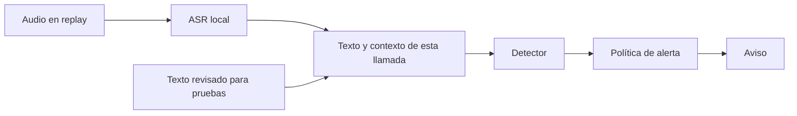

# Arquitectura conceptual y aviso de riesgo

Este documento permite revisar el recorrido del sistema en [#20](https://github.com/Corchets/bitacora_tesis/issues/20).
Describe qué información necesita cada parte; los modelos y las interfaces concretas
se decidirán al implementar y comparar alternativas.

## 1. Restricciones acordadas

- El replay de grabaciones es la base reproducible. VoIP propia es la integración
  objetivo, condicionada por la factibilidad; captura PSTN universal queda fuera.
- ASR y detector se ejecutan localmente. El detector analiza texto y conserva contexto
  de la llamada actual; no analiza tono ni otros rasgos acústicos para detectar fraude.
- Agenda, historial, reputación del número y dirección entrante/saliente no son entradas.
- Clase, escenario, etiquetas humanas, roles de atacante/víctima y `T_R`/`T_C` pertenecen
  a la referencia de evaluación. El detector no recibe esas respuestas.

Fuentes: [alcance del Plan](../propuesta/PLAN-DE-TRABAJO.md#6-alcance) y
[mapa de decisiones](../gestion/MAPA-DECISIONES.md).

## 2. Recorrido propuesto

Mateo aceptó usar un ejemplo bancario con fines didácticos el 2026-10-07. La sección 4
presenta una adaptación al par de WhatsApp seleccionado para el piloto.

> **Estado: propuesta sin discutir.** El flujo define responsabilidades conceptuales;
> la ventana y política siguen abiertas en [D08](../gestion/MAPA-DECISIONES.md#d08--congelar-protocolo-experimental)
> y los modelos en [D09](../gestion/MAPA-DECISIONES.md#d09--elegir-asr-y-detector).

La entrada de texto permite probar el detector antes de integrar ASR. Después se
reproduce el audio y se compara qué cambia por errores o demora de transcripción.
VoIP, si se integra, deberá alimentar ese mismo recorrido de audio.

| Parte | Recibe → produce | Qué hay que cuidar |
|---|---|---|
| Audio | Grabación → bloques de audio con relación temporal. | Entregar solo el audio disponible hasta ese momento. |
| ASR | Audio → actualizaciones de texto, intervalo de origen y momento de disponibilidad. | Declarar si entrega parciales, finales o revisiones. La segmentación puede estar dentro del ASR; no exige otro módulo. |
| Contexto | Actualizaciones → contenido disponible de esta llamada. | Incorporar revisiones sin duplicarlas y reiniciar al cambiar de llamada. |
| Detector | Texto con contexto → indicios de riesgo y evidencia que los sustenta. | No consultar texto futuro ni referencia humana. Un puntaje, si existe, no equivale automáticamente a probabilidad. |
| Política | Indicios → decisión de emitir un aviso y motivo. | Registrar la regla aplicada y el instante real de emisión. |
| Aviso | Decisión → advertencia comprensible y acción sugerida. | Explicar el riesgo sin afirmar identidad o fraude confirmado. |

Un bloque de audio, una actualización del ASR y un turno de conversación son cosas
distintas. No hace falta identificar turnos perfectos ni quién es el atacante para
empezar. Por ejemplo, el ASR puede entregar «pasame el código» y después completar
«del candado»: el detector debe interpretar lo disponible con el contexto previo
y la política debe decidir cómo tratar información todavía incompleta.

## 3. Referencia, tiempos y registros

La referencia humana se prepara por conversación según el [manual](../corpus/MANUAL-ANOTACION.md).
`T_R` y `T_C` se marcan sobre la grabación; `T_A` sale de la ejecución del sistema.
El intervalo al que corresponde un texto y el momento en que el sistema lo recibe
son distintos. La alerta incluye la demora de ASR y procesamiento: no se fecha hacia
atrás al comienzo o fin del fragmento. Las definiciones viven en [métricas](../evaluacion/METRICAS.md#1-marcas-temporales).
En pruebas con texto sin audio se informa posición o actualización, sin inventar segundos.

El experimento debe conservar datos, configuración y salidas suficientes para
reconstruir qué información produjo cada aviso. Audio y materiales vinculables
permanecen fuera de Git. Ese registro experimental se distingue del uso del prototipo,
cuyo tratamiento de contenido sigue la [política de privacidad](../corpus/PRIVACIDAD-DEL-SISTEMA.md).

## 4. Primer par escrito: del escenario al aviso

Se usa el par `SC-WA-CODE-01` / `LG-WA-CONSULTA-01` del
[catálogo](../corpus/CATALOGO-ESCENARIOS.csv), incluido en la
[selección del piloto](../corpus/METODO-CREACION-CORPUS.md#selección-inicial-del-piloto).
El par bancario conversado con Mateo tiene el mismo contraste didáctico, pero no
pertenece a esa selección. No se cambia el piloto para incorporar este ejercicio.

Mateo aceptó usar un caso directo para explicar la arquitectura el 2026-10-07 y
señaló su límite: el detector deberá probarse también con pedidos indirectos y
conversaciones largas. Este par no representa toda la dificultad del problema ni
demuestra rendimiento. Todo su contenido es ficticio.

### Escenarios y fichas de rol

Las fichas siguen el [método](../corpus/METODO-CREACION-CORPUS.md#5-fichas-de-rol).
Se entregan por separado; el diálogo siguiente ilustra una interpretación, no un
texto que haya que memorizar para grabar.

| Caso | Ficha A | Ficha B |
|---|---|---|
| Suplantación de soporte de WhatsApp | Busca obtener el código de activación por SMS con un pretexto ficticio. Puede crear urgencia y sostener el pretexto ante dudas. Si aceptan, escucha el código ficticio; si rechazan, termina. No agrega enlaces, pagos ni otras acciones. | Recibió un SMS ficticio y no pidió activar la cuenta. Actitud dudosa: puede preguntar para qué necesitan el código. Para esta rama acepta y dicta únicamente `000000`, inventado para el ejercicio. Puede rechazar y cerrar. |
| Consulta legítima a una persona conocida | Recibió un código inesperado y consulta cómo proteger la cuenta. Puede preguntar si necesita mostrarlo. No revela el código. | Orienta a no compartirlo y a revisar la seguridad desde la aplicación. Ante dudas explica que no necesita verlo; acepta que se interrumpa la consulta. No pide secretos ni acceso a la cuenta. |

Ambas personas conocen la condición de cierre: terminar después de la respuesta
al pedido o al consejo seguro, o antes si alguien lo solicita. Se detiene la
simulación si aparecen datos reales; no se activa ninguna cuenta ni se opera una app.

### Diálogos escritos

Las posiciones `F1`–`F5` y `L1`–`L4` permiten revisar el ejercicio. No son etiquetas
de atacante/víctima ni forman parte del texto que recibe el detector.

| Posición | Conversación fraudulenta |
|---|---|
| F1 | Te llamo de soporte por la activación de tu cuenta de WhatsApp. |
| F2 | Me acaba de llegar un SMS. No pedí activar nada. |
| F3 | Para cancelar esa activación tenemos que resolverlo ahora. |
| F4 | Decime el código de activación que recibiste por SMS. |
| F5 | Es cero, cero, cero, cero, cero, cero. |

| Posición | Conversación legítima difícil |
|---|---|
| L1 | Me llegó por SMS un código para activar WhatsApp y yo no lo pedí. |
| L2 | No me lo leas ni lo compartas. Revisá la seguridad desde la aplicación. |
| L3 | ¿Necesitás verlo para ayudarme? |
| L4 | No. No hace falta que me digas ningún código. |

### Referencia humana mínima, fuera del detector

Según el [manual](../corpus/MANUAL-ANOTACION.md#1-qué-registramos-por-conversación),
se guarda una ficha por conversación. Aquí las ubicaciones son textuales; no hay
`T_R` ni `T_C` medidos en segundos.

| Campo | Fraudulenta | Legítima difícil |
|---|---|---|
| Clase | `vishing`, por la suplantación simulada y el objetivo de la ficha | `legitima_dificil`, por el contexto ficticio y la conducta segura observada |
| Pedido que después se ubicará como `T_R` en audio | F4, desde «Decime» | Ausente |
| Cumplimiento que después se ubicará como `T_C` en audio | F5, desde el primer «cero» | Ausente |
| Evidencia seleccionada | F1–F3 como contexto, F4 como pedido (`REQUEST_AUTH_CODE`) y F5 como cumplimiento | L1–L4: mención de código, consejo de no compartirlo y rechazo explícito de recibirlo |
| Límite | La identidad real no puede verificarse solo por el diálogo. La clase no se deduce de la palabra «soporte». | La legitimidad de la ficha no es una entrada ni una garantía de que el detector acierte. |

La referencia describe lo escrito, no la salida del detector. Si una toma cambia
el diálogo o no incluye cumplimiento, se anota lo que ocurrió: no se copian estas
marcas automáticamente. `T_A` pertenece a la ejecución, no a esta ficha.

### Texto disponible y salida conceptual esperada

Cada llamada empieza con contexto vacío. En este ejercicio se agregan fragmentos
completos, sin revisiones de ASR. En cada actualización se dispone solo de las filas
ya entregadas, sin texto futuro. Los IDs y las posiciones sirven al registro; la
entrada del detector contiene únicamente el texto y contexto de la llamada actual.

| Actualización | Texto nuevo en la fraudulenta | Indicio esperado del detector | Texto nuevo en la legítima | Indicio esperado del detector |
|---|---|---|---|---|
| U1 | F1–F2 | Contexto de activación; todavía no hay pedido de revelar el código. | L1 | Mención de un código inesperado; no hay pedido de revelarlo. |
| U2 | F3 | Presión por resolver ahora; todavía no hay pedido del código. | L2 | Consejo de no compartirlo; no confundir la negación con un pedido. |
| U3 | F4 | Pedido explícito de código de activación, sustentado por F4 y el contexto anterior. | L3–L4 | La pregunta se responde rechazando recibir el código. No corresponde el aviso por pedido de código. |
| U4 | F5 | Cumplimiento visible; esta información no estaba disponible en U3. | Sin fragmento nuevo | No se inventa otra actualización para igualar longitudes. |

Estas son expectativas para revisar, no resultados de un detector ejecutado ni
doce etiquetas de salida obligatorias. La política recibe los indicios y decide
la emisión; detectar un pedido y mostrar un aviso son responsabilidades distintas.

> **Estado: propuesta sin discutir.** Para ilustrar el último paso, suponemos que
> la política emite el siguiente aviso después de procesar U3 de la fraudulenta.
> Es una rama didáctica, no la política final de
> [D08](../gestion/MAPA-DECISIONES.md#d08--congelar-protocolo-experimental).
>
> **Revisá esta llamada.** Te están pidiendo un código que podría dar acceso a tu cuenta.
> No lo compartas. Interrumpí la conversación y verificá el pedido por un canal conocido.

En este recorrido escrito se ubica el aviso después de U3; no se calcula un margen
temporal. En una ejecución con audio, `T_A` será el momento efectivo de emisión,
con la demora de ASR y procesamiento incluida, según la sección 3.

El motivo debe corresponder a la evidencia: un código de candado en una conversación
cotidiana no justifica este aviso. No se muestran códigos, claves ni citas sensibles.
Una acción sugerida para la persona no implica que el sistema pueda cortar la llamada.
La revisión de comprensión registrada aquí corresponde a Mateo sobre el ejemplo
bancario. La adaptación escrita a WhatsApp es asistida; no se atribuye una lectura
de estos diálogos exactos a Mateo ni a los otros integrantes, ni se reemplaza la
validación de D07 con audio.

## 5. Qué queda abierto

- **D07:** probar con audio los criterios de referencia humana y los motivos observables.
- **D08:** cuánto contexto usar, cuándo procesar, cómo tratar revisiones y cuándo alertar.
  No quedan fijados niveles de riesgo, umbrales ni dos detecciones consecutivas.
- **D09:** elegir ASR y detector mediante comparaciones. El recorrido puede probarse
  con texto antes de grabar o integrar ASR; un prototipo no elige el detector final.

H1 busca que el equipo entienda este recorrido y pueda preparar el primer par.
La arquitectura ejecutable y sus ajustes se comprueban en H2–H4.

## 6. Dirección del detector y visualización consolidada

Acordado el 2026-10-08 en el [issue #50](https://github.com/Corchets/bitacora_tesis/issues/50):
el ensayo corre con un SLM local directo que puntúa cada turno cerrado sobre el
texto incremental con el contexto de la llamada actual, y emite un aviso único
ante el primer resultado verdadero válido. Las reglas de incendio se ejecutan
como comparador independiente, no como arquitectura oficial. La cascada
encoder→SLM queda como alternativa a medir con datos reales; ninguna de las dos
variantes elige el detector final de D09.

> **Estado: propuesta sin discutir.** La política de persistencia del contador,
> la escalera de avisos y la ventana con decaimiento siguen siendo mecanismos
> propuestos en [VENTANA-DE-CONTEXTO-Y-ALERTA.md](../investigacion/VENTANA-DE-CONTEXTO-Y-ALERTA.md);
> su congelamiento corresponde a D08.

Además, el 2026-10-08 se adoptó en esta rama la consolidación del PR #58: una
visualización estática del pipeline propuesto y un simulador de riesgo en
`docs/ingenieria/arquitectura-web/`, publicados dentro del sitio de
ayuda-memoria bajo `/arquitectura/`. Sus estados de decisión se leen en vivo
desde [MAPA-DECISIONES.md](../gestion/MAPA-DECISIONES.md) a través del `data.json`
que genera el build; el resto del contenido es editorial del PR. El simulador
usa valores sintéticos e ilustrativos elegidos a mano: no son mediciones de
rendimiento y no cierran D08. Esta adopción no resuelve D07, D08, D09 ni D11
(abierta hasta que los cuatro ratifiquen «solo transcripción»).

## 7. Plan de experimento: Tito como filtro de consulta al SLM

**Fecha:** 2026-10-26. **Issue de implementación:** [#68](https://github.com/Corchets/bitacora_tesis/issues/68),
relacionado con [#51](https://github.com/Corchets/bitacora_tesis/issues/51).
Plan elaborado mediante entrevista con el usuario. Sus acuerdos son para un
experimento de desarrollo: no eligen la arquitectura final de
[D09](../gestion/MAPA-DECISIONES.md#d09--elegir-asr-y-detector), ni cierran
[D07](../gestion/MAPA-DECISIONES.md#d07--aprobar-taxonomía-y-evento-crítico) o
[D08](../gestion/MAPA-DECISIONES.md#d08--congelar-protocolo-experimental).
No se inició entrenamiento ni inferencia como parte de este plan.

### 7.1 Pregunta y acuerdos de la entrevista

¿Cuántas consultas y cuánto cómputo total se ahorran al activar el SLM ante una
sospecha de Tito, y qué avisos se pierden, agregan o retrasan frente al SLM directo?
La prioridad acordada es conservar detección, falsas alarmas y anticipación.

- Ensayo sobre texto: ocho conversaciones de desarrollo y dos variantes por
  cada SLM ya utilizado. El usuario amplió Q9 a todos los modelos previos; se
  conservan un único prompt, seed y umbral, sin barrido adicional ni audio.
- Tito será RoBERTuito congelado más regresión logística: se ajusta solamente la
  regresión, conservando los parámetros de RoBERTuito.
- Antes de activarse el SLM, Tito puntúa cada fragmento nuevo. La primera sospecha
  activa el SLM; desde esa línea el SLM evalúa cada nueva línea durante el resto
  de la conversación. Solo el SLM puede sugerir el aviso.
- El [contexto de consulta](../GLOSARIO.md) incluye, para este experimento,
  **todas las líneas disponibles desde el comienzo hasta la consulta actual**,
  incluida la que activó a Tito. No se resume ni recorta el historial. Otra
  selección de contexto corresponderá a otro experimento.
- Separado del diálogo se entrega el fragmento completo que activó a Tito, su
  número de línea y puntaje, declarado explícitamente como un indicio falible.
  El encoder actual no identifica palabras causales ni genera explicaciones.
- Ningún modelo recibe clase, etiquetas humanas ni marcas de referencia. Una
  llamada que nunca se deriva al SLM sigue contando al evaluar.

Ejemplo del bloque adicional para revisar al implementar el prompt:

> El filtro previo señaló para revisión la línea {n}: «{fragmento}».
> Su puntaje fue {puntaje}. Es una sospecha preliminar, puede ser incorrecta y no
> confirma una estafa. Evaluá el contexto de consulta completo y decidí si el
> indicio está justificado; podés descartarlo.

La comparación incorpora activación selectiva e indicio adicional juntos. No
aísla el aporte de cada cambio. El SLM directo es el comparador del experimento;
las reglas conservan su condición de baseline del proyecto.

### 7.2 Datos elegidos antes de ejecutar

Banco histórico:
[`bb542e1`, rama `nacho1706/feature-training-data`](https://github.com/Corchets/bitacora_tesis/tree/bb542e130e7a67a82e376a75a0438a15de32f4a6/experiments/laboratorio/entrenamiento_tito).
Contiene 5.520 textos exportados de 276 familias; los 480 apartados no se usan
para ajustar. Esa entrega produjo datos sintéticos, no un detector entrenado.
Conservar metadatos de familia y revisar coincidencias con los casos elegidos:
ausencia de duplicados literales no demuestra independencia semántica.

El usuario aceptó estos ocho casos. Suman 105 líneas: cada pasada del SLM directo
requiere 105 consultas de evaluación, además del calentamiento. Las marcas
actuales son provisionales; ninguno tiene revisión humana confirmada.

| Caso y texto completo | Clase | Líneas | `T_R` / `T_C` en líneas |
|---|---|---:|---|
| [TR-04: pedido tras charla larga](../../experiments/slm-directo/casos/texto/TR-04-pedido-tras-charla-larga.txt) | vishing | 30 | 26 / 27 |
| [TR-06: alerta bancaria legítima](../../experiments/slm-directo/casos/texto/TR-06-banco-alerta-legitima.txt) | legítima difícil | 12 | ausentes |
| [TR-07: pedido partido](../../experiments/slm-directo/casos/texto/TR-07-pedido-partido-en-dos-lineas.txt) | vishing | 10 | 7 / 9 |
| [TR-08: código del candado](../../experiments/slm-directo/casos/texto/TR-08-frase-cortada-candado.txt) | legítima difícil | 7 | ausentes |
| [Soporte remoto fraudulento](../../experiments/slm-directo/casos/texto/SC-SOPORTE-REMOTO-01-e01.txt) | vishing | 11 | 6 / ausente |
| [Soporte legítimo](../../experiments/slm-directo/casos/texto/LG-SUPPORT-INFO-01-e02.txt) | legítima difícil | 13 | ausentes |
| [Familiar fraudulento](../../experiments/slm-directo/casos/texto/SC-FAMILIAR-DINERO-01-e01.txt) | vishing | 12 | 9 / ausente |
| [TR-11: familiar legítimo](../../experiments/slm-directo/casos/texto/TR-11-familiar-real-pide-plata.txt) | legítima difícil | 10 | ausentes |

### 7.3 Orden de implementación y evidencia esperada

1. **Preparar datos y configuración.** Recuperar únicamente el material necesario
   del banco histórico, verificar exportaciones y hashes, revisar los ocho casos
   y registrar ambigüedades sin cambiar silenciosamente las referencias. No usar
   la reserva. Verificar los modelos y fijar prompt, umbral y política de fallos
   antes de medir, según §7.4.
2. **Ajustar y guardar una sola regresión.** Reutilizar la representación de
   [DetectorEncoder](../../experiments/laboratorio/detector_encoder.py): encoder
   sin ajuste de pesos, promedio con máscara y seed 42 para la regresión.
   Verificar el límite de 128 tokens por fragmento y registrar truncamientos.
   Persistir clasificador y metadatos para no reentrenar por llamada.
3. **Agregar el filtro al ensayo textual.** Reutilizar la acumulación incremental
   de [correr.py](../../experiments/slm-directo/correr.py) y el contrato de
   [DetectorSLM](../../experiments/slm-directo/detectores.py). Distinguir
   actualización procesada, SLM no consultado, consulta válida y fallo. Reiniciar
   activación, contexto e indicio al cambiar de conversación.
4. **Preparar el mensaje.** Enviar contexto completo e indicio separados; conservar
   la línea y puntaje de la primera activación durante esa llamada. El puntaje
   no estima probabilidad de fraude real. Ante exceso de contexto registrar fallo
   explícito, sin recorte silencioso. Guardar prompt completo y hash.
5. **Adaptar la evaluación.** El resumen actual exige una fila por línea y excluye
   casos sin respuestas válidas. Las omisiones deliberadas necesitan un estado
   propio: una llamada completa sin derivación cuenta como sin aviso. Sumar costo
   de Tito y consultas fallidas, además del cómputo válido del SLM.
6. **Verificar el recorrido y ejecutar dos pasadas por modelo.** Con dobles de prueba,
   comprobar activación persistente, historial íntegro, aislamiento entre llamadas
   y conteo de casos nunca derivados. Después comparar SLM directo y Tito→SLM
   sobre los mismos ocho textos, con igual configuración para ambas variantes
   de cada modelo. Ejecutar modelos secuencialmente y liberar el anterior antes
   de cargar el siguiente. Separar carga y calentamiento del cómputo por
   actualización; registrar también el total.
7. **Comparar caso por caso.** Informar primera derivación, primer aviso, motivos,
   consultas evitadas, tokens, costo total y fallos. Mantener visibles las estafas
   sin aviso y legítimas con falsas alarmas. Usar [METRICAS.md](../evaluacion/METRICAS.md):
   en texto los márgenes son posiciones, sin segundos ni RTF inventados. Revisar
   los avisos previos al pedido contra su evidencia.

El manifiesto registrará datos y hashes, partición, seed, código y diff local,
librerías/runtime, revisión de encoder y tokenizador, clasificador ajustado,
modelo SLM y digest, prompt, parámetros, hardware y comandos de reproducción.
Dos pasadas por modelo sirven para identificar fallos y decidir si continuar;
no prueban generalización, estabilidad ni ausencia de degradación.

### 7.4 Configuración acordada y requisitos de ejecución

Acuerdos Q9–Q11 del 2026-10-26: todos los modelos previamente usados, umbral
exploratorio fijo y análisis de sensibilidad de las marcas. Son acuerdos locales
del experimento, no una aprobación del equipo/tutor ni un cierre de D08/D09.

El inventario de ejecuciones contiene seis artefactos SLM distintos. Los digests
Qwen completos están en los manifiestos enlazados; la tabla muestra su prefijo.

| Artefacto que se debe preparar | Digest histórico, prefijo | Evidencia de uso previo |
|---|---|---|
| `qwen3.5:0.8b` | `de63045f2975` | [manifiesto 2026-10-22](../../experiments/slm-directo/corridas/2026-10-22_111736_win-0.8b-v1v2-nb32/manifiesto.json) |
| `qwen3.5:0.8b-q8_0` | `7c00f78aed0f` | [manifiesto 2026-10-23](../../experiments/slm-directo/corridas/2026-10-23_153722_linux-0.8b-v1v2-nb32/manifiesto.json) |
| `qwen3.5:2b-q8_0` | `0689d44085e0` | [manifiesto 2026-10-21](../../experiments/slm-directo/corridas/2026-10-21_201039_m1-2b-v1v2-nb32/manifiesto.json) |
| `qwen3.5:4b-q4_K_M` | `d8b0f5e9760c` | [manifiesto 2026-10-23](../../experiments/slm-directo/corridas/2026-10-23_144554_linux-4b-v1v2-cv2-nb32/manifiesto.json) |
| `qwen3.5:9b-q4_K_M` | `56671c2ab938` | [manifiesto 2026-10-23](../../experiments/slm-directo/corridas/2026-10-23_115920_linux-9b-v1v2-cv2-nb32/manifiesto.json) |
| `llama3.2:1b-instruct-q4_K_M` | no registrado | [CSV de la cascada de 2026-09-28](../../experiments/laboratorio/resultados/2026-09-28/resultados-2026-09-28-cascada-robertuito-llama3.2-1b-instruct-q4_K_M.csv) |

Los tags históricos `qwen3.5:2b` y `qwen3.5:4b` comparten digest con sus variantes
explícitas de la tabla: no se duplican. Los dos 0.8B tienen digests diferentes;
no se presume la cuantización del tag sin sufijo. Llama se incluye por el pedido
de todos los modelos, pero se ensaya ahora con el contrato textual actual: sus
cifras históricas, obtenidas con otra política y otros datos, no son comparables.
SmolLM2 aparece como candidato, sin evidencia de ejecución; no integra esta lista.

La matriz es **6 artefactos × 8 conversaciones × 2 variantes = 96 evaluaciones
de conversación**. Implica 630 consultas del SLM directo y hasta otras 630 del
flujo filtrado, además del calentamiento. El mismo ajuste de Tito se reutiliza
para los seis; no se ajusta una cabeza por SLM. El análisis alternativo de marcas
no requiere repetir inferencia.

- **Parámetros comunes:** prompt `tarea`, hablantes `ab`, seed 42, temperatura 0,
  `num_ctx=4096` y `num_batch=32`; desactivar razonamiento cuando el runtime/modelo
  admita `think=false`. Verificar JSON antes de medir; registrar cualquier
  incompatibilidad sin sustituir silenciosamente un modelo. Ambas variantes de
  un mismo artefacto deben usar idénticas opciones y timeout.
- **Runtime y modelos:** fijar una versión de runtime para la comparación nueva
  y comprobar los digests históricos de Qwen. Para Llama registrar el digest
  recuperado y el límite de trazabilidad histórica. La consulta local del
  2026-10-26 encontró otro runtime sin esos Qwen y el servicio histórico apagado:
  preparar el entorno es requisito previo, todavía no completado. Las cifras
  nuevas no se presentan como reproducción exacta de máquinas/versiones antiguas.
- **Derivación y fallos:** ajustar una vez sobre los 5.520 textos y activar ante
  `puntaje ≥ 0,5`, sin calibrarlo con los ocho casos ni reutilizar la zona gris
  antigua. Es una convención exploratoria, no un umbral validado para conservar
  sensibilidad ni una probabilidad real. Si Tito falla, activar el SLM y registrar
  el fallo, sin tratarlo como evidencia de fraude.
- **Referencias ambiguas:** informar marcas actuales y sensibilidad con las mismas
  predicciones: TR-04 con 21/22 además de 26/27; TR-07 con 8/9 además de 7/9,
  según sus notas. No adjudica cuál lectura es correcta ni cambia D07.

**Salida esperada:** una tabla por modelo y conversación con ahorro, primera
derivación, primera alerta, referencias, errores y costos; interpretación de cada
degradación observada antes de decidir otra iteración. La especificación y los
criterios de terminado se publicaron en #68 con `ready-for-agent` mediante
`to-spec`; el usuario confirmó como punto principal de prueba el recorrido
incremental completo hasta su traza y reporte, con Tito y SLM simulados. La
publicación no implica ejecución ni declara completado o cerrado #51.
El usuario aprobó la descomposición de #68 en seis subissues mediante `to-tickets`:
la implementación se toma desde sus relaciones nativas en GitHub. La primera
entrega es [#69](https://github.com/Corchets/bitacora_tesis/issues/69), recorrido
completo con modelos simulados; este documento no mantiene otro backlog.

### 7.5 Continuación acordada: validar Tito antes de optimizar consultas

**Fecha:** 2026-10-27. La especificación y los criterios de terminado de esta
continuación viven en [#95](https://github.com/Corchets/bitacora_tesis/issues/95),
relacionado con #51 y los antecedentes #68–#74. El usuario confirmó el recorrido
completo de preparación, ajuste, persistencia, carga, conversación y reporte
como punto principal de prueba. La publicación no ejecuta ese experimento.

El primer entregable es una evaluación independiente revisada por el equipo y
un diagnóstico del Tito actual. Para este trabajo se mantiene RoBERTuito y se
comparan frase aislada y contexto reciente; primero se evalúa el encoder
congelado y, si la calidad es insuficiente, se permite fine-tuning del mismo
RoBERTuito. Se separan entrenamiento, validación y evaluación independiente
por conversación, semilla y variantes relacionadas. El banco completo ya fue
visto por el artefacto actual y los ocho casos ya fueron analizados: dividirlos
ahora no los convierte en una evaluación independiente de ese artefacto.

Después se vuelve a medir directo y filtrado, deteniendo ambos al primer aviso
emitido, y se compara una política que pueda volver a filtrar cuando el SLM
descarta la alerta. Esa política es una candidata. Se prioriza aviso oportuno,
sin perder detecciones ni aumentar falsas alarmas; un retraso puede considerarse
si conserva margen preventivo suficiente. El valor mínimo de ese margen y las
configuraciones restantes requieren acuerdo antes de su fase, como explicita
#95 en relación con D07/D08/D09. No se congelan aquí la arquitectura final ni
el protocolo del proyecto; el plan original de §7.1–§7.4 conserva su condición
de antecedente de la primera comparación.

El 2026-10-27 el usuario aprobó dividir #95 en siete subissues, publicados como
#96–#102 con `ready-for-agent` y seis bloqueos nativos. La entrada disponible es
[#96](https://github.com/Corchets/bitacora_tesis/issues/96), datos revisados y
particiones verificables, en paralelo con
[#97](https://github.com/Corchets/bitacora_tesis/issues/97), recorrido hasta el
primer aviso y costos separados. Los criterios y dependencias se consultan en
GitHub, sin otro backlog local. El título, cuerpo, estado y metadatos de #95 se
conservaron; publicar los subissues no ejecuta el experimento.
