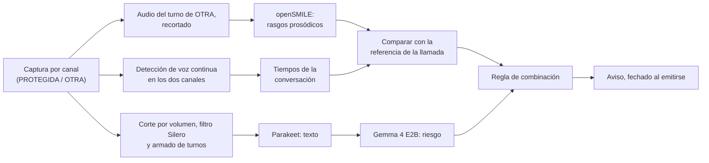

# Mejora futura: análisis acústico de la llamada

> **Estado: propuesta sin discutir.** Es trabajo futuro: no se implementó ni se midió nada de lo que sigue. El detector
> actual trabaja solo sobre la transcripción, y la decisión de sumar rasgos acústicos sigue abierta en
> [D11](../gestion/MAPA-DECISIONES.md#d11--análisis-lingüístico-o-también-acústico). Documenta una mejora futura y
> cómo se aplicaría; la tesis la resume en el [§11.4](../tesis/CAP-11-CONCLUSIONES.md#114-trabajo-futuro-acotado).
> Redactado el 2026-11-23.

## 1. La pregunta

¿Analizar cómo habla quien llama (`OTRA`) y cómo se reparten los tiempos de la conversación le da al detector
información que la transcripción no tiene?

**Objetivo.** Evaluar si los rasgos prosódicos de `OTRA` y los tiempos de interacción, medidos turno a turno a lo largo
de la llamada, permiten al detector avisar antes del primer pedido de alto riesgo (`T_R`,
[métricas](../evaluacion/METRICAS.md#1-marcas-temporales)) o avisar estafas que el texto solo no avisa, con un margen de
falsas alarmas fijado antes de evaluar.

**Por qué interesa.** En la evaluación final, el detector avisó 73 de 100 estafas del test, y 26 de las 27 que no
avisó se quedaron en riesgo 0,2, a un escalón del umbral de 0,3. Bajar el umbral no sirve: con 0,2 avisaría 99 de 100
estafas, pero también 45 de 56 legítimas. Además, en 43 de las 80 estafas con pedido el aviso no llegó antes de que
empezara el pedido ([análisis](../../experiments/slm-directo/corridas/2026-11-12_evaluacion-final/analisis.md),
[conclusiones](../evaluacion/CONCLUSIONES-EVALUACION-FINAL.md#qué-no-ve-y-lo-más-interesante)). Y ninguno de los
candidatos probados en [H12](../hallazgos/H12-cambiar-el-prompt-mueve-el-corte-no-la-separacion.md) mejoró claramente
la separación entre estafas y legítimas reales: los que bajaron las falsas alarmas perdieron detección o avisos a
tiempo. Eso no prueba que el texto haya llegado a un techo, pero sugiere buscar información que el detector no tiene,
en vez de otra forma de pedirle lo mismo. La voz es información que el sistema ya captura y hoy descarta: un operador y
un estafador pueden decir lo mismo, y lo que cambia es cómo lo dicen y cómo llevan la conversación. Además, la voz y
los tiempos no dependen de que el reconocedor transcriba bien: si Parakeet pierde una palabra clave, como «token», y el
riesgo del texto queda en duda en vez de avisar, cómo se dijo sigue ahí.

**A qué apunta.** La regla que se propone (§3.2) solo agrega o adelanta avisos. Apunta a las estafas que el texto deja
en duda y a los avisos tardíos. Las falsas alarmas en llamadas reales de H12 no bajan con esta regla; bajarlas con la
voz sería otro experimento, con el costo que se explica en §3.2.

**Hipótesis.** En algunas estafas, la forma de hablar de quien llama y la manera en que lleva la conversación cambian
de un modo que el texto no registra, y esos cambios aportan información una vez considerado el texto. No pasa en todas:
hay estafadores tranquilos, llamadas legítimas insistentes y emergencias reales con voces agitadas. Por eso el piloto
incluye esos casos, para poner a prueba la hipótesis.

**Qué no se afirma.** No se anticipa una ganancia. Si el piloto da negativo, la conclusión defendible es acotada: estos
rasgos, en estas condiciones y con esta política de aviso, no mostraron un aporte medible. Eso también responde la
pregunta.

## 2. Qué se analiza

### 2.1. Dos fuentes de señal

- **La voz de `OTRA`.** Cómo suena cada turno: altura, intensidad, ritmo y pausas, comparados con cómo hablaba esa
  persona al comienzo de la llamada.
- **Los tiempos de la conversación.** Quién habla cuánto, cuánto tarda cada uno en contestar, cuándo hablan a la vez y
  cómo cambia el largo de los turnos de `PROTEGIDA`.

Las dos se calculan por turno y están disponibles recién cuando el turno termina y se procesa.

### 2.2. Patrones a observar

Son hipótesis sobre qué podría distinguir una estafa, no supuestos. Cada uno tiene una versión legítima que lo imita:

| Patrón | Cómo se vería en una estafa | Qué lo puede imitar en una llamada legítima |
| --- | --- | --- |
| **1. Escalada** | Quien llama habla cada vez más rápido y más fuerte a medida que avanza la llamada | Un vendedor que insiste para cerrar la venta |
| **2. Cambio de registro** | Empieza con calma de operador («le hablamos del área de seguridad») y pasa a la urgencia al acercarse al pedido («tiene que hacerlo ahora») | Un aviso legítimo de un problema real con la cuenta |
| **3. Reacción ante una duda** | La persona dice «prefiero llamar al banco» y quien llama contesta enseguida, le habla encima y sube el tono | Un cobrador que se enoja cuando le dicen que no |
| **4. Dominio de la conversación** | Quien llama habla casi todo el tiempo, interrumpe, y la persona queda reducida a «sí» y «ajá» | Un operador que explica un trámite largo |

Del otro lado, hay casos donde el patrón no aparece aunque sea estafa: un estafador profesional puede mantener la calma
toda la llamada, y en el cuento del tío la agitación es parte del engaño desde el primer segundo, así que no escala. El
patrón 3 depende de un hecho del texto (la duda); para saber si la voz agrega algo sobre ese hecho, la evaluación
incluye un control (§4.1).

### 2.3. Definiciones para el piloto

- **Referencia de la propia voz:** una línea base fija, armada con los primeros segundos de voz de `OTRA` en la
  llamada; cuántos, se define antes de grabar. Para los patrones 1, 2 y 4, cada turno se compara con esa línea base.
  Para el patrón 3, la respuesta a la duda se compara además con el turno anterior de `OTRA`. Una referencia que se
  actualizara con cada turno amortiguaría la escalada, porque subiría junto con ella. Si no hay voz previa suficiente,
  no hay señal prosódica y decide el texto solo. La referencia puede fallar en llamadas cortas, cuando la presión empieza desde el saludo o
  cuando cambia la ganancia del micrófono.
- **Tiempos:** no todo solapamiento es una interrupción. Hay asentimientos («ajá»), eco y retrasos del canal. Se
  define qué cuenta como interrupción y se revisa a mano una muestra.
- **Duda u objeción** (para el patrón 3): un turno de `PROTEGIDA` que duda, se niega, pide verificar o posterga. Los
  ejemplos y los casos dudosos se fijan en una guía de anotación antes de grabar, y se anotan a mano en el piloto.
- **Ventana útil:** lo que aparece antes de `T_R` sirve para anticipar el aviso; lo que aparece después puede aportar a
  la detección, pero ya no adelanta nada. Se informan por separado. `T_R` marca el inicio del pedido, aunque caiga
  dentro de un turno, así que un turno puede empezar antes de `T_R` y terminar después: sus rasgos solo contribuyen
  cuando están disponibles, y el aviso se fecha entonces.

### 2.4. Rasgos

| Rasgo | Qué es | Resistencia al canal telefónico |
| --- | --- | --- |
| Altura ($F_0$) relativa | Nivel y rango de la altura de la voz frente a la referencia | Por verificar. En voz por VoIP, $F_0$ estuvo entre las medidas más estables (Xu et al., 2024) |
| Intensidad relativa | Volumen frente a la referencia | Por verificar. Depende de la ganancia y del control automático del canal |
| Ritmo | Tasa de regiones sonoras por segundo. Es una aproximación, no un conteo de sílabas | Por verificar |
| Pausas | Proporción de pausas internas: tramos sin voz de al menos una duración mínima (por ejemplo, 200 ms) entre el primer y el último tramo de voz del turno. No se usan las regiones no sonoras de eGeMAPS, que incluyen consonantes como la s o la f | Por verificar |
| Proporción de habla | Qué parte del tiempo habla cada canal hasta el momento | Por verificar |
| Demora de respuesta | Tiempo entre el fin de un turno y el inicio del siguiente | Por verificar. Le suma el retraso del canal |
| Solapamiento | Habla simultánea de los dos canales, según la definición de §2.3 | Por verificar. El eco puede simular solapamientos |
| Largo de los turnos de `PROTEGIDA` | Duración de cada turno frente a sus turnos anteriores | Por verificar |

Altura, intensidad y ritmo salen del conjunto eGeMAPS (Eyben et al., 2016) con openSMILE (Eyben, Wöllmer y Schuller,
2010), un programa en C++ que también corre en Android. Su versión abierta es para investigación y educación; usarlo en
un producto requiere la licencia comercial de audEERING ([repositorio](https://github.com/audeering/opensmile)). Las
pausas y el resto salen de la actividad de voz de cada canal. Todos se calculan sobre el turno recortado entre el
primer y el último tramo de voz, sin el audio previo ni el silencio que cerró el turno: si no, un turno corto parecería
tener más pausas que uno largo, y el modelo aprendería el silencio (§8). Ninguno de estos rasgos indica estafa por sí mismo: también cambian por el contenido de lo que se
dice, el ruido, el canal y la dinámica normal de una conversación. Qué dirección se espera en una estafa es parte de lo
que el piloto tiene que observar, no un supuesto.

## 3. Cómo se aplicaría en el detector

### 3.1. Turno a turno

Hoy, en cada canal, un corte por volumen (RMS) parte el audio en frases, Silero descarta las que no tienen voz y
Parakeet transcribe el resto ([ADR 0001](../ingenieria/adr/0001-parakeet-filtro-y-gemma4-e2b-con-tito-viejo.md)). Las
frases se agrupan en turnos, que se cierran cuando el otro canal habla en serio (más de 1 s o 3 palabras) o tras unos
2 s de silencio; al cerrarse un turno de `OTRA`, Gemma 4 E2B escribe el riesgo de la conversación hasta ahí
([ADR 0007](../ingenieria/adr/0007-consulta-al-cerrar-cada-turno-de-otra.md)). Con la mejora, en ese mismo momento:

1. **El texto sigue como hoy.** Si el riesgo del texto llega al umbral, el aviso sale sin esperar nada más.
2. **En paralelo se miden la voz y los tiempos.** openSMILE calcula los rasgos prosódicos del audio de ese turno,
   recortado como se explica en §2.4, y una detección de voz continua en los dos canales da los tiempos. Hoy el audio
   del turno no queda guardado aparte, porque el ASR descarta cada frase al transcribirla: hay que conservar el audio
   del turno en curso hasta que se cierre.
3. **Se comparan con la referencia de la llamada** (§2.3), y se guarda cuánto se apartó cada turno.
4. **La regla decide si adelanta o agrega un aviso** (§3.2).
5. **Al cortar, se borra todo.** La referencia y los resúmenes por turno viven en memoria hasta el final de la llamada
   y no se guardan.

En vivo, si el detector sigue ocupado, saltea consultas intermedias
([§5.4.2](../tesis/CAP-05-DISENO-Y-ARQUITECTURA.md#542-modelado-de-la-cola-secuencial-del-detector)). Los rasgos y los
tiempos se calculan igual para todos los turnos, para no romper la línea base ni el conteo de turnos.

La atribución de cada turno a una persona viene de la captura por canal. La mejora necesita los dos
canales separados: en la integración objetivo, una llamada VoIP controlada por la aplicación, se pueden separar si se
diseña así ([alternativas de captura](../ingenieria/ALTERNATIVAS-CAPTURA-AUDIO.md)). Por eso el canal objetivo se
prueba desde el piloto.

### 3.2. La regla de combinación

El riesgo que escribe Gemma no es un puntaje continuo ([H04](../hallazgos/H04-riesgo-escrito-no-es-puntaje.md)): se
concentra en pocos valores. En desarrollo, con `c-premisa`, 57 de 66 avisos salieron de exactamente 0,3
([ADR 0002](../ingenieria/adr/0002-detector-gemma4-e2b-solo-con-prompt-c-premisa.md),
[corrida de sensibilidad](../../experiments/slm-directo/corridas/2026-11-10_sensibilidad-c/analisis.md)). Una
regresión logística común sobre ese puntaje tampoco garantiza conservar la decisión del texto. Por eso, una regla
explícita:

- **Conserva los avisos existentes.** Cada llamada que el texto solo avisa sigue avisando, en el mismo turno o antes.
- **Puede agregar o adelantar un aviso** cuando se cumplen dos cosas a la vez: la voz o los tiempos muestran un cambio
  respecto de la referencia, y el texto ya marca algún riesgo, aunque no llegue al umbral. Para los patrones graduales
  (1, 2 y 4), el cambio tiene que sostenerse en más de un turno, no ser un pico suelto. Para la reacción ante una duda
  (patrón 3) alcanza el turno que responde a la duda: si tuviera que esperar otro, llegaría tarde. La voz y los tiempos
  nunca avisan solos: urgencia no es estafa. Como el riesgo escrito casi siempre es 0,1, 0,2 o 0,3, el piso natural es
  0,2, donde quedaron las estafas no avisadas. Cuánto cambio, cuántos turnos y qué piso se fijan con los datos de
  definición del piloto, no a mano.
- **Vuelve al texto solo cuando falta señal:** sin voz previa suficiente o con el canal degradado.

Con esta regla las falsas alarmas quedan iguales o aumentan; no pueden bajar. «Avisar antes con las mismas falsas
alarmas» es un resultado que hay que demostrar, no una propiedad de la regla. Usar la voz para bajar falsas alarmas,
por ejemplo subiendo el umbral común, sería otro experimento, porque puede eliminar avisos que hoy sí salen.

### 3.3. Qué cambia y qué no

- **El motivo del aviso** sigue saliendo del texto
  ([ADR 0006](../ingenieria/adr/0006-salida-cortada-tras-el-campo-que-decide-y-motivo-al-avisar.md)). Se le podría
  sumar una frase sobre la forma de hablar («le habló cada vez más rápido»), nunca sobre la persona.
- **Qué tan fuerte es el aviso** (suave o fuerte) es otra pregunta: si cambiar la intensidad mejora lo que hace la
  persona frente a la alerta. Se responde con usuarios, no con este piloto.
- **El costo** es openSMILE por turno y un resumen chico por turno en memoria. Cuánto suma en el teléfono no se midió
  (§8).

## 4. Cómo se evaluaría

### 4.1. Métodos

Todos sobre los mismos prefijos de conversación y con la información disponible en cada instante:

| Método | Qué ve | Qué aísla |
| --- | --- | --- |
| 0. Texto actual | La configuración congelada ([ADR 0002](../ingenieria/adr/0002-detector-gemma4-e2b-solo-con-prompt-c-premisa.md) y [ADR 0008](../ingenieria/adr/0008-prompt-del-detector-c-consejos.md)) | La base |
| 1. Texto con tiempos | 0, más los tiempos de la conversación | Si los tiempos suman sobre el texto |
| 2. Texto con tiempos y voz | 1, más los rasgos prosódicos de `OTRA` | Si la voz suma sobre todo lo anterior |
| Control. Texto con la duda marcada | 0, más la regla de §3.2 con «hubo una duda de `PROTEGIDA` en el turno anterior» en lugar del cambio en la voz, sin tocar el prompt | Si para el patrón 3 alcanza con señalar la duda, sin escuchar la respuesta |

Los métodos comparten la misma transcripción incremental, el mismo calendario de consultas y una única ejecución del
detector base. Esa ejecución corre sobre todos los turnos de `OTRA`, sin cortar en el primer aviso como hace la
configuración congelada, para tener las curvas completas; el `T_A` de cada método es su primer disparo. Cada método conserva los disparos del anterior y puede emitir un aviso adicional con la señal que
incorpora. El aviso base sale sin esperar el cálculo adicional. Los tiempos y los rasgos de un turno entran al cerrarse
el turno y terminar su cálculo. Si faltan rasgos prosódicos, el método 2 conserva la decisión del método 1. Compartir
la ejecución importa: la misma configuración, corrida en otra sesión y sin cortar en el primer aviso, pasó de 37 a 43
avisos antes del pedido ([H13](../hallazgos/H13-la-misma-configuracion-corrida-de-otro-modo.md)). Por eso el modo de
ejecución se declara y es el mismo para todos los métodos.

En el piloto las dudas se anotan a mano. Si el control resulta necesario en el teléfono, aparte se mide cuánto se
pierde cuando hay que detectarlas automáticamente.

### 4.2. Qué se informa

Cada método se compara con el anterior (1 contra 0, 2 contra 1, y el control contra 0), sobre llamadas pareadas y con
denominadores explícitos:

- cuántas estafas pasan a recibir un aviso antes de `T_R` (`T_A < T_R`);
- cuántas estafas que el método anterior no avisaba pasan a avisarse;
- cuánto cambia el margen `L_R` en las estafas que ya avisaban con los dos métodos;
- cuántas legítimas reciben un aviso nuevo, con un horizonte común;
- la incertidumbre de cada cifra, teniendo en cuenta que las llamadas de una misma persona o familia de guiones no son
  independientes.

Además:

- Todo separado por tipo de llamada (§5.1). Un método que mejora el total pero empeora un tipo se informa así.
- Por llamada, un gráfico con el riesgo del texto turno a turno, los rasgos de la voz y los tiempos, las dudas, los
  disparos de cada método, `T_R` y `T_A`, y **cuándo estuvo disponible cada señal**: los rasgos de un turno llegan después de que el turno
  termina.
- Entre llamadas, comparaciones con un horizonte común (por ejemplo, hasta `T_R` o las primeras N consultas), no con el
  máximo de la llamada entera, que favorece a las más largas.

## 5. El piloto

### 5.1. Cómo grabar

- **Conversaciones recreadas por personas**, en español argentino y con los dos canales separados.
- **Las dos clases recreadas, en las mismas condiciones.** «Voz humana» y «llamada real» son cosas distintas. Si las
  estafas se actúan y las legítimas son naturales, el modelo puede aprender la actuación aunque se use el mismo
  micrófono. En el piloto, estafas y legítimas se recrean por igual; la validación con llamadas naturales va después,
  por separado.
- **Participantes en las dos clases** cuando se pueda, para que la voz de una persona no delate la clase.
- **Un piso de participantes por conjunto,** fijado antes de grabar, para que la reserva no quede con dos o tres voces
  y la incertidumbre se pueda estimar. Las pruebas anteriores con voz real tuvieron solo dos voces
  ([§8.2.1](../tesis/CAP-08-RESULTADOS-EXPERIMENTALES.md#821-con-voz-real)).
- **Reserva agrupada por personas y por familias de guiones:** se asigna antes de ajustar la regla, y cada
  participante y cada familia completa de guiones queda en un solo conjunto, el que se usa para definir la regla o el
  que se usa para evaluarla.
- **Los tipos que pueden refutar la idea**, además de los típicos: estafas que escalan, estafas con tono tranquilo,
  estafas con presión desde el saludo, emergencias legítimas con un familiar agitado, vendedores y cobradores
  insistentes, legítimas tranquilas, y llamadas con y sin dudas antes del pedido.
- **El canal real.** Si se prueba banda telefónica, se codifica y decodifica con AMR-NB o G.711. Remuestrear a 8 kHz no
  equivale a pasar por el códec.
- El audio sintético (TTS) del corpus no sirve: su voz es la del sintetizador, no la de una persona presionando a otra.

### 5.2. Lo que se puede mirar sin audio

Es una nota de factibilidad, opcional y fuera del camino principal. Los conjuntos reales de la evaluación final son
texto traducido, sin audio: no sirven para la voz ni para los tiempos. Sí permiten ver si la persona duda antes del
pedido en llamadas que no se escribieron para esto, que es lo que necesita el patrón 3. En las 27 estafas reales con pedido de alto riesgo registrado se cuenta cuántas tienen
una duda antes del primer pedido; las seis sin pedido se describen aparte. En las 33 legítimas reales, no solo las 21
que avisaron, se cuentan hasta un horizonte común. Los límites son varios. En las estafas, 11
llamadas empiezan con la grabación avanzada, lo que puede cortar dudas del comienzo, la mayoría de las marcas las
propuso una IA sin revisión humana y la separación de hablantes tiene errores
([relevamiento](../corpus/RELEVAMIENTO-CORPUS-EXTERNO.md)). Las legítimas son llamadas comerciales entre empresas en
Estados Unidos, con los roles inferidos sobre una transcripción sin hablantes
([procedencia](FUENTES-LEGITIMAS-REALES.md#85-límites-para-informar)). Alcanzan para un recuento exploratorio, no para
estimar la frecuencia en llamadas a particulares en Argentina.

### 5.3. Para qué sirve el piloto

No fija un tamaño de muestra: lo estima. Sirve para saber:

- si los rasgos son estables: la misma persona, en las mismas condiciones, ¿da valores parecidos?;
- si los patrones de §2.2 aparecen, y en qué tipos de llamada;
- cuántas llamadas cambian de decisión entre un método y el siguiente;
- para el patrón 3, cuántas de las dudas grabadas dejan una respuesta aprovechable antes de `T_R`. Cuántas llamadas
  tienen dudas lo fija el diseño de los guiones, así que el piloto no mide esa frecuencia. §5.2 solo muestra si esas
  dudas aparecen en llamadas no guionadas; su frecuencia en llamadas a particulares en Argentina requiere datos
  locales.

Con eso se dimensiona una evaluación posterior: cuántas estafas y cuántas legítimas hacen falta, teniendo en cuenta
cuántas llamadas comparten participantes y qué precisión se quiere.

## 6. Paso a paso

1. **Antes de grabar, escribir** la guía de anotación de dudas e interrupciones, las definiciones de §2.3 y los
   valores del criterio para avanzar (§7): margen de estabilidad, mejora mínima y máximo de falsas alarmas adicionales.
2. **Grabar el piloto** (§5.1), sorteando antes qué participantes y familias de guiones van a la reserva.
3. **Extraer los rasgos y los tiempos,** con el audio original y pasado por el códec telefónico. Verificar la
   estabilidad (§7, condición 1) y revisar a mano una muestra de interrupciones y de cortes de turno.
4. **Mirar los patrones** solo en los datos de definición, con los gráficos por llamada de §4.2 (§7, condición 2).
5. **Fijar la regla** (§3.2: cuánto cambio, cuántos turnos y qué piso de riesgo del texto) solo con los datos de
   definición.
6. **Correr los métodos una sola vez sobre la reserva** y comparar con el criterio escrito en el paso 1 (§4 y §7).
7. **Si pasa el criterio:** medir latencia, memoria, batería y temperatura en un Android de gama alta, con Parakeet,
   openSMILE y E2B corriendo a la vez.
8. **Validar con llamadas naturales**, aparte.

El recuento sin audio de §5.2 se puede hacer en cualquier momento; no condiciona los pasos.

## 7. Criterio para avanzar

> **Estado: propuesta sin discutir.** Los valores concretos se fijan por escrito antes de grabar.

Antes de abrir la reserva se fijan una mejora mínima que justifique seguir y un máximo de falsas alarmas adicionales.
El piloto justifica una evaluación más grande si se cumplen las tres condiciones:

1. **Los rasgos son estables** en la misma persona y las mismas condiciones, dentro de un margen fijado.
2. **Algún patrón aparece.** En los datos usados para definir la regla, no en la reserva, al menos uno de los patrones
   de §2.2 es más frecuente en estafas que en legítimas del mismo tipo.
3. **Un método supera al anterior por la mejora mínima** (1 a 0, o 2 a 1) en estafas que pasan a avisarse antes de
   `T_R`, en estafas nuevas avisadas o en margen ganado, sin pasar el máximo de falsas alarmas adicionales, con la
   incertidumbre informada.

Si falla 1 o 2, se escribe por qué y se cierra. Si 1 supera a 0 y 2 no supera a 1, aportan los tiempos y no la voz. Si
el control explica la mejora del patrón 3, aporta notar la duda en el texto, no cómo se respondió.

## 8. Límites

- **Recreado no es natural.** Un resultado positivo en el piloto no prueba nada sobre llamadas reales; hace falta una
  validación aparte.
- **Que aprenda la grabación y no la estafa.** Un modelo de audio puede apoyarse en diferencias de grabación: en
  detección de voces falsas, modelos entrenados en ASVspoof 2019 se apoyaban en cuánto silencio había al principio
  (Müller et al., 2021). Grabar las dos clases igual y agrupar la reserva por personas apunta a eso.
- **Sesgo por grupos.** En el piloto se registran la región o tonada, el género y la edad de quienes graban. El
  análisis de falsas alarmas por grupo, con márgenes fijados antes e incertidumbre, va en la evaluación posterior: en
  un piloto chico cada grupo tendría una o dos personas. Aun así, una diferencia en un grupo chico puede ser ruido, y
  no observar diferencias tampoco demuestra que no haya sesgo.
- **Turnos armados por una heurística.** Las reglas que cierran los turnos no se calibraron con grabaciones
  ([ADR 0007](../ingenieria/adr/0007-consulta-al-cerrar-cada-turno-de-otra.md)). Si parten o pegan turnos de más,
  afectan al texto y a los rasgos por turno. El piloto también sirve para revisarlas.
- **Qué no se mide.** Ni acento, región o nivel socioeconómico: no son pertinentes para la finalidad, penalizarían a
  hablantes legítimos por cómo hablan, y la Ley 25.326 exige que los datos sean pertinentes y no excesivos para la
  finalidad
  ([privacidad del sistema](../corpus/PRIVACIDAD-DEL-SISTEMA.md#2-marco-legal-argentino-ley-25326-de-protección-de-datos-personales)).
  Ni si alguien miente: los analizadores de estrés vocal rinden cerca del azar (Horvath, 1982; National Research
  Council, 2003), y Eriksson y Lacerda (2007) califican de charlatanería a dos de esos detectores. Ni si la voz es
  sintética, que es otra línea con otros datos (por ejemplo AASIST, Jung et al., 2022).
- **Privacidad en el producto.** La referencia y los resúmenes por turno se conservan en memoria hasta el final de la
  llamada, no solo durante el turno. Se descartan al cortar y nunca se guardan.
- **Privacidad en la investigación.** Las grabaciones del piloto requieren consentimiento informado, acceso restringido
  y un plazo de retención explícito, y quedan fuera de Git ([invariantes](../../AGENTS.md#invariantes)).
- **Costo en el teléfono, sin medir.** En un iPhone 15 Pro Max corrieron juntos el detector con la configuración
  final y Parakeet con filtro, con audio sintético; en el Samsung A56 solo se midió el detector, con un prompt anterior
  ([§8.6](../tesis/CAP-08-RESULTADOS-EXPERIMENTALES.md#86-rendimiento-y-límites-del-hardware)). Falta medir en un
  Android de gama alta el recorrido completo con la extracción de rasgos.

## 9. Alternativas posteriores

Quedan fuera del piloto y solo tienen sentido si el método 2 muestra algo:

- **Dimensiones de tono preentrenadas.** El modelo de audEERING estima activación, dominancia y valencia a partir de la
  onda de audio (Wagner et al., 2023). Dos cuidados: «dominancia» no equivale a dar órdenes, y los mismos autores
  muestran que el modelo capta información léxica al estimar la valencia. Si mejora la clasificación, es más difícil
  atribuir la mejora al tono y no a las palabras.
- **Una red propia sobre el espectrograma.** Necesita mucho audio y es la más expuesta a aprender la grabación.

VISHGUARD ([estado del arte](SINTESIS-ESTADO-DEL-ARTE.md#23-datasets-y-límites-de-reutilización-recuperación-de-43))
sirve como antecedente de anotación de persuasión y emoción en llamadas sintéticas, no como datos para este piloto: no
tiene español.

## 10. Fuentes

- Eriksson, A. y Lacerda, F. (2007). Charlatanry in forensic speech science: A problem to be taken seriously.
  *International Journal of Speech, Language and the Law*, 14(2), 169–193.
- Eyben, F., Wöllmer, M. y Schuller, B. (2010). openSMILE: the Munich versatile and fast open-source audio feature
  extractor. *Proceedings of the 18th ACM International Conference on Multimedia*, 1459–1462.
  [doi:10.1145/1873951.1874246](https://doi.org/10.1145/1873951.1874246).
- Eyben, F. et al. (2016). The Geneva Minimalistic Acoustic Parameter Set (GeMAPS) for Voice Research and Affective
  Computing. *IEEE Transactions on Affective Computing*, 7(2), 190–202.
  [doi:10.1109/TAFFC.2015.2457417](https://doi.org/10.1109/TAFFC.2015.2457417).
- Horvath, F. (1982). Detecting deception: the promise and the reality of voice stress analysis. *Journal of Forensic
  Sciences*, 27(2), 340–351.
- Jung, J. et al. (2022). AASIST: Audio Anti-Spoofing using Integrated Spectro-Temporal Graph Attention Networks.
  *ICASSP 2022*.
- Müller, N. M. et al. (2021). Speech is Silver, Silence is Golden: What do ASVspoof-trained Models Really Learn?
  *ASVspoof 2021 Workshop*.
- National Research Council (2003). *The Polygraph and Lie Detection*. Washington, DC: The National Academies Press.
- Wagner, J. et al. (2023). Dawn of the Transformer Era in Speech Emotion Recognition: Closing the Valence Gap. *IEEE
  Transactions on Pattern Analysis and Machine Intelligence*, 45(9), 10745–10759.
  [arXiv:2203.07378](https://arxiv.org/abs/2203.07378).
- Xu, C. et al. (2024). Voice quality in telephone speech: Comparing acoustic measures between VoIP telephone and
  high-quality recordings. *Interspeech 2024*, 1570–1574.
  [doi:10.21437/Interspeech.2024-2240](https://doi.org/10.21437/Interspeech.2024-2240).
