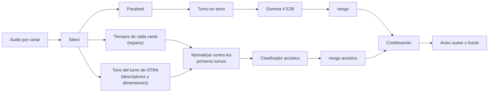

# Mejora futura: escuchar cómo habla quien llama, además de qué dice

> **Estado: propuesta sin discutir.** Es trabajo futuro: no se implementó ni se midió nada de lo que sigue. El detector
> actual trabaja solo sobre la transcripción, y la decisión de sumar rasgos acústicos sigue abierta en
> [D11](../gestion/MAPA-DECISIONES.md#d11--análisis-lingüístico-o-también-acústico). Redactado el 2026-11-23 a pedido
> del tutor, que pidió desarrollar las mejoras futuras en vez de dejarlas como viñetas
> ([§11.4](../tesis/CAP-11-CONCLUSIONES.md#114-trabajo-futuro-acotado)).

## 1. Por qué

En las 33 llamadas reales legítimas de call center, el detector avisó en 21
([§11.1](../tesis/CAP-11-CONCLUSIONES.md#111-aportes-y-resultados-principales)), y siete prompts no bajaron esa falsa
alarma sin perder estafas ([H12](../hallazgos/H12-cambiar-el-prompt-mueve-el-corte-no-la-separacion.md)). Una
explicación posible es que el texto solo no alcanza: un operador que pide el DNI y un estafador que lo pide dicen lo
mismo. Lo que puede cambiar es **cómo** lo dicen y cómo reaccionan cuando la otra persona duda.

**Hipótesis:** el tono de quien llama (`OTRA`) —activación, dominancia, entonación, velocidad, pausas— y cómo cambia a
lo largo de la llamada, sobre todo después de que la persona protegida duda o se niega, separa mejor las estafas de
las legítimas difíciles, o adelanta el aviso cuando el texto es ambiguo.

Es una hipótesis, no un resultado. Los dos conjuntos reales de H12 son texto traducido, sin audio, así que no sirven
para probarla: hace falta audio nuevo (§8).

## 2. Qué se mide y qué no

**Se mide:** el tono de `OTRA` y cómo se reparte la conversación, siempre **relativos a la misma llamada**. Cada valor
se compara con los primeros turnos del mismo hablante: lo que importa es que acelere, suba la intensidad o se ponga más
imperativo, no cómo habla de base. Eso también neutraliza diferencias de género y edad en la altura de la voz.

**No se mide, y se deja escrito por qué:**

- **Acento, región o nivel socioeconómico.** No tienen relación con el fraude y penalizarían a hablantes legítimos por
  cómo hablan. Choca con la minimización de datos de la Ley 25.326
  ([privacidad del sistema](../corpus/PRIVACIDAD-DEL-SISTEMA.md#2-marco-legal-argentino-ley-25326-de-protección-de-datos-personales)).
  La normalización intra-llamada busca justamente no comparar a una persona contra otra.
- **Detectar mentiras por la voz.** Los analizadores de estrés vocal (VSA, CVSA, LVA) no tienen respaldo: rinden
  cerca del azar (Horvath, 1982; National Research Council, 2003) y la comunidad de fonética forense los considera
  charlatanería (Eriksson y Lacerda, 2007). Además, estrés no es mentira: una persona legítima apurada también se
  estresa. El aviso nunca dice que alguien miente.
- **Voz sintética o *deepfake*.** Es otra línea, *anti-spoofing* (por ejemplo AASIST, Jung et al., 2022), con otros
  datos y otro objetivo: saber si la voz es generada, no si la llamada es una estafa. Queda fuera de esta mejora.

## 3. El tono: qué se escucharía

Es el centro de la mejora. Se describe en dos niveles: descriptores de la voz, que se pueden medir y explicar uno por
uno, y dimensiones de tono, que los resumen.

### 3.1. Descriptores de la voz

| Descriptor | Qué es | Qué se esperaría en una estafa | Resiste el códec telefónico |
| --- | --- | --- | --- |
| Tono ($F_0$): nivel, rango y pendiente | La altura de la voz y cómo sube o baja | Sube y se estrecha cuando aprieta; cierres descendentes en las órdenes | Sí, en buena medida |
| Intensidad | El volumen | Sube cuando la víctima duda | Sí, en términos relativos |
| Velocidad de habla | Sílabas por segundo de voz | Acelera en la etapa de presión | Sí |
| Pausas | Cuánto silencio hay dentro del turno | Menos pausas: no deja lugar para pensar | Sí |
| Calidad de voz (*jitter*, *shimmer*, HNR) | Irregularidad y ruido en la voz | Poco clara; más ligada al estrés que al fraude | No: AMR-NB a 8 kHz la deforma |

Todos salen del estándar eGeMAPS (Eyben et al., 2016), 88 valores por ventana que se calculan con openSMILE, un
programa en C++ liviano que también corre en Android. La velocidad de habla puede salir además de las marcas de tiempo
del ASR, si Parakeet las entrega por token.

### 3.2. Dimensiones de tono

La psicología describe el tono emocional en tres dimensiones continuas:

- **Activación** (*arousal*): calma o agitación. Es la más fácil de estimar por la voz.
- **Dominancia** (*dominance*): sumiso o imperativo. Es la que más se acerca a «está dando órdenes».
- **Valencia** (*valence*): agradable o desagradable. Es la más difícil de estimar por la voz sola.

Hay modelos preentrenados que estiman las tres directamente del audio, como el de audEERING sobre wav2vec 2.0
(Wagner et al., 2023). La ventaja es grande: **no hay que entrenar una red con nuestros datos** para tener el tono;
solo la capa que lo combina con el texto. Lo que hay que verificar: está entrenado con podcasts en inglés, y no se
sabe cuánto se sostiene en español rioplatense ni en banda telefónica. Además es pesado para un teléfono (§9).

### 3.3. Los patrones que interesan

Un valor suelto de tono no dice nada: hay operadores legítimos enérgicos y estafadores tranquilos. Lo que se buscaría
son **cambios**:

1. **Escalada.** La activación y la dominancia de `OTRA` suben a lo largo de la llamada, en vez de quedarse estables.
2. **Reacción a la duda.** Cuando `PROTEGIDA` duda o se niega («prefiero llamar al banco»), el tono de `OTRA` en el
   turno siguiente se endurece en vez de aflojar. El texto ya marca la duda; la voz dice cómo se respondió. Es el
   patrón con más valor, porque combina las dos señales.
3. **Cambio de registro.** Empieza con calma de operador y pasa de golpe a urgencia cuando llega al pedido.

En una legítima de servicio se esperaría lo contrario: tono estable, y si el cliente dice que no, el operador afloja.

### 3.4. Dónde entra el espectrograma

El espectrograma no es un modelo aparte: es **la forma de ver el audio** que usan casi todas las opciones. Muestra
cuánta energía hay en cada frecuencia a lo largo del tiempo. Una variante, el **log-mel**, comprime las frecuencias
como las percibe el oído, y es la entrada estándar de los modelos de voz. En el sistema ya existe: Parakeet lo calcula
para transcribir, y el codificador de audio de Gemma 4 E2B también parte de él.

| | Qué se saca del espectrograma | Qué decide | A favor | En contra |
| --- | --- | --- | --- | --- |
| **A. Descriptores** (§3.1) | Los 88 valores de eGeMAPS | Un clasificador chico sobre los cambios en la llamada | Pocos datos, explicable, liviano | Pierde matices |
| **B. Dimensiones preentrenadas** (§3.2) | Activación, dominancia y valencia por turno | Lo mismo que A, sobre tres valores | No se entrena la red; explicable | Pesado; sin verificar en español ni a 8 kHz |
| **C. Red propia sobre el espectrograma** | El log-mel del turno, como imagen | Una CNN entrenada para la tarea | Aprende sola qué mirar | Muchos datos, opaca y aprende atajos (§9) |
| **D. Que E2B escuche** | El audio crudo del último turno, con lo anterior como texto | Gemma 4 E2B, en la misma consulta | Un solo modelo | Quedó afuera sin medir ([corrida de #152](../../experiments/asr-local/corridas/2026-11-10_152-opcion-b-e2b-transcribe/resumen.md#por-qué-la-opción-c-queda-afuera-sin-medirla)); probablemente necesite ajuste fino ([#176](https://github.com/Corchets/bitacora_tesis/issues/176)) |

Una variante más barata: **reusar el codificador de Parakeet**, que ya corre, y poner un clasificador encima. El
riesgo es que un codificador entrenado para transcribir tiende a descartar justo cómo habla la persona.

**Recomendación:** A y B juntas en laboratorio, porque se explican y casi no necesitan entrenamiento. C solo con mucho
audio. D depende de resolver antes lo que dice la corrida de #152.

## 4. Complemento: cómo se reparte la conversación

Es la parte más barata y la que mejor resiste el teléfono. No mira el tono sino los tiempos: quién habla, cuánto y
cuándo. Silero ya marca cuándo habla cada uno, y los canales están separados, así que sale casi gratis.

| Rasgo | Qué se esperaría en una estafa |
| --- | --- |
| Proporción del tiempo que habla `OTRA` | Lleva la conversación: habla mucho más |
| Interrupciones | Empieza a hablar mientras `PROTEGIDA` todavía habla, sobre todo cuando duda |
| Demora en contestar una objeción | Responde enseguida, como con un guion |
| Largo de los turnos de `PROTEGIDA` | Se acortan: la víctima queda reducida a «sí» y «ajá» |

Además de sumar como señal, le da al tono el **cuándo**: marca los momentos de duda o interrupción en los que conviene
mirar la reacción de `OTRA` (§3.3, patrón 2).

## 5. Cómo se integraría

El recorrido actual: audio por canal → Silero y Parakeet → turno de `OTRA` cerrado → Gemma 4 E2B escribe el riesgo
([capítulo 5](../tesis/CAP-05-DISENO-Y-ARQUITECTURA.md)). La mejora se cuelga en paralelo, sin tocar el texto:

- **Mismo corte de turno.** El extractor usa el segmento que Silero ya marcó y que ya está en memoria.
- **Combinación tardía.** El riesgo de E2B y el acústico se combinan al final con una regla calibrada en un conjunto
  aparte. La otra forma, pasarle a E2B una etiqueta en el prompt («habla cada vez más rápido»), es más simple pero
  mezcla dos señales que conviene medir por separado.
- **El texto decide si avisar; la voz, qué tan fuerte.** Un tono urgente sin un pedido en el texto no dispara nada:
  urgencia no es estafa. Encaja con el aviso en dos niveles que ya está en el §11.4: con el texto en riesgo, un tono
  que escala sube el aviso a fuerte, y uno tranquilo lo deja suave.
- **El motivo del aviso** ([ADR 0006](../ingenieria/adr/0006-salida-cortada-tras-el-campo-que-decide-y-motivo-al-avisar.md))
  sigue saliendo del texto. Se le podría sumar una frase sobre el ritmo («le habló cada vez más rápido»); nunca sobre
  la persona.

## 6. Qué mejora esperar

No hay datos para predecirla. Lo que sigue es una cuenta aproximada para saber qué esperar y qué haría falta para
medirla.

**Punto de partida.** En H12, con el mismo largo de llamada, la probabilidad de que una estafa real puntúe más que una
legítima real es 0,73 con el prompt de la evaluación final (0,5 es azar; 1, separación perfecta).

**Supuestos de la cuenta.** Cada señal tiene distribución normal con la misma varianza en las dos clases, las dos
señales se equivocan de forma independiente y se combinan de la mejor forma lineal, y se fija el corte que conserva el
90 % de las estafas. Con eso, el texto solo da unas 22 falsas alarmas en 33, cerca de las 21 medidas.

| Escenario | Separación del tono solo | Separación combinada | Falsas alarmas en 33 legítimas reales |
| --- | --- | --- | --- |
| Hoy, solo texto | — | 0,73 | ~22 |
| Pesimista: el tono casi no distingue, o el códec lo borra | 0,55 | 0,74 | ~22 |
| Intermedio | 0,65 | 0,77 | ~20 |
| Optimista: el tono distingue tanto como el texto | 0,75 | 0,82 | ~16 |
| Muy optimista: la reacción a la duda distingue mucho | 0,85 | 0,89 | ~11 |

Qué se lee:

- **Lo realista es bajar de 2 a 6 falsas alarmas en 33, y es el mejor caso de cada fila.** Si el tono se equivoca en
  las mismas llamadas que el texto, la ganancia se achica: en el escenario intermedio, con una correlación de 0,3 entre
  los errores, la combinada baja de 0,77 a 0,74.
- **El techo lo pone qué clase de llamadas son las falsas alarmas.** El tono puede sacar las de servicio tranquilo (un
  operador que pide el DNI con calma), no las de venta insistente, que suenan a presión igual que una estafa. Esas
  podrían hasta sumar falsas alarmas. H12 no leyó los textos, así que hoy no se sabe cuántas de las 21 son de cada
  tipo. Leerlas da el techo de la mejora sin grabar nada.
- **Con 33 llamadas no se podría medir.** Tres llamadas son 9 puntos (H12). Para distinguir una baja de 64 % a 55 %
  con una comparación pareada (el mismo conjunto con y sin tono) harían falta del orden de **150 legítimas con audio**.
- **Si el tono solo separa mejor que el texto, primero hay que sospechar** que aprendió la fuente de la grabación y no
  la estafa (§9).
- **Avisar antes.** Hoy 37 de 80 estafas avisan antes del pedido. La escalada del tono podría subir el riesgo en la
  etapa de presión, antes de que el pedido aparezca en el texto. Pero adelantar casi siempre cuesta falsas alarmas: se
  esperaría poco, y como compromiso.
- **Aunque no baje la cuenta, puede mejorar el aviso.** Si el tono decide entre suave y fuerte, una venta tranquila
  recibe un aviso suave en vez del mismo que una estafa clara. Eso no se ve en la cantidad de falsas alarmas, se ve en
  cuánto molestan.

Si la combinación no mejora nada, también es un resultado: respalda que el fraude telefónico se reconoce sobre todo
por lo que se dice, que es lo que hoy afirma el
[§5.5.4](../tesis/CAP-05-DISENO-Y-ARQUITECTURA.md#554-enfoque-lingüístico-frente-a-acústico-d11-abierta) sin haberlo
medido.

## 7. Paso a paso

1. **Ratificar el encuadre** de §2 entre los cuatro y con el tutor, y decidir si D11 se reabre para esta línea.
2. **Leer las 21 falsas alarmas reales** y separarlas en servicio tranquilo y venta con presión. Da el techo de §6 sin
   audio.
3. **Juntar audio real** con consentimiento (§8). Sin este paso no hay nada que medir.
4. **Extraer en laboratorio (Python)** el reparto (§4), los descriptores con `opensmile` (§3.1) y las dimensiones con
   el modelo preentrenado (§3.2), normalizados por llamada.
5. **Mirar antes de clasificar.** Graficar activación y dominancia turno a turno en estafas y legítimas, y ver si
   aparecen la escalada y la reacción a la duda (§3.3). Si no se ven a ojo, es difícil que un clasificador las
   encuentre.
6. **Comparación pareada** sobre las mismas llamadas: solo texto (el detector actual), texto con reparto, texto con
   tono y texto con los dos. Con la regla de adopción escrita antes de correr, como en H12.
7. **Auditoría de sesgo.** Falsas alarmas separadas por región o tonada, género y edad. Si el tono sube la falsa alarma
   de algún grupo, no se adopta, aunque mejore el total.
8. **Banda telefónica.** Repetir 6 con el audio degradado a 8 kHz (AMR-NB y G.711). Si el tono desaparece y queda solo
   el reparto, se escribe así.
9. **Teléfono.** Llevar lo que pase a Android (openSMILE por NDK; el modelo de dimensiones, cuantizado) y medir memoria
   pico, latencia p50 y p90, batería y temperatura con Parakeet y E2B a la vez.

## 8. Datos que harían falta

- **Llamadas reales en español argentino, con consentimiento**: estafas simuladas por personas y legítimas difíciles
  con carga emocional (cobranzas, reclamos, ventas insistentes). Del orden de 150 legítimas (§6). El audio TTS del
  corpus no sirve: el tono es el del sintetizador, no el de una persona presionando a otra.
- **Las dos clases grabadas en las mismas condiciones** (mismo canal, mismos equipos), para que el clasificador no
  aprenda la fuente (§9).
- **Varias personas por rol**, para que no aprenda a reconocer a un actor.
- **De apoyo, no para evaluar:** conjuntos públicos de emoción en español (EmoMatchSpanishDB, MESD, EMOVOME) o en
  inglés (MSP-Podcast), para verificar que el modelo de dimensiones responde en español. Son emociones actuadas o de
  otro contexto, no estafas. VISHGUARD
  ([estado del arte](SINTESIS-ESTADO-DEL-ARTE.md#23-datasets-y-límites-de-reutilización-recuperación-de-43)) anota
  persuasión y emoción, pero no tiene español y su acceso es restringido.
- El audio queda fuera de Git, como el resto del corpus ([invariantes](../../AGENTS.md#invariantes)).

## 9. Riesgos

- **Atajos.** Un modelo de audio aprende lo que distingue a los conjuntos, no a las estafas: el micrófono, el códec, el
  ruido o el silencio. En *anti-spoofing* se mostró que modelos entrenados en ASVspoof 2019 se apoyaban en la duración
  del silencio inicial (Müller et al., 2021). Pesa más en C que en A y B, pero ninguna está libre.
- **Venta insistente.** Suena a presión igual que una estafa (§6). El tono no la separa y podría sumar falsas alarmas
  justo en las llamadas de números no agendados, que son el alcance del detector
  ([ADR 0003](../ingenieria/adr/0003-detector-solo-en-entrantes-de-no-agendados.md)).
- **Pocos datos.** Con decenas de llamadas, cualquier clasificador sobreajusta. Por eso A y B, que casi no se entrenan.
- **El códec.** AMR-NB a 8 kHz recorta lo que pasa de 4 kHz y deforma la calidad de voz; es uno de los fundamentos de
  la exclusión actual (§5.5.4). El tono y la velocidad resisten mejor; el reparto, del todo.
- **Presupuesto del teléfono.** E2B ya tarda 3,7 s por turno en el Samsung A56
  ([§8.6](../tesis/CAP-08-RESULTADOS-EXPERIMENTALES.md#86-rendimiento-y-límites-del-hardware)). openSMILE y el reparto
  son baratos; un modelo sobre wav2vec 2.0 no lo es.
- **Biometría.** Las salidas intermedias de un modelo de voz pueden identificar a una persona. Todo se procesa en
  memoria y se descarta al terminar el turno; no se guardan rasgos ni representaciones de la voz.

## 10. Fuentes

- Eriksson, A. y Lacerda, F. (2007). Charlatanry in forensic speech science: A problem to be taken seriously.
  *International Journal of Speech, Language and the Law*, 14(2), 169–193.
- Eyben, F. et al. (2016). The Geneva Minimalistic Acoustic Parameter Set (GeMAPS) for Voice Research and Affective
  Computing. *IEEE Transactions on Affective Computing*, 7(2), 190–202.
- Horvath, F. (1982). Detecting deception: the promise and the reality of voice stress analysis. *Journal of Forensic
  Sciences*, 27(2), 340–351.
- Jung, J. et al. (2022). AASIST: Audio Anti-Spoofing using Integrated Spectro-Temporal Graph Attention Networks.
  *ICASSP 2022*.
- Müller, N. M. et al. (2021). Speech is Silver, Silence is Golden: What do ASVspoof-trained Models Really Learn?
  *ASVspoof 2021 Workshop*.
- National Research Council (2003). *The Polygraph and Lie Detection*. Washington, DC: The National Academies Press.
- Wagner, J. et al. (2023). Dawn of the Transformer Era in Speech Emotion Recognition: Closing the Valence Gap. *IEEE
  Transactions on Pattern Analysis and Machine Intelligence*, 45(9), 10745–10759. Modelo:
  [`audeering/wav2vec2-large-robust-12-ft-emotion-msp-dim`](https://huggingface.co/audeering/wav2vec2-large-robust-12-ft-emotion-msp-dim).
