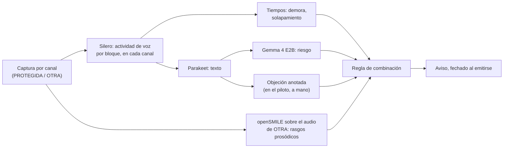

# Trabajo futuro: ¿la reacción de quien llama ante una objeción aporta algo que el texto no tiene?

> **Estado: propuesta sin discutir.** Es trabajo futuro: no se implementó ni se midió nada de lo que sigue. El detector
> actual trabaja solo sobre la transcripción, y la decisión de sumar rasgos acústicos sigue abierta en
> [D11](../gestion/MAPA-DECISIONES.md#d11--análisis-lingüístico-o-también-acústico). Redactado el 2026-11-23 a pedido
> del tutor, que pidió desarrollar las mejoras futuras en vez de dejarlas como viñetas
> ([§11.4](../tesis/CAP-11-CONCLUSIONES.md#114-trabajo-futuro-acotado)).

## 1. La pregunta

Cuando la persona protegida (`PROTEGIDA`) duda o se niega, ¿la forma en que responde quien llama (`OTRA`) le da al
detector información que la transcripción todavía no tiene?

**Objetivo.** Evaluar si los tiempos de interacción y los cambios prosódicos de `OTRA` después de una objeción permiten
al detector avisar antes del primer pedido de alto riesgo (`T_R`, [métricas](../evaluacion/METRICAS.md#1-marcas-temporales)),
con un margen de falsas alarmas acordado antes de evaluar. El piloto usa conversaciones recreadas por personas, en
español argentino y con los dos canales separados. Los métodos se comparan sobre las mismas llamadas y con la
información disponible en cada instante. El aviso se fecha cuando el sistema lo emite efectivamente (`T_A`).

**Por qué interesa.** Ninguno de los candidatos probados en
[H12](../hallazgos/H12-cambiar-el-prompt-mueve-el-corte-no-la-separacion.md) mejoró claramente la separación entre
estafas y legítimas reales: los que bajaron las falsas alarmas perdieron estafas. Eso no prueba que el texto haya
llegado a un techo, pero sugiere buscar información que el detector no tiene, en vez de otra forma de pedirle lo mismo.
La reacción ante una objeción es un buen lugar para buscar: es el momento en que una estafa necesita insistir y una
llamada legítima puede aflojar.

**Antecedente directo.** En 100 llamadas en turco, siete modelos de lenguaje clasificaron mejor las estafas a partir de
la transcripción que escuchando el audio directo (Eren et al., 2026). Es un argumento a favor del enfoque actual, pero
ese estudio clasifica la llamada entera; no prueba sumar la voz al texto turno a turno ni mira la reacción a una
objeción.

**Qué no se afirma.** No se anticipa una ganancia. Si el piloto da negativo, la conclusión defendible es acotada: estos
rasgos, en estas condiciones y con esta política de aviso, no mostraron un aporte medible. Eso también responde la
pregunta.

## 2. Qué se mide

### 2.1. Tres señales que hay que separar

«Reacción a la objeción» junta tres cosas distintas. Si un detector combinado mejora, hay que poder decir cuál de ellas
lo explica:

1. **Que hubo una objeción.** Es información del texto. El detector actual la lee, pero no se le marca.
2. **Los tiempos de la respuesta.** Cuánto tarda `OTRA` en contestar, si empieza a hablar encima, cuánto habla. Salen
   de la actividad de voz de cada canal.
3. **Cómo suena la respuesta.** Los cambios prosódicos de `OTRA` frente a cómo venía hablando.

Si la mejora viene de 1, alcanza con texto; si viene de 2, alcanza con tiempos. Solo si 3 suma algo sobre 1 y 2 se
puede atribuir la mejora al tono.

### 2.2. Definiciones para el piloto

- **Objeción:** un turno de `PROTEGIDA` que duda, se niega, pide verificar o posterga: «prefiero llamar al banco»,
  «no tengo el código a mano», «¿por qué me lo pide?». Los ejemplos y los casos dudosos se fijan en una guía de
  anotación antes de grabar, y se anotan a mano en el piloto.
- **Respuesta medida:** el primer turno de `OTRA` después de la objeción.
- **Ventana útil:** solo cuentan para anticipar las objeciones anteriores a `T_R`. Una reacción posterior al pedido
  puede aportar a la detección, pero ya perdió la oportunidad de adelantar el aviso. Las dos se informan por separado.
- **Referencia de la propia voz:** la prosodia de la respuesta se compara con los turnos anteriores de la misma
  persona en la misma llamada. Hay que definir cuánta voz previa hace falta (en segundos) y qué pasa si falta: en ese
  caso no hay señal prosódica y decide el texto solo. La referencia puede fallar en llamadas cortas, cuando la presión
  empieza desde el saludo o cuando cambia la ganancia del micrófono.
- **Tiempos:** no todo solapamiento es una interrupción. Hay asentimientos («ajá»), eco y retrasos del canal. Se
  define qué cuenta como interrupción y se revisa a mano una muestra.

### 2.3. Pocos rasgos, definidos de antemano

| Rasgo | Qué es | Resistencia al canal telefónico |
| --- | --- | --- |
| Altura ($F_0$) relativa | Nivel y rango de la altura de la voz frente a la referencia | Por verificar. En voz por VoIP, $F_0$ estuvo entre las medidas más estables (Xu et al., 2024) |
| Intensidad relativa | Volumen frente a la referencia | Por verificar. Depende de la ganancia y del control automático del canal |
| Ritmo | Tasa de regiones sonoras por segundo. Es una aproximación, no un conteo de sílabas | Por verificar |
| Pausas | Proporción de silencio dentro del turno | Por verificar |
| Demora de respuesta | Tiempo entre el fin de la objeción y el inicio de la respuesta | Por verificar. Le suma el retraso del canal |
| Solapamiento | Habla simultánea al inicio de la respuesta, según la definición de §2.2 | Por verificar. El eco puede simular solapamientos |

Los cuatro primeros salen del conjunto eGeMAPS (Eyben et al., 2016) con openSMILE. Ninguno de estos rasgos indica
estafa por sí mismo: también cambian por el contenido de lo que se dice, el ruido, el canal y la dinámica normal de una
conversación. Qué dirección se espera en una estafa es parte de lo que el piloto tiene que observar, no un supuesto.

### 2.4. De dónde sale cada cosa

El espectrograma, que muestra cuánta energía hay en cada frecuencia a lo largo del tiempo, es la base de los rasgos
prosódicos. Pero no todo sale de ahí ni del log-mel que ya calcula Parakeet:

La atribución de cada turno a una persona viene de la captura por canal, no de Silero. Por eso el canal objetivo (la
forma real de capturar la llamada) se prueba desde el piloto.

## 3. La comparación

### 3.1. Una escalera de cuatro métodos

Todos sobre los mismos prefijos de conversación y con la información disponible en cada instante:

| Método | Qué ve | Qué aísla |
| --- | --- | --- |
| 0. Texto actual | La configuración congelada ([ADR 0002](../ingenieria/adr/0002-detector-gemma4-e2b-solo-con-prompt-c-premisa.md) y [ADR 0008](../ingenieria/adr/0008-prompt-del-detector-c-consejos.md)) | La base |
| 1. Texto con la objeción explícita | Lo mismo, más la marca de que hubo una objeción | Si alcanza con señalar la objeción |
| 2. Texto con tiempos | 1, más los tiempos de la respuesta | Si los tiempos suman sobre el texto |
| 3. Texto con prosodia | 2, más los rasgos prosódicos de la respuesta | Si el tono suma sobre todo lo anterior |

En el piloto las objeciones se anotan a mano. Aparte se mide cuánto se pierde cuando hay que detectarlas
automáticamente, porque en el teléfono no habrá anotación.

### 3.2. La regla de combinación del piloto

El riesgo que escribe Gemma no es un puntaje continuo ([H04](../hallazgos/H04-riesgo-escrito-no-es-puntaje.md)): se
concentra en pocos valores, y 57 de 66 avisos salen de exactamente 0,3
([ADR 0002](../ingenieria/adr/0002-detector-gemma4-e2b-solo-con-prompt-c-premisa.md)). Una regresión logística común sobre ese puntaje tampoco garantiza
conservar la decisión del texto. Para el piloto conviene una regla explícita:

- **Conserva los avisos existentes.** Cada llamada que el texto solo avisa sigue avisando, en el mismo turno o antes.
- **Puede agregar o adelantar avisos** cuando, después de una objeción, los tiempos o la prosodia de la respuesta
  cumplen una condición escrita antes de evaluar.
- **Vuelve al texto solo cuando falta señal:** sin objeción, sin voz previa suficiente o con el canal degradado.

Con esta regla las falsas alarmas quedan iguales o aumentan; no pueden bajar. «Avisar antes con las mismas falsas
alarmas» es un resultado que hay que demostrar, no una propiedad de la regla. Por eso se miden las dos cosas: cuántos
avisos agrega y cuánto los adelanta, y cuántos de los agregados caen en legítimas. Subir el umbral común para
compensar sería otro experimento, porque puede eliminar avisos que hoy sí salen.

Qué tan fuerte es el aviso (suave o fuerte) es otra pregunta: si cambiar la intensidad mejora lo que hace la persona
frente a la alerta. Se responde con usuarios, no con este piloto.

### 3.3. Qué se informa

- Estafas con aviso antes de `T_R` (`T_A < T_R`), por método, y cuántos turnos o segundos se adelantó cada una.
- Avisos agregados en legítimas, por método.
- Todo separado por tipo de llamada (§4.2). Un método que mejora el total pero empeora un tipo se informa así.
- Por llamada, un gráfico con el riesgo de cada método turno a turno, la marca de la objeción, `T_R` y `T_A`, y
  **cuándo estuvo disponible cada señal**: la prosodia de un turno llega después de que el turno termina.
- Entre llamadas, comparaciones con un horizonte común (por ejemplo, hasta `T_R` o las primeras N consultas), no con el
  máximo de la llamada entera, que favorece a las más largas.

## 4. El piloto

### 4.1. Antes de grabar: contar objeciones en lo que ya hay

Sin audio se puede estimar algo que decide si vale la pena seguir: cuántas llamadas tienen una objeción antes del
pedido. Se revisan las 33 legítimas reales, no solo las 21 que avisaron, para ver qué distingue a unas de otras, y las
33 estafas reales. Son textos traducidos, pero alcanzan para contar objeciones y ver dónde caen respecto de `T_R`.

### 4.2. Cómo grabar

- **Las dos clases recreadas, en las mismas condiciones.** «Voz humana» y «llamada real» son cosas distintas. Si las
  estafas se actúan y las legítimas son naturales, el modelo puede aprender la actuación aunque se use el mismo
  micrófono. En el piloto, estafas y legítimas se recrean por igual; la validación con llamadas naturales va después,
  por separado.
- **Participantes en las dos clases** cuando se pueda, para que la voz de una persona no delate la clase.
- **Reserva agrupada por personas y por familias de guiones:** nadie ni ningún guion aparece a la vez en lo que se usa
  para definir la regla y en lo que se usa para evaluarla.
- **Los tipos que pueden refutar la idea**, además de los típicos: estafas con tono tranquilo, estafas con presión
  desde el saludo, emergencias legítimas con un familiar agitado, vendedores y cobradores insistentes, legítimas
  tranquilas, y llamadas con y sin objeción antes del pedido.
- **El canal real.** Si se prueba banda telefónica, se codifica y decodifica con AMR-NB o G.711. Remuestrear a 8 kHz no
  equivale a pasar por el códec.

### 4.3. Para qué sirve el piloto

No fija un tamaño de muestra: lo estima. Sirve para saber:

- con qué frecuencia aparecen objeciones aprovechables, antes de `T_R`;
- si los rasgos son estables: la misma persona, en las mismas condiciones, ¿da valores parecidos?;
- cuántas llamadas cambian de decisión entre un método y el siguiente.

Con eso se dimensiona una evaluación posterior: cuántas estafas con objeción antes del pedido y cuántas legítimas hacen
falta, teniendo en cuenta cuántas llamadas comparten participantes y qué precisión se quiere.

## 5. Criterio para avanzar

> **Estado: propuesta sin discutir.** Los valores concretos se acuerdan entre los cuatro y con el tutor antes de grabar.

El piloto justifica una evaluación más grande si se cumplen las tres condiciones:

1. **Hay de dónde sacar.** Una proporción acordada de las estafas tiene una objeción antes de `T_R`. Si casi nunca
   ocurre, la señal no puede adelantar avisos aunque exista.
2. **Los rasgos son estables** en la misma persona y las mismas condiciones, dentro de un margen acordado.
3. **El método 3 adelanta avisos sobre el método 2** en alguna estafa, sin agregar en legítimas más falsas alarmas que
   el margen acordado, con la incertidumbre informada.

Si falla 1 o 2, se escribe por qué y se cierra. Si falla 3 pero 1 o 2 mejoran sobre 0, el resultado sigue valiendo:
la objeción o los tiempos aportan, el tono no.

## 6. Límites

- **Recreado no es natural.** Un resultado positivo en el piloto no prueba nada sobre llamadas reales; hace falta una
  validación aparte.
- **Que aprenda la grabación y no la estafa.** Un modelo de audio puede apoyarse en diferencias de grabación: en
  detección de voces falsas, modelos entrenados en ASVspoof 2019 se apoyaban en cuánto silencio había al principio
  (Müller et al., 2021). Grabar las dos clases igual y agrupar la reserva por personas apunta a eso.
- **Sesgo por grupos.** Las falsas alarmas se informan por región o tonada, género y edad, con márgenes fijados antes e
  incertidumbre. Con grupos chicos, una diferencia puede ser ruido, y no observar diferencias tampoco demuestra que no
  haya sesgo.
- **Qué no se mide.** Ni acento, región o nivel socioeconómico: no tienen relación con el fraude y chocan con la
  minimización de datos de la Ley 25.326
  ([privacidad del sistema](../corpus/PRIVACIDAD-DEL-SISTEMA.md#2-marco-legal-argentino-ley-25326-de-protección-de-datos-personales)).
  Ni si alguien miente: los analizadores de estrés vocal rinden cerca del azar (Horvath, 1982; National Research
  Council, 2003) y la fonética forense los considera charlatanería (Eriksson y Lacerda, 2007). Ni si la voz es
  sintética, que es otra línea con otros datos (por ejemplo AASIST, Jung et al., 2022).
- **Privacidad en el producto.** La comparación con la propia voz necesita conservar en memoria un resumen de los
  rasgos de `OTRA` hasta el final de la llamada, no solo durante el turno. Ese resumen se descarta al cortar y nunca se
  guarda.
- **Privacidad en la investigación.** Las grabaciones del piloto requieren consentimiento informado, acceso restringido
  y un plazo de retención explícito, y quedan fuera de Git ([invariantes](../../AGENTS.md#invariantes)).
- **Costo en el teléfono, sin medir.** La única medición en un Android (Samsung A56, 3,60 s de mediana por consulta)
  es del detector solo, con otro prompt y sin ASR
  ([§8.6](../tesis/CAP-08-RESULTADOS-EXPERIMENTALES.md#86-rendimiento-y-límites-del-hardware)). Cuánto suma extraer
  rasgos no se sabe.

## 7. Alternativas posteriores

Quedan fuera del piloto y solo tienen sentido si el método 3 muestra algo:

- **Dimensiones de tono preentrenadas.** El modelo de audEERING estima activación, dominancia y valencia a partir de la
  onda de audio (Wagner et al., 2023). Dos cuidados: «dominancia» no equivale a dar órdenes, y los mismos autores
  muestran que el modelo capta información léxica al estimar la valencia. Si mejora la clasificación, es más difícil
  atribuir la mejora al tono y no a las palabras.
- **Una red propia sobre el espectrograma.** Necesita mucho audio y es la más expuesta a aprender la grabación.
- **Que E2B escuche el turno.** Quedó afuera sin medir en la
  [corrida de #152](../../experiments/asr-local/corridas/2026-11-10_152-opcion-b-e2b-transcribe/resumen.md#por-qué-la-opción-c-queda-afuera-sin-medirla)
  y probablemente necesite ajuste fino ([#176](https://github.com/Corchets/bitacora_tesis/issues/176)).

VISHGUARD ([estado del arte](SINTESIS-ESTADO-DEL-ARTE.md#23-datasets-y-límites-de-reutilización-recuperación-de-43))
sirve como antecedente de anotación de persuasión y emoción en llamadas sintéticas, no como datos para este piloto: no
tiene español.

## 8. Fuentes

- Eren, A., Cheung, M., Zhang, Y., Ngai, G. y Fu, E. Y. (2026). Exploring the Limits of Audio-Based Detection of
  Turkish Phone Call Scams. Póster, *IEEE Symposium on Security and Privacy 2026*.
  [PDF](https://www.ieee-security.org/TC/SP2026/downloads/posters/sp2026posters-final95.pdf).
- Eriksson, A. y Lacerda, F. (2007). Charlatanry in forensic speech science: A problem to be taken seriously.
  *International Journal of Speech, Language and the Law*, 14(2), 169–193.
- Eyben, F. et al. (2016). The Geneva Minimalistic Acoustic Parameter Set (GeMAPS) for Voice Research and Affective
  Computing. *IEEE Transactions on Affective Computing*, 7(2), 190–202.
  [doi:10.1109/TAFFC.2015.2457417](https://doi.org/10.1109/TAFFC.2015.2457417).
- Horvath, F. (1982). Detecting deception: the promise and the reality of voice stress analysis. *Journal of Forensic
  Sciences*, 27(2), 340–351.
- Jung, J. et al. (2022). AASIST: Audio Anti-Spoofing using Integrated Spectro-Temporal Graph Attention Networks.
  *ICASSP 2022*.
- Müller, N. M. et al. (2021). Speech is Silver, Silence is Golden: What do ASVspoof-trained Models Really Learn?
  *ASVspoof 2021 Workshop*.
- National Research Council (2003). *The Polygraph and Lie Detection*. Washington, DC: The National Academies Press.
- Wagner, J. et al. (2023). Dawn of the Transformer Era in Speech Emotion Recognition: Closing the Valence Gap. *IEEE
  Transactions on Pattern Analysis and Machine Intelligence*, 45(9), 10745–10759.
  [arXiv:2203.07378](https://arxiv.org/abs/2203.07378).
- Xu, C. et al. (2024). Voice quality in telephone speech: Comparing acoustic measures between VoIP telephone and
  high-quality recordings. *Interspeech 2024*, 1570–1574.
  [doi:10.21437/Interspeech.2024-2240](https://www.isca-archive.org/interspeech_2024/xu24j_interspeech.html).
