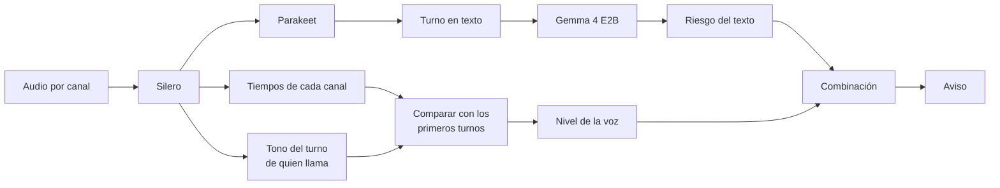

# Mejora futura: escuchar cómo habla quien llama, además de qué dice

> **Estado: propuesta sin discutir.** Es trabajo futuro: no se implementó ni se midió nada de lo que sigue. El detector
> actual trabaja solo sobre la transcripción, y la decisión de sumar rasgos acústicos sigue abierta en
> [D11](../gestion/MAPA-DECISIONES.md#d11--análisis-lingüístico-o-también-acústico). Redactado el 2026-11-23 a pedido
> del tutor, que pidió desarrollar las mejoras futuras en vez de dejarlas como viñetas
> ([§11.4](../tesis/CAP-11-CONCLUSIONES.md#114-trabajo-futuro-acotado)).

## En corto

- **La idea:** que el detector, además de leer lo que dice quien llama, escuche cómo lo dice: si se agita, si se pone
  imperativo, si acelera y, sobre todo, cómo reacciona cuando la persona duda.
- **Para qué:** para mejorar el detector en general. Puede servir para avisar más estafas, para avisar antes o para
  avisar menos en llamadas legítimas. El texto solo ya mostró un techo: cambiar el prompt mueve cuánto avisa, no a
  quién.
- **Cómo se combina:** el texto sigue decidiendo si hay riesgo; la voz mueve la vara. Con una voz tranquila, el texto
  necesita más evidencia para avisar; con una voz que escala, menos.
- **Qué se podría ganar:** con nuestros números, si la voz fuera perfecta para elegir esa vara, las falsas alarmas en
  llamadas reales bajarían de 23 a 5 de 33 sin perder estafas. Una estimación realista está bastante por debajo: de 2
  a 6 falsas alarmas menos, o de 2 a 6 estafas más de cada 100.
- **Qué hace falta:** audio real grabado con consentimiento, del orden de 150 llamadas legítimas. El audio sintético
  no sirve: el tono es el del sintetizador.
- **Qué no se hace:** juzgar a nadie por su acento ni decir que alguien miente.

## 1. Por qué

El detector actual solo lee. Le va bien cuando la estafa se dice con palabras claras, y la evaluación final le marcó
tres límites ([§11.1](../tesis/CAP-11-CONCLUSIONES.md#111-aportes-y-resultados-principales)):

- **Se le escapan estafas.** Avisó 73 de 100 estafas del test.
- **Avisa tarde.** De las 80 estafas con un pedido, avisó antes de que empezara el pedido en 37.
- **Avisa de más en llamadas reales.** Avisó en 21 de 33 llamadas legítimas de call center.

Y el texto parece tener un techo. Siete prompts distintos movieron cuánto avisa el detector, pero no mejoraron a quién
le avisa ([H12](../hallazgos/H12-cambiar-el-prompt-mueve-el-corte-no-la-separacion.md)): los que bajan las falsas
alarmas pierden estafas, y al revés. Para separar mejor hace falta información nueva, no otra forma de pedirle lo mismo
al modelo.

La voz es información que el sistema ya captura y hoy descarta. Un operador que pide el DNI y un estafador que lo pide
dicen lo mismo; lo que puede cambiar es cómo lo dicen y qué hacen cuando la otra persona duda.

**Hipótesis:** el tono de quien llama (`OTRA`) y cómo cambia a lo largo de la llamada, combinado con el riesgo del
texto, separa mejor estafas de legítimas que el texto solo. Esa mejor separación se puede usar para avisar más estafas,
para avisar antes o para avisar menos en legítimas (§6).

Es una hipótesis, no un resultado. Los dos conjuntos reales de H12 son texto traducido, sin audio, así que no sirven
para probarla: hace falta audio nuevo (§9).

## 2. Qué se escucharía: el tono

Es el centro de la mejora.

### 2.1. Qué se mide de la voz

Hay cinco cosas de la voz que se pueden medir y explicar una por una:

| Qué se mide | Qué es | Qué se esperaría en una estafa | Resiste el códec telefónico |
| --- | --- | --- | --- |
| Altura ($F_0$) | Qué tan aguda es la voz y cómo sube o baja | Sube cuando aprieta; las órdenes cierran hacia abajo | Sí, en buena medida |
| Intensidad | El volumen | Sube cuando la persona duda | Sí, en términos relativos |
| Velocidad | Sílabas por segundo de voz | Acelera cuando presiona | Sí |
| Pausas | Cuánto silencio hay dentro de un turno | Menos pausas: no deja lugar para pensar | Sí |
| Calidad de voz (*jitter*, *shimmer*, HNR) | Qué tan regular o ronca suena | Poco clara; se asocia al estrés, no al fraude | No: el códec la deforma |

Todas salen del estándar eGeMAPS (Eyben et al., 2016), un conjunto de 88 valores pensado para describir la voz en
investigación. Se calculan con openSMILE, un programa liviano en C++ que también corre en Android.

Además, la voz se puede resumir en tres dimensiones de tono que usa la psicología:

- **Activación:** de calmo a agitado. Es la más fácil de estimar por la voz.
- **Dominancia:** de sumiso a imperativo. Es la que más se acerca a «está dando órdenes».
- **Valencia:** de agradable a desagradable. Es la más difícil de estimar por la voz sola.

Hay modelos ya entrenados que estiman las tres a partir del audio, como el de audEERING (Wagner et al., 2023). La
ventaja es que no hay que entrenar un modelo de voz con nuestros datos para tener el tono. Lo que falta saber es si
funciona igual en español rioplatense y por teléfono, porque se entrenó con podcasts en inglés.

### 2.2. Contra qué se compara

Cada valor se compara con los primeros turnos de la misma persona en la misma llamada. Lo que importa es que acelere o
se agite, no cómo habla de base. Así no se compara a una persona contra otra, y se neutralizan las diferencias de voz
entre hombres y mujeres, entre edades y entre regiones.

### 2.3. Qué patrones se buscan

Un tono suelto no dice nada: hay operadores enérgicos y estafadores tranquilos. Se buscan cambios:

1. **Escalada.** Quien llama se agita y se pone más imperativo a medida que avanza la llamada.
2. **Cambio de registro.** Empieza con la calma de un operador y pasa a la urgencia cuando llega al pedido.
3. **Reacción a la duda.** Cuando la persona dice «prefiero llamar al banco», quien llama se endurece en vez de
   aflojar. Es el patrón más prometedor, porque junta las dos señales: el texto marca la duda y la voz muestra cómo se
   respondió.

En una legítima se esperaría lo contrario: un tono estable y, si la persona dice que no, un operador que afloja.

## 3. Complemento: cómo se reparte la conversación

No mira el tono sino los tiempos: quién habla, cuánto y cuándo. Es lo más barato, porque Silero ya marca cuándo habla
cada uno y los canales están separados, y es lo que mejor resiste el teléfono.

| Qué se mide | Qué se esperaría en una estafa |
| --- | --- |
| Cuánto del tiempo habla quien llama | Lleva la conversación: habla mucho más |
| Interrupciones | Empieza a hablar mientras la persona todavía habla, sobre todo cuando duda |
| Cuánto tarda en contestar una objeción | Responde enseguida, como con un guion |
| Largo de los turnos de la persona protegida | Se acortan: queda reducida a «sí» y «ajá» |

Además de sumar como señal propia, le dice al tono cuándo mirar: marca los momentos de duda o de interrupción en los
que conviene medir la reacción de quien llama (§2.3, patrón 3).

## 4. De dónde sale: el espectrograma

Todo lo anterior se calcula a partir del espectrograma, que es la forma estándar de ver el audio: muestra cuánta
energía hay en cada frecuencia a lo largo del tiempo. Una variante, el log-mel, ordena las frecuencias como las
percibe el oído. El sistema ya lo calcula: Parakeet lo usa para transcribir, y el modelo de audio de Gemma 4 E2B
también. Lo que no existe todavía es algo que lo mire para otra cosa que transcribir.

Hay cuatro formas de aprovecharlo:

| | Qué se saca | A favor | En contra |
| --- | --- | --- | --- |
| **A. Las cinco medidas de la voz** (§2.1) | Los 88 valores de eGeMAPS | Pocos datos, se explica, liviano | Pierde matices |
| **B. Las tres dimensiones de tono** (§2.1) | Activación, dominancia y valencia por turno | No hay que entrenar el modelo de voz; se explica | Pesado para un teléfono; sin verificar en español ni por teléfono |
| **C. Una red propia sobre el espectrograma** | Lo que la red aprenda | Aprende sola qué mirar | Muchos datos, no se sabe qué miró y aprende atajos (§10) |
| **D. Que E2B escuche el turno** | El audio del último turno, con lo anterior como texto | Un solo modelo | Ya se analizó y quedó afuera sin medir ([corrida de #152](../../experiments/asr-local/corridas/2026-11-10_152-opcion-b-e2b-transcribe/resumen.md#por-qué-la-opción-c-queda-afuera-sin-medirla)); probablemente necesite ajuste fino ([#176](https://github.com/Corchets/bitacora_tesis/issues/176)) |

**Recomendación:** A y B en laboratorio, porque se explican y casi no necesitan entrenamiento. C solo si hay mucho
audio. D depende de resolver antes lo que dice la corrida de #152.

## 5. Cómo se combinan los dos riesgos

### 5.1. Las dos señales

En cada turno cerrado de quien llama habría dos lecturas:

- **El riesgo del texto**, que ya existe: Gemma 4 E2B lee la conversación y escribe un número entre 0 y 1. Hoy se
  avisa cuando llega a 0,3 ([ADR 0002](../ingenieria/adr/0002-detector-gemma4-e2b-solo-con-prompt-c-premisa.md)).
- **El nivel de la voz**, nuevo: cuánto se apartó quien llama de cómo hablaba al principio, con las medidas de §2 y
  §3. Para empezar alcanza con tres niveles: **tranquila**, **neutra** o **escala**.

La voz corre en paralelo y no toca el texto: si se apaga, el detector queda como hoy.

### 5.2. Tres formas de combinarlas, de la más prudente a la más ambiciosa

**1. La voz decide qué tan fuerte es el aviso.** El texto decide si se avisa, como hoy. La voz solo elige entre un
aviso suave y uno fuerte. No cambia qué llamadas avisan, así que no gana estafas ni saca falsas alarmas, pero una
venta tranquila recibe un aviso suave y no el mismo que una estafa clara. Es la versión más segura y la primera que se
probaría. Encaja con el aviso en dos niveles que ya está en el §11.4.

**2. La voz mueve la vara del texto.** Es la propuesta principal. En vez de un umbral fijo de 0,3, el umbral depende
de la voz:

| Nivel de la voz | Umbral del riesgo del texto |
| --- | --- |
| Tranquila | 0,5: el texto tiene que ser más claro para avisar |
| Neutra | 0,3: como hoy |
| Escala | 0,2: alcanza con menos evidencia en el texto |

Los valores son ilustrativos; los definitivos se calibran en un conjunto aparte. La voz nunca dispara un aviso sola:
con un riesgo del texto de 0,1, ninguna voz avisa. Urgencia no es estafa.

Esta forma tiene una ventaja: con nuestros datos se puede calcular cuánto podría ganar, como máximo. En H12, con
umbral 0,3, el detector avisó las 33 estafas reales y 23 de 33 legítimas reales; con umbral 0,5, 28 estafas y 5
legítimas. Si la voz acertara siempre (tranquila en las legítimas, escala en las estafas), las estafas usarían 0,3 y
las legítimas 0,5: **las 33 estafas y solo 5 falsas alarmas, en vez de 23**. Ninguna voz va a acertar siempre, y esas
llamadas no tienen audio para probarlo, pero muestra que el margen existe: el texto ya ordena bastante bien, y lo que
falta es saber dónde poner el corte en cada llamada.

**3. Una combinación aprendida.** Un modelo chico, por ejemplo una regresión logística, recibe el riesgo del texto y
las medidas de la voz y devuelve un riesgo único. Es la más flexible, pero necesita datos etiquetados para aprender los
pesos y es la menos explicable. Va después, si 2 funciona y hay audio suficiente.

### 5.3. Cómo quedaría en casos concretos

Con la forma 2:

| Situación | Riesgo del texto | Voz | Umbral | Resultado | Frente a hoy |
| --- | --- | --- | --- | --- | --- |
| Estafa clásica: pide el código con apuro | 0,8 | Escala | 0,2 | Avisa | Igual |
| Estafa con voz tranquila y profesional | 0,6 | Tranquila | 0,5 | Avisa | Igual: el texto alcanza |
| Legítima: el banco pide el DNI con calma | 0,35 | Tranquila | 0,5 | No avisa | Una falsa alarma menos |
| Estafa que todavía no pidió nada, pero apura | 0,25 | Escala | 0,2 | Avisa | Una estafa más, o un aviso antes |
| Venta insistente | 0,35 | Escala | 0,2 | Avisa | Sigue siendo falsa alarma |

La última fila es el límite de la idea: una venta insistente suena a presión igual que una estafa, y la voz no la
separa.

### 5.4. Cómo verlo

- **En una llamada:** un gráfico con el riesgo del texto turno a turno, el nivel de la voz debajo y el umbral que se
  mueve, con la marca de cuándo empezó el pedido y cuándo avisó. Permite ver si la voz anticipó algo que el texto
  todavía no decía.
- **En un conjunto de llamadas:** cada llamada es un punto, con el riesgo del texto en un eje y el nivel de la voz en
  el otro, en un color para las estafas y otro para las legítimas. Lo que interesa es la franja del texto entre 0,3 y
  0,5, donde hoy se mezclan. Si ahí los colores se separan por la voz, la voz aporta.
- **En la demo:** el panel podría mostrar las dos curvas en vivo durante la llamada.

## 6. Qué se podría ganar

### 6.1. La mejora se puede usar de dos maneras

Si la voz ayuda, lo que mejora es la separación: qué tan seguido una estafa puntúa más alto que una legítima. Esa
mejora se puede usar de dos maneras, y elegir entre ellas es una decisión de producto:

- **Avisar las mismas estafas con menos falsas alarmas.**
- **Avisar más estafas con las mismas falsas alarmas.**

También se puede repartir entre las dos.

### 6.2. Estimación

No hay datos para predecir la mejora. Lo que sigue es una cuenta aproximada, con supuestos simples, para saber qué
orden de mejora esperar.

El punto de partida es H12: con el mismo largo de llamada, una estafa real puntúa más que una legítima real el 73 % de
las veces (50 % sería azar; 100 %, separación perfecta). La cuenta supone que las dos señales se reparten como curvas
normales, que se equivocan en llamadas distintas y que se combinan de la mejor forma posible. Con el texto solo, la
cuenta da 66 % de falsas alarmas al avisar el 90 % de las estafas, cerca del 64 % medido.

| Escenario | Separación de la voz sola | Separación combinada | Falsas alarmas, avisando el 90 % de las estafas | Estafas avisadas de cada 100, con las falsas alarmas de hoy |
| --- | --- | --- | --- | --- |
| Hoy, solo texto | — | 73 % | 66 % (~22 de 33) | 90 |
| Pesimista: la voz casi no distingue, o el códec la borra | 55 % | 73 % | 65 % (~22) | 90 |
| Intermedio | 65 % | 77 % | 60 % (~20) | 92 |
| Optimista: la voz distingue tanto como el texto | 75 % | 82 % | 50 % (~16) | 96 |
| Muy optimista: la reacción a la duda distingue mucho | 85 % | 89 % | 34 % (~11) | 98 |

### 6.3. Cómo leerla

- **Lo realista es una mejora moderada:** de 2 a 6 falsas alarmas menos en 33, o de 2 a 6 estafas más de cada 100.
  Es el mejor caso de cada fila: si la voz se equivoca en las mismas llamadas que el texto, la ganancia baja.
- **El máximo de §5.2 (de 23 a 5) es un techo, no una expectativa.** Supone una voz que nunca se equivoca.
- **Avisar antes.** La escalada del tono puede aparecer antes que el pedido en el texto, y la forma 2 bajaría la vara
  justo ahí. No se puede estimar sin audio, y adelantar suele costar falsas alarmas.
- **No depende del reconocedor.** Si Parakeet transcribe mal «token» o «CVV», el texto pierde la pista, pero la voz no.
- **El tipo de falsa alarma pone un límite.** La voz puede sacar las de servicio tranquilo, no las de venta insistente.
  H12 no leyó los textos, así que no se sabe cuántas de las 21 son de cada tipo. Leerlas da una idea del techo sin
  grabar nada.
- **Con 33 llamadas no se podría medir.** Tres llamadas son 9 puntos (H12). Para distinguir una baja de 64 % a 55 %
  comparando el mismo conjunto con y sin voz, harían falta del orden de 150 legítimas con audio.
- **Si la voz sola separa mejor que el texto, primero hay que sospechar** que aprendió de dónde salió la grabación y
  no la estafa (§10).
- **Si no mejora nada, también es un resultado.** Respalda que el fraude telefónico se reconoce sobre todo por lo que
  se dice, que es lo que hoy afirma el
  [§5.5.4](../tesis/CAP-05-DISENO-Y-ARQUITECTURA.md#554-enfoque-lingüístico-frente-a-acústico-d11-abierta) sin
  haberlo medido.

## 7. Qué no se mide

- **Acento, región o nivel socioeconómico.** No tienen relación con el fraude y penalizarían a personas legítimas por
  cómo hablan. Choca con la minimización de datos de la Ley 25.326
  ([privacidad del sistema](../corpus/PRIVACIDAD-DEL-SISTEMA.md#2-marco-legal-argentino-ley-25326-de-protección-de-datos-personales)).
  Comparar a cada persona consigo misma (§2.2) apunta justamente a eso.
- **Si alguien miente.** Los analizadores de estrés vocal que prometen detectar mentiras rinden cerca del azar
  (Horvath, 1982; National Research Council, 2003), y la fonética forense los considera charlatanería (Eriksson y
  Lacerda, 2007). Además, una persona apurada se estresa sin mentir. El aviso nunca dice que alguien miente.
- **Si la voz es sintética.** Detectar voces generadas (*deepfakes*) es otra línea, con otros datos y otro objetivo
  (por ejemplo AASIST, Jung et al., 2022). Queda fuera.

## 8. Paso a paso

1. **Acordar el encuadre** entre los cuatro y con el tutor, y decidir si D11 se reabre para esta línea.
2. **Leer las 21 falsas alarmas reales** y separarlas en servicio tranquilo y venta insistente. Da una idea del techo
   sin grabar nada.
3. **Grabar audio real** con consentimiento (§9). Sin esto no hay nada que medir.
4. **Medir en laboratorio** (Python): los tiempos de cada canal, las medidas de la voz con `opensmile` y las tres
   dimensiones con el modelo de audEERING, comparadas con el comienzo de cada llamada.
5. **Mirar antes de combinar.** Hacer los gráficos de §5.4 y ver si aparecen la escalada y la reacción a la duda. Si
   no se ven a ojo, es difícil que una combinación las encuentre.
6. **Comparar sobre las mismas llamadas:** el detector de hoy, la voz como vara (forma 2) con tiempos, con tono y con
   los dos. La regla de adopción se escribe antes de correr, como en H12: por ejemplo, menos falsas alarmas sin perder
   estafas a tiempo, o más estafas sin sumar falsas alarmas.
7. **Revisar el sesgo.** Separar las falsas alarmas por región o tonada, género y edad. Si la voz las sube en algún
   grupo, no se adopta, aunque mejore el total.
8. **Probar por teléfono.** Repetir 6 con el audio degradado a 8 kHz (AMR-NB y G.711). Si el tono desaparece y quedan
   solo los tiempos, se escribe así.
9. **Medir en el teléfono.** Llevar lo que funcione a Android y medir memoria, demora, batería y temperatura con
   Parakeet y E2B corriendo a la vez.

## 9. Datos que harían falta

- **Llamadas reales en español argentino, grabadas con consentimiento:** estafas actuadas por personas y legítimas
  difíciles (cobranzas, reclamos, ventas insistentes). Del orden de 150 legítimas (§6.3). El audio sintético del corpus
  no sirve: el tono es el del sintetizador, no el de una persona presionando a otra.
- **Las dos clases grabadas en las mismas condiciones** (mismo canal, mismos equipos), para que la voz no aprenda de
  dónde salió cada grabación (§10).
- **Varias personas por rol**, para no aprender a reconocer a un actor.
- **De apoyo, no para evaluar:** conjuntos públicos de emoción en español (EmoMatchSpanishDB, MESD, EMOVOME) o en
  inglés (MSP-Podcast), para verificar que el modelo de dimensiones responde en español. VISHGUARD
  ([estado del arte](SINTESIS-ESTADO-DEL-ARTE.md#23-datasets-y-límites-de-reutilización-recuperación-de-43)) anota
  persuasión y emoción, pero no tiene español y su acceso es restringido.
- El audio queda fuera de Git, como el resto del corpus ([invariantes](../../AGENTS.md#invariantes)).

## 10. Riesgos

- **Que aprenda la grabación y no la estafa.** Un modelo de voz aprende lo que distingue a los conjuntos: el
  micrófono, el códec, el ruido o el silencio. En detección de voces falsas se mostró que modelos entrenados en
  ASVspoof 2019 se apoyaban en cuánto silencio había al principio (Müller et al., 2021). Pesa más en una red propia
  (C) que en A y B, pero ninguna está libre.
- **La venta insistente.** Suena a presión como una estafa (§5.3), y las llamadas de números no agendados, que son el
  alcance del detector ([ADR 0003](../ingenieria/adr/0003-detector-solo-en-entrantes-de-no-agendados.md)), tienen
  muchas.
- **Pocos datos.** Con decenas de llamadas, cualquier combinación aprendida se ajusta a esas llamadas y no generaliza.
  Por eso primero la forma 2, que solo calibra tres umbrales.
- **El códec.** AMR-NB a 8 kHz recorta los agudos y deforma la calidad de voz; es uno de los motivos de la exclusión
  actual (§5.5.4). La altura, la velocidad y los tiempos resisten mejor.
- **El teléfono.** E2B ya tarda 3,7 s por turno en el Samsung A56
  ([§8.6](../tesis/CAP-08-RESULTADOS-EXPERIMENTALES.md#86-rendimiento-y-límites-del-hardware)). openSMILE y los
  tiempos son baratos; el modelo de audEERING no.
- **Identificar a la persona.** Lo que calcula un modelo de voz puede servir para reconocer a alguien. Todo se procesa
  en memoria y se descarta al terminar el turno; no se guarda nada de la voz.

## 11. Fuentes

- Eriksson, A. y Lacerda, F. (2007). Charlatanry in forensic speech science: A problem to be taken seriously.
  *International Journal of Speech, Language and the Law*, 14(2), 169–193.
- Eyben, F. et al. (2016). The Geneva Minimalistic Acoustic Parameter Set (GeMAPS) for Voice Research and Affective
  Computing. *IEEE Transactions on Affective Computing*, 7(2), 190–202.
- Horvath, F. (1982). Detecting deception: the promise and the reality of voice stress analysis. *Journal of Forensic
  Sciences*, 27(2), 340–351.
- Jung, J. et al. (2022). AASIST: Audio Anti-Spoofing using Integrated Spectro-Temporal Graph Attention Networks.
  *ICASSP 2022*.
- Müller, N. M. et al. (2021). Speech is Silver, Silence is Golden: What do ASVspoof-trained Models Really Learn?
  *ASVspoof 2021 Workshop*.
- National Research Council (2003). *The Polygraph and Lie Detection*. Washington, DC: The National Academies Press.
- Wagner, J. et al. (2023). Dawn of the Transformer Era in Speech Emotion Recognition: Closing the Valence Gap. *IEEE
  Transactions on Pattern Analysis and Machine Intelligence*, 45(9), 10745–10759. Modelo:
  [`audeering/wav2vec2-large-robust-12-ft-emotion-msp-dim`](https://huggingface.co/audeering/wav2vec2-large-robust-12-ft-emotion-msp-dim).
