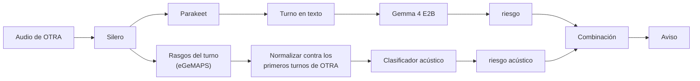

# Mejora futura: escuchar cómo habla quien llama, además de qué dice

> **Estado: propuesta sin discutir.** Es trabajo futuro: no se implementó ni se midió nada de lo que sigue. El detector
> actual trabaja solo sobre la transcripción, y la decisión de sumar rasgos acústicos sigue abierta en
> [D11](../gestion/MAPA-DECISIONES.md#d11--análisis-lingüístico-o-también-acústico). Redactado el 2026-11-23 a pedido
> del tutor, que pidió desarrollar las mejoras futuras en vez de dejarlas como viñetas
> ([§11.4](../tesis/CAP-11-CONCLUSIONES.md#114-trabajo-futuro-acotado)).

## 1. Por qué

En las 33 llamadas reales legítimas de call center, el detector avisó en 21
([§11.1](../tesis/CAP-11-CONCLUSIONES.md#111-aportes-y-resultados-principales)), y siete prompts no bajaron esa falsa
alarma sin perder estafas ([H12](../hallazgos/H12-cambiar-el-prompt-mueve-el-corte-no-la-separacion.md)). Una
explicación posible es que el texto solo no alcanza: un vendedor insistente y un estafador dicen cosas parecidas.

**Hipótesis:** cómo habla quien llama (`OTRA`) —urgencia, tono imperativo, velocidad, pausas, interrupciones y cómo
cambian a lo largo de la llamada— separa mejor las estafas de las legítimas difíciles, o adelanta el aviso cuando el
texto es ambiguo.

Es una hipótesis, no un resultado. Los dos conjuntos reales de H12 son texto traducido, sin audio, así que no sirven
para probarla: hace falta audio nuevo (§6).

## 2. Qué se mide y qué no

**Se mide:** rasgos paralingüísticos y prosódicos de `OTRA`, **relativos a la misma llamada**. Cada valor se compara
con los primeros turnos del mismo hablante: lo que importa es que acelere, suba la intensidad o deje de hacer pausas,
no cómo habla de base.

**No se mide, y se deja escrito por qué:**

- **Acento, región o nivel socioeconómico.** No tienen relación con el fraude y penalizarían a hablantes legítimos por
  cómo hablan. Choca con la minimización de datos de la Ley 25.326
  ([privacidad del sistema](../corpus/PRIVACIDAD-DEL-SISTEMA.md#2-marco-legal-argentino-ley-25326-de-protección-de-datos-personales)).
  La normalización intra-llamada busca justamente no comparar a una persona contra otra.
- **Detectar mentiras por la voz.** Los analizadores de estrés vocal (VSA, CVSA, LVA) no tienen respaldo: rinden
  cerca del azar (Horvath, 1982; National Research Council, 2003) y la comunidad de fonética forense los considera
  charlatanería (Eriksson y Lacerda, 2007). Además, estrés no es mentira: una persona legítima apurada también se
  estresa. El aviso nunca dice que alguien miente.
- **Voz sintética o *deepfake*.** Es otra línea, *anti-spoofing* (por ejemplo AASIST, Jung et al., 2022), con otros
  datos y otro objetivo: saber si la voz es generada, no si la llamada es una estafa. Queda fuera de esta mejora.

## 3. Dónde entra el espectrograma

El espectrograma no es un modelo aparte: es **la forma de ver el audio** que usan casi todas las opciones. Muestra
cuánta energía hay en cada frecuencia a lo largo del tiempo. Una variante, el **log-mel**, comprime las frecuencias
como las percibe el oído, y es la entrada estándar de los modelos de voz.

En el sistema ya existe: Parakeet calcula el log-mel de cada fragmento para transcribir, y el codificador de audio de
Gemma 4 E2B también parte de él. Lo que no existe es algo que lo mire para otra cosa que transcribir.

Hay tres formas de usarlo, de más interpretable a más opaca:

| | Qué se saca del audio | Qué decide | A favor | En contra |
| --- | --- | --- | --- | --- |
| **A. Rasgos clásicos** | 88 valores por ventana del estándar eGeMAPS (Eyben et al., 2016): tono ($F_0$), intensidad, *jitter*, *shimmer*, pendientes espectrales, MFCC, pausas. Se calculan del espectrograma y de la señal. | Un clasificador chico (regresión logística o árboles) sobre los valores normalizados en la llamada. | Pocos datos, se puede explicar cada rasgo, liviano (openSMILE en C++). | Pierde matices que una red sí vería. |
| **B. Red sobre el espectrograma** | El log-mel del turno entero, como imagen. | Una CNN chica entrenada para la tarea, o un codificador preentrenado (wav2vec 2.0, WavLM, emotion2vec) con una capa encima. | Aprende sola qué mirar. Hay modelos que ya estiman activación, dominancia y valencia (Wagner et al., 2023). | Necesita muchos datos, no se sabe qué miró, y aprende atajos (§7). |
| **C. Que E2B escuche** | El audio crudo del último turno de `OTRA`, con lo anterior como texto. | Gemma 4 E2B, en la misma consulta. | Un solo modelo para texto y voz. | Ya se analizó y quedó afuera sin medir ([corrida de #152](../../experiments/asr-local/corridas/2026-11-10_152-opcion-b-e2b-transcribe/resumen.md#por-qué-la-opción-c-queda-afuera-sin-medirla)); probablemente necesite ajuste fino ([#176](https://github.com/Corchets/bitacora_tesis/issues/176)). |

Una cuarta idea, más barata, cruza B con lo que ya corre: **reusar el codificador de Parakeet**. Sus salidas ya se
calculan para transcribir; promediarlas por turno y poner un clasificador encima costaría casi nada. El riesgo es que
un codificador entrenado para transcribir tiende a descartar justo lo que acá interesa (quién habla y cómo), así que
habría que medir si queda algo.

**Recomendación:** empezar por A. Es la única que se puede entrenar con los pocos datos que habría al principio, y la
única cuyo aviso se puede explicar («habló cada vez más rápido y dejó de hacer pausas»). B y la variante de Parakeet
solo si A muestra señal y hay audio suficiente. C depende de resolver antes lo que dice la corrida de #152.

## 4. Cómo se integraría

El recorrido actual: audio por canal → Silero y Parakeet → turno de `OTRA` cerrado → Gemma 4 E2B escribe el riesgo
([capítulo 5](../tesis/CAP-05-DISENO-Y-ARQUITECTURA.md)). La mejora se cuelga en paralelo, sin tocar el texto:

- **Mismo corte de turno.** Silero ya marca dónde empieza y termina cada turno; el extractor usa ese mismo segmento de
  audio, que ya está en memoria.
- **Combinación tardía.** El riesgo de E2B y el acústico se combinan al final con una regla calibrada en un conjunto
  aparte. La otra forma, pasarle a E2B una etiqueta discreta en el prompt («habla rápido y sin pausas»), es más simple
  pero mezcla dos señales que conviene medir por separado.
- **El texto sigue mandando.** El riesgo acústico solo, sin un pedido en el texto, no debería disparar un aviso: tono
  urgente no es estafa. Su papel es subir o bajar el riesgo cuando el texto es ambiguo.
- **El motivo del aviso** ([ADR 0006](../ingenieria/adr/0006-salida-cortada-tras-el-campo-que-decide-y-motivo-al-avisar.md))
  sigue saliendo del texto. Con A se podría sumar una frase sobre el ritmo; nunca sobre la persona.

## 5. Paso a paso

1. **Ratificar el encuadre** de §2 entre los cuatro y con el tutor, y decidir si D11 se reabre para esta línea.
2. **Juntar audio real** con consentimiento (§6). Sin este paso no hay nada que medir.
3. **Línea base en laboratorio (Python).** Extraer eGeMAPS con `opensmile`, normalizar por llamada y entrenar el
   clasificador A. Revisar a mano qué rasgos pesan.
4. **Ablación pareada** sobre las mismas llamadas con audio: (1) solo texto, que es el detector actual, (2) solo
   acústico, (3) combinado. Con la regla de adopción escrita antes de correr, como en H12.
5. **Auditoría de sesgo.** Falsas alarmas separadas por región o tonada, género y edad. Si el acústico sube la falsa
   alarma de algún grupo, no se adopta, aunque mejore el total.
6. **Banda telefónica.** Repetir 4 con el audio degradado a 8 kHz (AMR-NB y G.711). Si la señal desaparece, la mejora
   solo sirve para llamadas por internet.
7. **Solo si 4 a 6 dan bien:** probar B o la variante de Parakeet con el mismo protocolo.
8. **Teléfono.** Llevar el extractor a Android (openSMILE por NDK) y medir memoria pico, latencia p50 y p90, batería
   y temperatura con Parakeet y E2B corriendo a la vez.

## 6. Datos que harían falta

- **Llamadas reales en español argentino, con consentimiento**, de estafas simuladas por personas y de legítimas
  difíciles con carga emocional (cobranzas, reclamos, ventas insistentes). El audio TTS del corpus no sirve: la
  prosodia es la del sintetizador, no la de una persona presionando a otra.
- **Varias personas por rol**, para que el clasificador no aprenda a reconocer a un actor.
- **De apoyo, no para evaluar:** conjuntos públicos de emoción en español (EmoMatchSpanishDB, MESD, EMOVOME) o en
  inglés (MSP-Podcast), para calibrar los rasgos. Son emociones actuadas o de otro contexto, no estafas. VISHGUARD
  ([estado del arte](SINTESIS-ESTADO-DEL-ARTE.md#23-datasets-y-límites-de-reutilización-recuperación-de-43)) anota
  persuasión y emoción, pero no tiene español y su acceso es restringido.
- El audio queda fuera de Git, como el resto del corpus ([invariantes](../../AGENTS.md#invariantes)).

## 7. Riesgos

- **Atajos.** Una red sobre el espectrograma aprende lo que distingue a los conjuntos, no a las estafas: el micrófono,
  el códec, el ruido o el silencio. En *anti-spoofing* se mostró que modelos entrenados en ASVspoof 2019 se apoyaban
  en la duración del silencio inicial (Müller et al., 2021). Si las estafas salen de una fuente y las legítimas de
  otra, el clasificador va a aprender la fuente. Por eso las dos clases tienen que grabarse en las mismas condiciones.
- **Pocos datos.** Con decenas de llamadas, B sobreajusta. A es la única opción razonable al principio.
- **El códec.** AMR-NB a 8 kHz recorta lo que pasa de 4 kHz y deforma *jitter* y *shimmer*; es uno de los fundamentos
  de la exclusión actual ([§5.5.4](../tesis/CAP-05-DISENO-Y-ARQUITECTURA.md#554-enfoque-lingüístico-frente-a-acústico-d11-abierta)).
- **Presupuesto del teléfono.** E2B ya tarda 3,7 s por turno en el Samsung A56
  ([§8.6](../tesis/CAP-08-RESULTADOS-EXPERIMENTALES.md#86-rendimiento-y-límites-del-hardware)). A es barato; un
  codificador como wav2vec 2.0 no lo es.
- **Biometría.** Un *embedding* de voz puede identificar a una persona. El extractor procesa en memoria y descarta al
  terminar el turno; no se guardan rasgos ni *embeddings*.

## 8. Qué resultado se esperaría

No hay forma de anticiparlo sin datos. Lo que se esperaría observar si la hipótesis es cierta:

- En la ablación, el combinado baja la falsa alarma en legítimas difíciles **sin perder estafas a tiempo** frente a
  solo texto. Esa es la regla de adopción, la misma que no pasó ningún prompt en H12.
- Solo acústico, por sí mismo, separa algo mejor que el azar pero peor que el texto. Si separara mejor que el texto,
  lo primero a sospechar es un atajo.
- Con banda telefónica, la ganancia se achica. Cuánto, es parte de la pregunta.

Si el combinado no mejora, también es un resultado: respalda que el fraude telefónico es sobre todo lingüístico, que
es lo que hoy afirma el §5.5.4 sin haberlo medido.

## 9. Fuentes

- Eriksson, A. y Lacerda, F. (2007). Charlatanry in forensic speech science: A problem to be taken seriously.
  *International Journal of Speech, Language and the Law*, 14(2), 169–193.
- Eyben, F. et al. (2016). The Geneva Minimalistic Acoustic Parameter Set (GeMAPS) for Voice Research and Affective
  Computing. *IEEE Transactions on Affective Computing*, 7(2), 190–202.
- Horvath, F. (1982). Detecting deception: the promise and the reality of voice stress analysis. *Journal of Forensic
  Sciences*, 27(2), 340–351.
- Jung, J. et al. (2022). AASIST: Audio Anti-Spoofing using Integrated Spectro-Temporal Graph Attention Networks.
  *ICASSP 2022*.
- Müller, N. M. et al. (2021). Speech is Silver, Silence is Golden: What do ASVspoof-trained Models Really Learn?
  *ASVspoof 2021 Workshop*.
- National Research Council (2003). *The Polygraph and Lie Detection*. Washington, DC: The National Academies Press.
- Wagner, J. et al. (2023). Dawn of the Transformer Era in Speech Emotion Recognition: Closing the Valence Gap. *IEEE
  Transactions on Pattern Analysis and Machine Intelligence*, 45(9), 10745–10759. Modelo:
  [`audeering/wav2vec2-large-robust-12-ft-emotion-msp-dim`](https://huggingface.co/audeering/wav2vec2-large-robust-12-ft-emotion-msp-dim).
