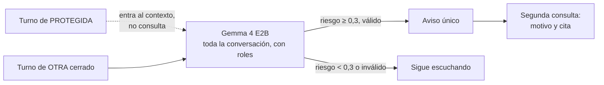

> **Estado: borrador del 2026-11-03**, actualizado el 2026-11-11 con el detector del [ADR 0002](../ingenieria/adr/0002-detector-gemma4-e2b-solo-con-prompt-c-premisa.md) y el ASR del [ADR 0001](../ingenieria/adr/0001-parakeet-filtro-y-gemma4-e2b-con-tito-viejo.md). Requiere revisión del equipo.

# Capítulo 5: Diseño y arquitectura del sistema

El presente capítulo expone la arquitectura técnica y el diseño conceptual del sistema de detección incremental de llamadas de ingeniería social y vishing (*voice phishing*). Se detallan la descomposición modular, el flujo temporal de procesamiento, los modelos de datos y contratos de interfaz que vinculan los componentes, la gestión del estado conversacional en memoria volátil y las decisiones de diseño adoptadas, contrastadas con sus alternativas y fundamentadas en las restricciones de seguridad, privacidad y plataforma vigentes.

## 5.1. Contexto de la solución y descomposición modular

El objetivo del sistema es asistir de manera oportuna a una persona receptora de una comunicación verbal potencialmente fraudulenta, emitiendo una advertencia comprensible y procesable antes de que se consume una acción perjudicial (como la entrega de un código de autenticación de un solo uso o una transferencia bancaria). Para satisfacer esta meta sin comprometer la privacidad del usuario ni violar las políticas de seguridad de los sistemas operativos móviles modernos, la solución se concibe como un pipeline completamente local (*on-device*) que procesa la conversación de manera incremental.

El sistema se estructura en seis componentes funcionales con responsabilidades desacopladas, vinculados en un flujo unidireccional:

```mermaid
flowchart LR
    A["1. Ingesta de audio<br/>(Replay / Meet por canal)"] -->|"Bloques PCM 16 kHz"| B["2. ASR local<br/>(Parakeet con filtro Silero)"]
    B -->|"Actualizaciones<br/>(JSONL)"| C["3. Contexto incremental<br/>(Memoria volátil)"]
    C -->|"Líneas disponibles<br/>(Prefijo temporal)"| D["4. Detector<br/>(Gemma 4 E2B)"]
    D -->|"Respuesta tipada<br/>(Riesgo, alerta, motivo)"| E["5. Política de alerta<br/>(Aviso único)"]
    E -->|"Advertencia validada"| F["6. Interfaz de usuario<br/>(Aviso preventivo)"]
```



La responsabilidad de cada uno de los componentes se define con precisión:

1. **Ingesta de audio:** Suministra el flujo de audio en bloques temporales uniformes sin entregar información del futuro de la llamada. En la base experimental obligatoria del proyecto, este componente consiste en un motor de reproducción (*replay*) de archivos de audio que simula la llegada secuencial de fragmentos PCM; en la demostración, un panel web captura en la notebook de la persona protegida su micrófono y el canal remoto desde una pestaña de Google Meet, con la llamada de ejemplo como plan B (ver [Alternativas para obtener el audio](../ingenieria/ALTERNATIVAS-CAPTURA-AUDIO.md)).
2. **Reconocimiento automático del habla (ASR local):** Transforma el flujo continuo de audio en actualizaciones de texto estructuradas. Opera de forma local con Parakeet TDT 0.6B v3 y emite segmentos con sus marcas temporales de inicio, fin y momento de disponibilidad en el reloj de la llamada. Cada persona es un canal.
3. **Gestor de contexto incremental:** Mantiene en memoria de acceso aleatorio el estado conversacional de la llamada en curso. Su función es incorporar el texto emitido por el ASR, reemplazar los borradores preliminares cuando se recibe una transcripción más precisa y consolidar los segmentos cerrados, asegurando que el detector reciba en todo instante únicamente el prefijo de diálogo disponible hasta ese momento.
4. **Detector:** Gemma 4 E2B analiza el diálogo acumulado, con cada línea marcada como `PROTEGIDA` u `OTRA` según el canal, sin etiquetas externas ni acceso a señales futuras. Se lo consulta al cerrar cada turno de OTRA y escribe solo el riesgo, un número entre 0 y 1. En el primer aviso, una segunda consulta escribe el motivo y la evidencia textual que lo sustenta. El acceso al modelo es un recurso secuencial.
5. **Política de emisión de alerta:** Evalúa la secuencia de respuestas producidas por el detector a lo largo del tiempo y decide el instante en que se emite la advertencia. Emite un único aviso por llamada.
6. **Módulo de aviso al usuario:** Transforma la decisión de alerta en una comunicación no obstructiva, clara y orientada a la acción inmediata (interrumpir la entrega de información o verificar por un canal alternativo), sin emitir afirmaciones categóricas ni revelar credenciales sensibles.

---

## 5.2. Flujo de procesamiento temporal

El recorrido temporal del sistema debe respetar rigurosamente la causalidad física del proceso. Un error metodológico habitual en la literatura sobre detección de vishing consiste en evaluar modelos sobre textos completos al finalizar la llamada o fechar las advertencias en el instante en que comenzó a pronunciarse una palabra, ignorando el tiempo que el hardware demora en capturar el audio, digitalizarlo, procesarlo en el transductor acústico y ejecutar la inferencia del modelo de lenguaje.

El flujo implementado distingue de manera explícita tres referencias temporales:

- **Intervalo del audio ($[\tau_{\text{inicio}}, \tau_{\text{fin}}]$):** Ventana temporal, medida en segundos desde el inicio de la conversación grabada, en la cual se pronunciaron los fonemas correspondientes al fragmento transcripto.
- **Instante de disponibilidad ($t_{\text{disp}}$):** Momento en el reloj del audio en que el transcriptor completa la inferencia de ese bloque acústico y publica el texto. Satisface estrictamente la invariante de causalidad:
  $$t_{\text{disp}} \ge \tau_{\text{fin}}$$
- **Instante de evaluación y emisión ($t_{\text{eval}}$, $T_A$):** Momento en que el detector lingüístico finaliza su cálculo sobre el texto disponible y la política resuelve emitir el aviso. Este instante absorbe tanto la demora acumulada en la cola de inferencia como el tiempo de cómputo del detector.

En la siguiente tabla se resumen las entradas, salidas y restricciones críticas de cada etapa del pipeline:

| Etapa | Entrada | Salida | Invariante crítica |
|---|---|---|---|
| **Audio** | Flujo acústico bruto (WAV/FLAC mono o estéreo, 16 kHz). | Bloques de PCM con marcas de tiempo. | Prohibido entregar muestras acústicas con timestamp posterior al reloj actual. |
| **ASR local** | Bloques de PCM de 40 ms en vivo, 100 ms en las corridas offline. | Eventos de transcripción (`parcial` o `final`). | $t_{\text{disp}} \ge \tau_{\text{fin}}$. La latencia de cómputo se suma hacia adelante; no se reasignan marcas al pasado. |
| **Contexto** | Actualización de ASR (`tipo`, `segmento`, `texto`). | Tupla inmutable de líneas de diálogo cerradas y abiertas. | Aislamiento estricto entre llamadas: al cambiar de sesión el estado se vacía totalmente. |
| **Cola de evaluación** | Líneas de diálogo en $t_{\text{disp}}$ y estado del detector. | Turno de cómputo secuencial con inicio y fin de evaluación. | Recurso secuencial (una inferencia a la vez): en replay se evalúan todas en orden; en vivo se toma lo último disponible (§5.4.2). |
| **Detector** | Prefijo conversacional acumulado hasta el cierre de un turno de OTRA, con el rol de cada línea. | `riesgo` en cada consulta; `motivo` y `evidencia` solo en el primer aviso. | Ceguera hacia el futuro y ausencia de datos de referencia humana (clase, marcas $T_R$/$T_C$). El rol sale del canal capturado, no de la referencia. |
| **Política de alerta** | Respuesta del detector y estado de avisos previos. | Disparo del aviso definitivo y marca $T_A$. | Principio de aviso único: a lo sumo un aviso principal por sesión para prevenir fatiga. |

---

## 5.3. Modelo de datos y contratos de interfaz

La robustez de la integración y la reproducibilidad experimental dependen de la especificación estricta de los contratos de datos entre componentes. En el sistema coexisten tres modelos de datos primarios: el contrato de transcripción incremental emitido por el ASR (`actualizaciones.jsonl`), la traza unificada de eventos generada por el simulador de replay (`eventos.csv`) y los manifiestos de reproducibilidad técnica (`manifiesto.json`).

### 5.3.1. Contrato de salida del ASR (`actualizaciones.jsonl`)

El componente de reconocimiento de voz emite un flujo en formato JSON Lines (JSONL). La primera línea contiene un objeto de metadatos globales (`meta`), y cada línea subsiguiente representa un evento de transcripción emitido en orden cronológico no decreciente de `disponible_s`.

```json
{"meta": {"motor": "sherpa-parakeet", "modelo": "csukuangfj/sherpa-onnx-nemo-parakeet-tdt-0.6b-v3-int8", "tipo_entrega": "parciales_y_finales", "es_streaming": false, "sample_rate": 16000, "hardware": {"sistema": "Darwin", "arquitectura": "arm64", "ram_total_gb": 8.0}}}
{"llamada_id": "SC-WA-CODE-01-tts", "n": 7, "tipo": "parcial", "segmento": 2, "texto": "pasame el código", "inicio_audio_s": 8.40, "fin_audio_s": 10.12, "disponible_s": 10.31, "proceso_ms": 190.0, "canal": null}
{"llamada_id": "SC-WA-CODE-01-tts", "n": 8, "tipo": "final", "segmento": 2, "texto": "Pasame el código de activación.", "inicio_audio_s": 8.40, "fin_audio_s": 11.20, "disponible_s": 11.45, "proceso_ms": 250.0, "canal": null}
```

La semántica de los campos de cada actualización se especifica a continuación:

- `llamada_id` (cadena): Identificador unívoco de la conversación a la que pertenece el audio.
- `n` (entero): Número de secuencia monótonamente creciente de la actualización en la sesión (1, 2, 3…).
- `tipo` (cadena, enumeración `{"parcial", "final"}`):
  - `"parcial"`: Transcripción preliminar y revisable de un segmento de habla actualmente abierto. Una actualización parcial posterior con idéntico valor de `segmento` reemplaza a la precedente.
  - `"final"`: Segmento de habla concluido definitivamente (tras detección de silencio o corte de locución). Su contenido queda congelado y no se modifica en actualizaciones posteriores.
- `segmento` (entero): Índice correlativo del turno o bloque de habla detectado por la segmentación acústica.
- `texto` (cadena): Cadena de texto decodificada por el motor de inferencia.
- `inicio_audio_s` y `fin_audio_s` (flotantes): Estampas temporales en segundos del reloj de audio que delimitan el tramo acústico de origen.
- `disponible_s` (flotante): Instante en el reloj de audio en el que la transcripción estuvo efectivamente lista para consumo del pipeline. Incorpora la latencia acumulada de decodificación y garantiza $disponible\_s \ge fin\_audio\_s$.
- `proceso_ms` (flotante): Tiempo de CPU/GPU en milisegundos que consumió el motor para decodificar ese bloque específico.
- `canal` (cadena opcional): Identificador del canal. En la llamada en vivo vale `"protegida"` u `"otra"`; en grabaciones estéreo de dos vías, `"A"` o `"B"`; en audio monoaural o mezclas de altavoz, `null`. El detector ve `PROTEGIDA` u `OTRA` según el canal ([ADR 0002](../ingenieria/adr/0002-detector-gemma4-e2b-solo-con-prompt-c-premisa.md)). En la configuración del ADR 0001 veía las letras A y B por orden de aparición, sin que indicaran quién llamó ni quién es sospechoso.

### 5.3.2. Traza unificada de ejecución del Replay (`eventos.csv`)

El motor de simulación de reproducción (`experiments/replay/replay.py`) integra las actualizaciones del ASR, gestiona la cola secuencial y vuelca una traza exhaustiva en formato tabular. Cada registro documenta la foto exacta del sistema ante cada actualización:

- Identificación y contenido: `llamada_id`, `n`, `tipo`, `segmento`, `canal`, `texto`, `texto_disponible_resumido`.
- Reloj de audio: `inicio_audio_s`, `fin_audio_s`, `disponible_s`.
- Reloj de cómputo y cola: `inicio_eval_s`, `fin_eval_s`, `espera_cola_ms`, `ms_detector`.
- Salida del detector: `riesgo`, `alerta_sugerida`, `motivo`, `evidencia`, `valida`, `error`.
- Decisión de política: `aviso` (booleano que indica si esa línea desencadenó la alerta pública), `t_a` (estampa en segundos del reloj de audio en que se concreta la alerta).

### 5.3.3. Manifiestos reproducibles (`manifiesto.json`)

Para garantizar la auditabilidad y trazabilidad experimental, cada corrida genera de forma automática un archivo de manifiesto estructurado que almacena:

1. **Procedencia criptográfica:** Hash SHA-256 del audio o del archivo JSONL de entrada, hash SHA-256 de las plantillas de prompt empleadas y estado del repositorio de control de versiones Git (hash del commit de cabecera y bandera booleana `cambios_sin_commit`).
2. **Entorno de ejecución:** Nombre del sistema operativo, versión del kernel, arquitectura del procesador, cantidad de núcleos físicos de CPU, memoria RAM instalada y versiones exactas de las librerías del entorno virtual (Python, Sherpa-ONNX, ONNX Runtime, Faster-Whisper, SoundFile, NumPy).
3. **Parámetros operativos:** Motor acústico, hilos de ejecución configurados, tamaño de bloque acústico, detector evaluado, modelo de lenguaje subyacente, semilla pseudoaleatoria (`seed`) o indicación explícita de `no-aplica`.
4. **Métricas globales de cómputo:** Factor de tiempo real ($RTF$), pico de memoria residente ($RSS$) medido a nivel de sistema operativo mediante la llamada `resource.getrusage(resource.RUSAGE_SELF)`, cantidad total de actualizaciones procesadas y desglose de parciales y finales.

---

## 5.4. Estado temporal, cola secuencial y política de aviso único

### 5.4.1. Gestión de contexto incremental en memoria volátil

El contexto de la llamada se gestiona en la clase [`ContextoLlamada`](../../experiments/replay/contexto.py). El estado se estructura en dos colecciones en memoria de acceso aleatorio:

- Una lista secuencial `cerrados: list[Linea]` que almacena los segmentos de habla confirmados (`tipo == "final"`).
- Un diccionario indexado `parciales: dict[int, Linea]` que retiene el borrador activo correspondiente a cada segmento abierto (`tipo == "parcial"`).

Cuando arriba una actualización parcial para el segmento $k$, el sistema sobrescribe la entrada `parciales[k]`. Cuando arriba una actualización final para el segmento $k$, el sistema extrae y elimina la entrada de `parciales` y anexa la línea definitiva al final de `cerrados`. En cada invocación, la instantánea de texto disponible entregada al detector se construye concatenando las líneas cerradas con los parciales vigentes ordenados por número de segmento:

$$\text{TextoDisponible} = \text{cerrados} + [\text{parciales}[s] \text{ para } s \in \text{sorted}(\text{parciales})]$$

Este mecanismo garantiza dos propiedades estructurales:
1. **Idempotencia de reemplazo:** Los borradores preliminares jamás duplican líneas en el diálogo acumulado.
2. **Reinicialización absoluta:** Al cambiar el identificador de la llamada (`llamada_id`), las estructuras `cerrados` y `parciales` se purgan por completo, impidiendo la filtración de contexto o vocabulario entre llamadas distintas.

### 5.4.2. Modelado de la cola secuencial del detector

Un dispositivo móvil cuenta con recursos computacionales acotados. Por ende, el detector lingüístico no puede concebirse como un servicio paralelizable sin límites: constituye un **recurso secuencial (una inferencia a la vez)**. Si el reconocedor ASR emite actualizaciones a un ritmo superior a la velocidad de inferencia del detector, las solicitudes de análisis deben encolarse.

El simulador implementa el cálculo exacto de la cola secuencial en el reloj continuo del audio:

$$\text{inicio\_eval}_n = \max(t_{\text{disp}, n}, \text{fin\_eval}_{n-1})$$

$$\text{fin\_eval}_n = \text{inicio\_eval}_n + \frac{\text{ms}_n}{1000}$$

$$\text{espera\_cola\_ms}_n = (\text{inicio\_eval}_n - t_{\text{disp}, n}) \times 1000$$

Donde $t_{\text{disp}, n}$ es el instante de disponibilidad de la actualización $n$ según el ASR, y $\text{ms}_n$ es la duración de la inferencia lingüística en milisegundos.

Si el detector procesa con holgura ($\text{ms} < \Delta t_{\text{audio}}$), la espera en cola se mantiene en cero y la evaluación inicia inmediatamente en $t_{\text{disp}, n}$. Si el detector se degrada o experimenta picos de latencia, $\text{inicio\_eval}_n$ queda dominado por $\text{fin\_eval}_{n-1}$, acumulando un atraso temporal medible en `espera_cola_ms`.

**En vivo, el detector no hace cola.** Si llega texto mientras evalúa, la siguiente evaluación toma lo último disponible y las intermedias se saltean, registradas como `saltadas`; en una llamada larga, evaluarlas todas haría crecer la demora. Cada consulta ve toda la transcripción, así que una frase que llegó mientras el modelo estaba ocupado no se pierde: entra en la consulta siguiente. Al cortar la llamada, lo pendiente se evalúa con un tope de 30 s (corrección `7e6b971`). Toda llamada en vivo se puede volver a medir después con `replay.py`.

### 5.4.3. Política de aviso único

La política de alerta adoptada en el núcleo del sistema es la de **aviso único ante la primera respuesta válida positiva** (`aviso_unico_primer_true_valido`). 

Bajo esta regla, el instante de alerta de la conversación ($T_A$) se congela en el momento de finalización de cómputo de la primera actualización que retorne un resultado válido positivo. En la configuración del [ADR 0002](../ingenieria/adr/0002-detector-gemma4-e2b-solo-con-prompt-c-premisa.md), positivo es un riesgo mayor o igual a 0,3: la salida se corta después del riesgo, antes de `alerta_sugerida`, que no se lee ([ADR 0006](../ingenieria/adr/0006-salida-cortada-tras-el-campo-que-decide-y-motivo-al-avisar.md)):

$$T_A = \text{fin\_eval}_n$$

Esta formulación garantiza que $T_A$ refleje la totalidad del tiempo transcurrido en el mundo real, incluyendo la duración del audio, la latencia del transcriptor ASR, el tiempo de espera en la cola secuencial y el procesamiento del detector.

El tratamiento de excepciones e inconsistencias sigue reglas rigurosas:
- **Invalidez no es predicción:** Si el modelo genera un JSON malformado, omite campos obligatorios, produce un valor numérico de riesgo fuera del rango $[0, 1]$, supera el límite de contexto o agota el tiempo de espera (*timeout*), el evento se califica como **fallo técnico** (`valida == False`). Un fallo **jamás** se computa como voto negativo ni bloquea la emisión de alertas en turnos subsiguientes.
- **Fallo del motivo:** Si la segunda consulta falla, el aviso se mantiene con un texto fijo y el error queda registrado.
- **Inhibición de fatiga:** Una vez que la llamada emite su primer aviso ($T_A$), las actualizaciones posteriores continúan registrándose con sus respectivos niveles de riesgo y motivos a efectos de análisis retrospectivo, pero su bandera `aviso` se fuerza a `False`. En la llamada en vivo, después del aviso no se consulta más. El sistema no repite alertas para un mismo nivel de riesgo, protegiendo a la persona usuaria de la saturación cognitiva durante una llamada bajo estrés.

### 5.4.4. Problemática del contexto en llamadas extensas (D08 abierta)

En llamadas de duración prolongada (de 10 a 20 minutos), la estrategia ingenua de concatenar la totalidad del diálogo acumulado introduce dos patologías severas:

1. **Acumulación binomial de falsas alarmas:** Si un detector posee una probabilidad $p$ de emitir un falso positivo en una revisión aislada de una llamada legítima, y el sistema evalúa la llamada periódicamente cada $\Delta t$ segundos generando $N$ revisiones ($N = \text{duración} / \Delta t$), la probabilidad acumulada de que la persona usuaria sufra al menos una falsa alarma en la llamada viene dada por:
   $$P(\text{al menos una falsa alarma}) = 1 - (1 - p)^N$$
   Como se demostró en la investigación de diseño de [VENTANA-DE-CONTEXTO-Y-ALERTA.md](../investigacion/VENTANA-DE-CONTEXTO-Y-ALERTA.md), un clasificador con un rendimiento aparentemente excepcional del $99\ \%$ de acierto por turno ($p = 0.01$), al ser consultado cada 15 segundos en una llamada de 20 minutos ($N = 80$ revisiones), genera al menos una falsa alarma en el **$55.2\ \%$** de las llamadas perfectamente legítimas.
2. **Envenenamiento contextual y saturación de memoria:** Menciones inocuas o ambiguas ocurridas al inicio de la llamada (por ejemplo, hablar de una urgencia médica o comentar una compra) permanecen indefinidamente en la ventana si no existe olvido, diluyendo la atención del modelo o provocando correlaciones espurias cuando se combinan con pedidos posteriores neutros.

Para mitigar estas patologías, se investigaron dos familias de alternativas arquitectónicas:
- **Ventana contextual con decaimiento temporal:** Estructuras donde los eventos pierden peso en función de su vida media ($h_\gamma$), diferenciando la persistencia de una suplantación de identidad (de larga retención) de la urgencia transitoria (de rápido decaimiento).
- **Registro de eventos estructurado:** Sustituir el arrastre de texto libre por un buffer de entidades tipadas y ordenadas temporalmente (quién habló, qué maniobra intentó y cómo reaccionó la contraparte), el cual consume una cantidad ínfima de tokens.

> **Estado: propuesta sin discutir.** El modelo final de estado temporal, el tamaño óptimo de la ventana y el criterio definitivo de persistencia (evaluación de cruces consecutivos frente a histéresis con doble umbral) continúan abiertos en [D08 — Congelar protocolo experimental](../gestion/MAPA-DECISIONES.md#d08--congelar-protocolo-experimental).

---

## 5.5. Decisiones arquitectónicas y análisis de alternativas

El diseño sintetiza elecciones donde se priorizó la defensa metodológica, la factibilidad técnica y la reproducibilidad. El ASR está registrado en [ADR 0001](../ingenieria/adr/0001-parakeet-filtro-y-gemma4-e2b-con-tito-viejo.md) y el detector, en [ADR 0002](../ingenieria/adr/0002-detector-gemma4-e2b-solo-con-prompt-c-premisa.md).



### 5.5.1. Detector

**El modelo decide solo.** Gemma 4 E2B (`gemma4:e2b-it-q4_K_M`) recibe la conversación disponible con el prompt `c-premisa-corte-riesgo`. El prompt le explica cómo se arma una estafa telefónica y le pide mirar hacia dónde va la llamada, no solo la última frase: si OTRA va llevando a PROTEGIDA a dictar un código, decir una clave, transferir o seguir pasos en el celular, conviene avisar aunque todavía no haya un pedido. Un párrafo agrega la premisa del alcance ([ADR 0003](../ingenieria/adr/0003-detector-solo-en-entrantes-de-no-agendados.md)): la llamada viene de un número no agendado, y un banco, una empresa o un organismo no pide por teléfono el código ni las claves. Otro aclara que una legítima también puede pedir el nombre o el DNI. Las líneas de PROTEGIDA entran en el contexto, pero solo consultan los turnos de OTRA ([ADR 0007](../ingenieria/adr/0007-consulta-al-cerrar-cada-turno-de-otra.md)). No hay componente entrenado: el detector es un modelo general con un prompt.

**Por qué esta configuración.** La configuración del ADR 0001 ponía a Tito viejo como compuerta y le pasaba al modelo su indicio. Las dos cosas salieron. La baja de falsas alarmas que se le atribuía al filtro era casi toda punto ciego ([H08](../hallazgos/H08-tito-evita-falsas-alarmas-por-punto-ciego.md)), porque Tito se entrenó como clasificador de estafas y no como compuerta de lo sensible ([H09](../hallazgos/H09-tito-clasificador-en-vez-de-compuerta.md)), y el indicio le hacía perder estafas al modelo ([H07](../hallazgos/H07-indicio-de-tito-pierde-estafas.md)). El prompt C pregunta por la intención y no por el pedido. Por eso avisa antes del pedido y suma las estafas sin pedido ([H10](../hallazgos/H10-c-avisa-antes-del-pedido.md)). Entre las variantes de C, la [prueba de sensibilidad](../../experiments/slm-directo/corridas/2026-11-10_sensibilidad-c/analisis.md) eligió la de la premisa con una regla escrita antes de correr. En desarrollo, dentro del alcance, avisó 40 de 46 estafas, 19 de 36 antes del pedido, con 26 falsas alarmas en 94 legítimas. Es una búsqueda a mano sobre los mismos casos, sin revisión humana: el número que vale es el del test (#52).

| **Reglas léxicas** | 58,3 % de falsas alarmas en 24 negativos difíciles | No distinguen mencionar de pedir. Quedan como línea base y respaldo sin modelo. |
| **Cascada con zona gris (spike #29)** | Bajó de 12/16 a 7/16 aciertos | Consultaba al modelo solo en una zona gris. |
| **Tito viejo como compuerta de E2B (ADR 0001)** | 10/10 · 0/10 en #101, con la mitad de las consultas | Las falsas alarmas que evita son punto ciego (H08) y pierde una estafa en desarrollo. Salió el 2026-11-06, también como ablación. |
| **E2B con `v4`, cortado tras la alerta** | Contra C, 8 estafas menos y 42/94 falsas alarmas contra 27/94 ([etapa 2](../../experiments/slm-directo/corridas/2026-11-07_alcance-etapa-2/analisis.md)) | Pregunta por el pedido, así que avisa en el pedido y no en las estafas sin él. |
| **Leer la probabilidad del token** | Empata con el riesgo escrito | Sin ajuste fino no sirve. Trabajo futuro (#176). |
| **Gemma 4 E4B con Tito viejo** | 10/10 · 1/10 | En la M1 de 8 GB avisó a +49 s. No se corrió sobre los 244 casos de desarrollo; se compara como referencia en #173. |
| **Tito nuevo con E2B** | 2/10 · 0/10 | Pierde casi todas las estafas. Se probó sin ajuste fino del encoder. |
| **Qwen3.5 9B con `v2`** | 10/10 · 1/10 | 6,6 GB: techo experimental, no entra en el teléfono. |
| **Riesgo primero (`gemma3n:e2b`)** | 10/10 · 3–6/10, o 2/10 · 0/10 | Lo elegido en selección no se transfiere al informe. |
| **Cross-encoder y NLI** | bge: 4/10 · 1/10 | Miden tema, no intención ([#123](https://github.com/Corchets/bitacora_tesis/issues/123)). |
| **Modelo por API** | Sin medir | Lo descartó el tutor, por la restricción de privacidad. Se mide como techo, solo en desarrollo, en #174. |

### 5.5.2. Captura de audio

La obtención del audio separa la experimentación de la demostración:

1. **Replay (obligatorio para medir):** reproducir archivos en bloques secuenciales es la única alternativa que permite repetir una corrida con control temporal.
2. **Captura por canal en la notebook (demo):** el panel toma el micrófono de la persona protegida y el audio remoto desde una pestaña de Google Meet. El tutor la aprobó el 2026-10-28 como demo de la defensa. Cada persona ocupa un canal, sin diarización. WhatsApp Desktop quedó afuera porque no funcionó con BlackHole.
3. **VoIP propia:** era la integración objetivo original. Queda sin construir porque la captura por canal da la misma separación con menos riesgo.
4. **PSTN universal:** Android reserva `VOICE_UPLINK` y `VOICE_DOWNLINK` a apps del sistema con el privilegio `CAPTURE_AUDIO_OUTPUT`. Se declaró **fuera del alcance** ([D05](../gestion/MAPA-DECISIONES.md#d05--elegir-la-fuente-de-audio-demostrable)); no se recurre a *rooting* ni a captura encubierta.

### 5.5.3. Reconocimiento de voz

Se usa **Parakeet TDT 0.6B v3 int8** por frases, con la opción B: la energía RMS corta la frase tras 0,8 s por debajo de 0,008, y Silero con umbral 0,5 decide qué cuenta como voz. Así, el ruido no se transcribe y no se pierde el corte estable.

| Alternativa | Resultado | Por qué no |
|---|---|---|
| **Silero solo (opción A)** | WER 32,8 %; 205 segmentos para 129 frases; inglés o portugués en 25 frases | Parte las frases. Es 0,75 s más rápida y recupera más términos críticos, pero empata en etiquetas. |
| **Zipformer Kroko** | WER de 4–5 % con TTS, malo con voz real | El resultado con TTS no se sostuvo. Retirado el 2026-10-29. |
| **Whisper base** | RTF 0,27 con TTS | No es streaming y solo transcribe al cerrar la frase. |
| **Gemma 4 E2B como ASR** | Con TTS, WER 8,5 % contra 4,9 % de Parakeet; 2,7 s por turno en CPU contra 0,18 s | Transcribe peor, pierde cifras dictadas y no ahorra memoria con claridad. Además, al ser el mismo modelo que detecta, su demora se suma al aviso ([corrida](../../experiments/asr-local/corridas/2026-11-10_152-opcion-b-e2b-transcribe/resumen.md)). |
| **Gemma 4 E2B escuchando el audio** | No se midió | Acepta 30 s de audio por entrada, a 25 tokens por segundo: una llamada de 5 minutos no entra en el contexto, y sin texto no hay motivo ni registro. Medirla exigía rehacer la evaluación en audio. |

**Riesgo aceptado.** Parakeet es multilingüe y no permite fijar el idioma. Además, confunde «token» con «toque» y «CVV» con «CBB» o «CBU», en ambas opciones.

### 5.5.4. Enfoque lingüístico frente a acústico (D11 abierta)

El pipeline centra su análisis en el contenido semántico y pragmático de la transcripción textual, descartando deliberadamente la prosodia, el tono de voz o biomarcadores acústicos para clasificar el vishing. Esta decisión obedece a tres fundamentos:
- La variabilidad acústica introducida por los códecs de compresión telefónica (como AMR-NB a 8 kHz o G.711) destruye micro-rasgos prosódicos.
- Los indicios determinantes de una maniobra de ingeniería social (la suplantación de identidad, la creación de urgencia artificial y la solicitud de códigos secretos) son fenómenos de naturaleza intrínsecamente lingüística.
- Preserva el presupuesto de cómputo del dispositivo al evitar la inferencia simultánea de redes acústicas pesadas.

> **Estado: propuesta sin discutir.** La ratificación formal de operar exclusivamente sobre la transcripción textual y diferir el análisis acústico como trabajo futuro permanece abierta en [D11 — Análisis lingüístico o también acústico](../gestion/MAPA-DECISIONES.md#d11--análisis-lingüístico-o-también-acústico).

---

## 5.6. Seguridad, privacidad y despliegue local

La operación de un detector de vishing plantea interrogantes éticos y legales inmediatos, dado que procesa la señal más íntima de las telecomunicaciones interpersonales: la voz en tiempo real. La arquitectura del sistema responde a estos desafíos mediante un enfoque estricto de **Privacidad desde el Diseño** (*Privacy by Design*).

### 5.6.1. Inferencia local estricta y descarte en memoria volátil

El sistema no se conecta a ningún servidor central, API comercial ni servicio en la nube durante el curso de la llamada:
- **Ejecución on-device:** El transcriptor ASR y los modelos se ejecutan en el equipo; en el prototipo, la notebook. Ni el audio ni el texto salen de él. El tutor descartó por completo el uso de un modelo por API. La ejecución en un teléfono no se midió.
- **Ciclo de vida en memoria volátil (diseño del producto):** Los buffers PCM de audio y las estructuras de diálogo del contexto (`cerrados` y `parciales`) residen exclusivamente en memoria RAM. Al cortarse o finalizar la comunicación, la memoria se libera, sin persistir grabaciones ni transcripciones.
- **Diferencia del prototipo de laboratorio:** Para poder medir, el panel sí guarda `estereo.wav` y los registros de cada llamada en una carpeta fuera de Git, con consentimiento de quienes participan y datos ficticios. Es una decisión del experimento, no del producto.

### 5.6.2. Encuadre normativo argentino (Ley 25.326)

El diseño arquitectónico satisface las exigencias de la [Ley 25.326 de Protección de Datos Personales](../corpus/PRIVACIDAD-DEL-SISTEMA.md#2-marco-legal-argentino-ley-25326-de-protección-de-datos-personales):
- **Principio de minimización y finalidad (Art. 4):** Los datos procesados son estrictamente adecuados y no excesivos respecto al fin exclusivo de proteger a la persona receptora contra el fraude; la destrucción inmediata en RAM tras la llamada cumple con el mandato legal de supresión de datos cuando han dejado de ser necesarios.
- **Consentimiento y licitud (Art. 5 y 6):** En el ámbito experimental y en la integración VoIP controlada, ambos participantes conocen de antemano el propósito del estudio y prestan su consentimiento explícito. En un producto comercial de autoprotección, la herramienta es operada por el propio titular del dispositivo de forma transparente.
- **Seguridad y confidencialidad (Arts. 9 y 10):** La arquitectura elimina el riesgo de fuga masiva de datos en tránsito o reposo al carecer de bases de datos remotas.
- **Prohibición de cesión (Art. 11):** No existe transferencia de información personal a terceros.

### 5.6.3. Secreto de las comunicaciones y no interceptación

El marco penal argentino sanciona penalmente en los artículos 153 y 153 bis del Código Penal la interceptación indebida de comunicaciones privadas y el acceso no autorizado a sistemas informáticos. Asimismo, el artículo 197 tipifica el entorpecimiento de las telecomunicaciones.

La arquitectura diseñada se alinea con la doctrina jurídica aplicable:
1. **Inexistencia de captación por terceros:** En el prototipo de laboratorio y en la llamada consentida, la aplicación forma parte del canal extremo receptor. No actúa como un agente encubierto interceptor de telecomunicaciones ajenas.
2. **No interferencia en el servicio:** El detector opera en modo de escucha pasiva en el extremo terminal. No altera la señal de red, no desvía paquetes ni interrumpe la conexión telefónica (cumpliendo con la exigencia de no entorpecer el servicio según el art. 197).
3. **Naturaleza del aviso:** La advertencia emitida es un mensaje visual o sensorial local dirigido exclusivamente a la persona usuaria para alertarla cognitivamente. El sistema no inyecta audio sintetizado en el canal de la contraparte ni ejecuta acciones invasivas sin supervisión humana.
