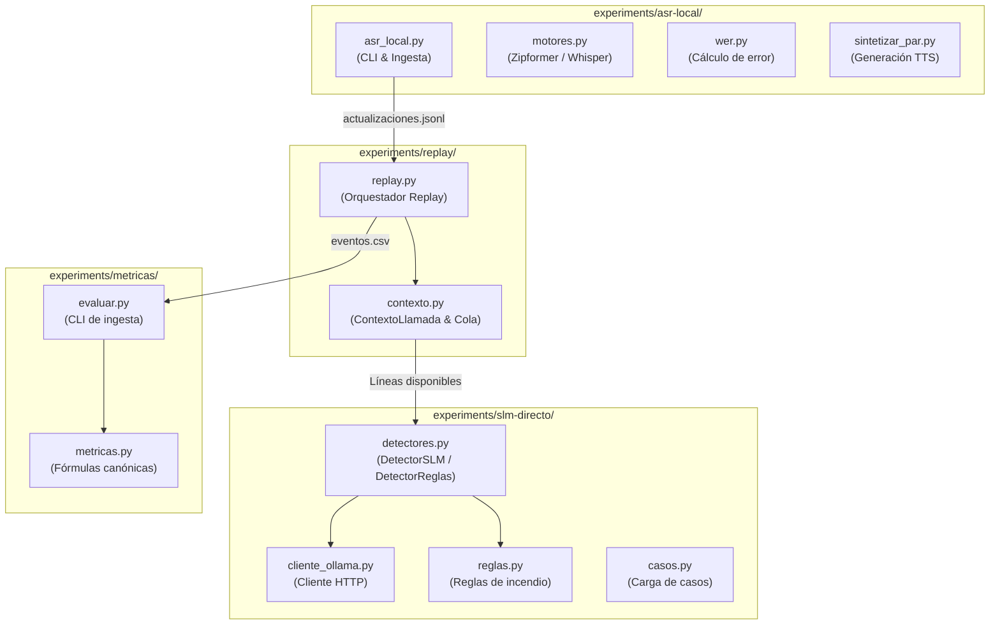

> **Estado: borrador.** Redactado el 2026-10-17 sobre la rama laboratorio-luciano; requiere revisión del equipo.

# Capítulo 6: Implementación del sistema

En este capítulo se describe la materialización del sistema experimental de detección incremental de vishing, detallando el conjunto de herramientas de software y versiones adoptadas, la organización modular del código fuente, las rutinas de automatización e inspección desarrolladas y las restricciones o limitaciones técnicas advertidas durante el proceso de implementación y ejecución en hardware de laboratorio.

---

## 6.1. Pila tecnológica y versiones del entorno de ejecución

El desarrollo del software se diseñó para operar de forma autocontenida sobre la biblioteca estándar de Python y un conjunto estrictamente acotado de librerías abiertas para inferencia de modelos neuronales en formato compilado. La experimentación se llevó a cabo sobre una estación de trabajo Apple Silicon (procesador Apple M1, 8 núcleos físicos de CPU, 8 GB de memoria RAM unificada, arquitectura ARM64, sistema operativo macOS Darwin 25.6.0) y complementariamente en entornos Windows 11 x86_64 con GPU para la ejecución de modelos de lenguaje mediante Ollama.

Las bibliotecas y runtimes utilizados, con sus números de versión reales extraídos de los manifiestos de corrida (`manifiesto.json`) y archivos de requerimientos (`requirements.txt`), se presentan en la siguiente tabla:

| Componente | Paquete / Runtime | Versión real verificada | Función en el sistema |
|---|---|---|---|
| **Lenguaje base** | `python` | `3.14.3` (ASR/Replay) / `3.11+` | Intérprete y entorno de ejecución del pipeline experimental. |
| **ASR Streaming** | `sherpa-onnx` | `1.13.8` | Motor de decodificación acústica de Zipformer basado en C++ y ONNX Runtime. |
| **Runtime ONNX** | `onnxruntime` | `1.31.0` | Ejecución optimizada de grafos computacionales en CPU con cuantización. |
| **ASR Comparador** | `faster-whisper` | `1.2.1` | Motor de transcripción por segmentos basado en CTranslate2 en precisión int8. |
| **E/S de Audio** | `soundfile` | `0.14.0` | Lectura de archivos WAV/FLAC y manipulación de arreglos PCM vía `libsndfile`. |
| **Cálculo matricial** | `numpy` | `2.5.4` (ASR) / `>=2.0.0` | Procesamiento de buffers acústicos y cálculo de energía RMS. |
| **Gestión de modelos** | `huggingface-hub` | `>=2.2.0` | Descarga automatizada y control de versiones de modelos preentrenados. |
| **Servidor de SLM** | `ollama` | `0.40.4` | Demonio local de inferencia de modelos de lenguaje con API REST HTTP. |
| **Modelos de lenguaje** | `qwen3.5:0.8b`, `2b`, `4b` | Versión HuggingFace GGUF | Familia de modelos generativos evaluados en escalera de tamaños. |
| **Herramientas de SO** | `ffmpeg` | Instalado en el sistema | Decodificación y conversión de formatos de audio en el entorno. |
| **Síntesis de voz** | `say` (macOS) | Nativo de plataforma | Generación de voces TTS en español de México (`Paulina`, `Mónica`) para humo. |
| **Pruebas de software** | `unittest` | Biblioteca estándar | Marco de pruebas unitarias y de integración sin dependencias externas. |

La elección de `sherpa-onnx` frente a frameworks pesados de entrenamiento como PyTorch obedece al estricto requerimiento de despliegue local: permite ejecutar transductores acústicos de última generación en CPUs convencionales sin arrastrar dependencias pesadas de compilación CUDA ni sobrecargar la huella de memoria residente.

---

## 6.2. Implementación por componente

El código de los experimentos se organiza de manera modular dentro del directorio `experiments/` del repositorio, dividiéndose en cuatro módulos funcionales altamente cohesivos:

### 6.2.1. Reconocimiento de voz local (`experiments/asr-local/`)

El módulo implementa un procedimiento repetible y estandarizado para la transcripción incremental de audio local:

1. **Orquestador de línea de comandos ([`asr_local.py`](../../experiments/asr-local/asr_local.py)):**
   - Ingiere archivos de audio monoaurales o estéreo a una frecuencia de muestreo normalizada de 16 kHz.
   - Divide la señal en bloques acústicos uniformes de duración configurable (`--bloque-ms 100`, 100 ms por defecto).
   - Dispone de dos modos de operación: el *modo rápido*, que procesa los bloques tan pronto como el hardware lo permite para optimizar corridas en lote; y el modo `--simular-tiempo-real`, que introduce demoras calibradas con `time.sleep` para reproducir fielmente el ritmo de emisión de una llamada en vivo.
   - Mide el consumo de recursos en tiempo real mediante `time.perf_counter()` para el tiempo de procesamiento y la llamada de sistema `resource.getrusage(resource.RUSAGE_SELF).ru_maxrss` para determinar el pico de memoria física residente (RSS).
2. **Jerarquía de motores acústicos ([`motores.py`](../../experiments/asr-local/motores.py)):**
   - Define la clase abstracta `MotorASR`, especificando la interfaz obligatoria: `inicializar()`, `procesar_bloque()`, `vaciar_final()` y `metadatos()`.
   - **`MotorZipformer`:** Implementa la decodificación continua con el modelo de Hugging Face [`csukuangfj/sherpa-onnx-streaming-zipformer-es-kroko-2025-08-06`](https://huggingface.co/csukuangfj/sherpa-onnx-streaming-zipformer-es-kroko-2025-08-06). Utiliza un transductor ONNX (`tokens.txt`, `encoder.onnx`, `decoder.onnx`, `joiner.onnx`) configurado para búsqueda codiciosa (*greedy search*), 4 hilos de CPU y 80 dimensiones de características MFCC. La segmentación de turnos combina la detección nativa de puntos finales (*endpointing*) del reconocedor (`rule1_silence=2.4`, `rule2_silence=1.0`, `rule3_utterance=20.0`) con una regla de energía RMS (`umbral_rms_silencio=0.005`) que dispara el cierre del segmento tras un silencio acumulado de 0.8 s (`corte_silencio_s`). Emite eventos de tipo `parcial` mientras el segmento está activo y un evento `final` al detectarse el corte.
   - **`MotorFasterWhisper`:** Implementa un comparador secundario segmentado con `faster-whisper-base` en precisión int8 para CPU. No opera en streaming real; acumula el audio por turnos mediante el filtro Voice Activity Detector (VAD) de Whisper (`min_silence_duration_ms=500`) y emite únicamente eventos finales tras transcribir el lote.
   - **`MotorFalso`:** Mock determinista que emite eventos parciales y finales programados a instantes temporales prefijados, permitiendo probar la lógica de downstream sin requerir modelos pesados.
3. **Cálculo de errores de transcripción ([`wer.py`](../../experiments/asr-local/wer.py)):**
   - Implementa el cálculo de la tasa de error por palabra ($WER$) y por carácter ($CER$) mediante alineación de cadenas con distancia de Levenshtein (programación dinámica).
   - Realiza normalización canónica de texto eliminando acentos (`unicodedata.normalize`), signos de puntuación y convirtiendo a minúsculas.
   - Incluye la función `analizar_palabras_clave()`, que verifica específicamente si términos determinantes para la detección de fraude (tales como `codigo`, `cero`, `sms`, `whatsapp`, `activacion`, `soporte`, `cuenta`) fueron transcritos correctamente o si sufrieron sustitución o eliminación.
4. **Generador de audio sintético de humo ([`sintetizar_par.py`](../../experiments/asr-local/sintetizar_par.py) / [`sintetizar_par.sh`](../../experiments/asr-local/sintetizar_par.sh)):**
   - Produce audio de prueba sin violar la privacidad a partir de los textos del par de WhatsApp (`SC-WA-CODE-01-e01` y `LG-WA-CONSULTA-01-e01`).
   - Utiliza la utilidad `say` de macOS asignando la voz `Paulina` (español de México) al interlocutor A y la voz `Mónica` al interlocutor B, con pausas artificiales de 1.0 s entre turnos para ejercitar la segmentación automática.
   - Genera tanto versiones monoaurales como archivos estéreo de 16 kHz donde el canal izquierdo corresponde exclusivamente a A y el derecho a B.

### 6.2.2. Contexto incremental y simulación de Replay (`experiments/replay/`)

El módulo de reproducción y gestión temporal se implementa en:

1. **Estructura de contexto y cola ([`contexto.py`](../../experiments/replay/contexto.py)):**
   - Modela la actualización de entrada en la dataclass inmutable `Actualizacion` (`llamada_id`, `n`, `tipo`, `segmento`, `texto`, `inicio_audio_s`, `fin_audio_s`, `disponible_s`, `proceso_ms`, `canal`).
   - La clase `ContextoLlamada` mantiene las listas `cerrados: list[Linea]` y el mapa `parciales: dict[int, Linea]`. En su método `aplicar()`, procesa la actualización y devuelve la tupla ordenada de líneas visibles.
   - En su método `registrar_evaluacion()`, implementa las ecuaciones de la cola secuencial:
     $$\text{inicio\_eval}_s = \max(\text{disponible\_s}, \text{ultimo\_fin\_eval\_s})$$
     $$\text{fin\_eval}_s = \text{inicio\_eval}_s + (\text{ms} / 1000.0)$$
     $$\text{espera\_cola\_ms} = (\text{inicio\_eval}_s - \text{disponible\_s}) \times 1000.0$$
   - Implementa la política de aviso único: si la respuesta del detector es válida y `alerta_sugerida == True`, y no se había emitido alerta previa (`aviso_emitido == False`), fija `aviso_t_a = fin_eval_s` y activa la bandera de aviso para esa línea. Si la respuesta es inválida, incrementa el contador `fallos` y almacena el motivo en `errores`.
2. **Ejecutor de replay ([`replay.py`](../../experiments/replay/replay.py)):**
   - Procesa flujos de audio ASR (`--actualizaciones`) o casos de texto directo (`--texto`).
   - En modo texto sin audio, garantiza el principio metodológico de no inventar segundos: las columnas de tiempo de audio quedan vacías y el aviso se referencia por número de línea.
   - Valida el canal de audio: si el JSONL contiene `canal == null`, conmuta de forma automática el parámetro de hablantes a `sin` para evitar atribuir letras arbitrarias al modelo.
   - Genera los artefactos de salida en el directorio especificado: `eventos.csv`, `manifiesto.json` y `resumen.md`.

### 6.2.3. Modelos de lenguaje directo y reglas heurísticas (`experiments/slm-directo/`)

La capa de detección lingüística implementa dos variantes complementarias:

1. **Detector con modelo de lenguaje local ([`detectores.py`](../../experiments/slm-directo/detectores.py) - `DetectorSLM`):**
   - Se comunica con el demonio de Ollama mediante llamadas HTTP POST a la ruta `/api/chat` implementadas en [`cliente_ollama.py`](../../experiments/slm-directo/cliente_ollama.py).
   - Configura las opciones del modelo: temperatura fija $0.0$, semilla pseudoaleatoria $42$, límite de ventana de contexto `num_ctx = 4096`, límite de predicción `num_predict = 512` y bandera de inhibición de razonamiento verbalizado (`think: false`).
   - **Control de desborde de contexto:** Debido a que Ollama trunca silenciosamente los textos que exceden la ventana sin arrojar error, el método `evaluar()` estima previamente la longitud en tokens ($(\text{longitud\_prompt} + \text{longitud\_usuario}) / 3$). Si supera el $90\ \%$ de `num_ctx`, detiene la invocación y emite una respuesta no válida con el error `contexto_excedido`.
   - **Forzado y validación de esquema:** Envía a la API el esquema estructurado `ESQUEMA_SALIDA` exigiendo un objeto JSON con cuatro propiedades obligatorias (`riesgo`, `alerta_sugerida`, `motivo`, `evidencia`). La función `validar_salida()` verifica exhaustivamente que el texto devuelto parsee como JSON, que los tipos coincidan, que `riesgo` esté acotado entre $0$ y $1$ y que una alerta sugerida posea obligatoriamente un motivo en texto.
   - **Verificación adversarial de evidencia:** La función `evidencia_en_texto()` normaliza la cita devuelta por el modelo y comprueba si cada uno de sus renglones existe literalmente dentro de la transcripción histórica disponible. Si el modelo inventa o parafrasea frases que no se pronunciaron, la bandera `evidencia_en_texto` se fija en `False`.
2. **Comparador de reglas de laboratorio ([`reglas.py`](../../experiments/slm-directo/reglas.py) / `DetectorReglas`):**
   - Reproduce fielmente las reglas heurísticas desarrolladas por Ignacio en el laboratorio (`experiments/laboratorio/rules.py`, commit `a39fca6`).
   - Agrupa los términos sospechosos en seis familias de patrones (`REQUEST_AUTH_CODE`, `REQUEST_SECRET`, `REQUEST_TRANSFER`, `REQUEST_PERSONAL_DATA`, `REQUEST_REMOTE_ACCESS`, `REQUEST_SECURITY_ACTION`).
   - La función `_cerca()` implementa coincidencia exacta para patrones cortos ($\le 5$ caracteres, como `pin`, `otp`, `cbu` o el término sensible `numeros`) y tolera una distancia Damerau-Levenshtein de hasta 1 edición (`_edicion1()`) en términos de 6 o más caracteres para absorber errores tipográficos o de transcripción ASR.
   - La función `_niega_el_pedido()` inhibe el disparo si la frase contiene expresiones de negación ("no te pido", "ningun", "no voy a dar"), excepto si la misma cláusula incorpora simultáneamente un verbo imperativo ("no cortes y decime").
   - `DetectorReglas` evalúa exclusivamente la última línea entregada; no conserva memoria de turnos pasados.

### 6.2.4. Módulo de métricas estandarizadas (`experiments/metricas/`)

Implementa en funciones puras y reutilizables la totalidad de las fórmulas de evaluación formal definidas en `METRICAS.md`:

- **Biblioteca matemática ([`metricas.py`](../../experiments/metricas/metricas.py)):**
  - `calcular_margen_lr(t_r, t_a)` y `calcular_margen_lc(t_c, t_a)`: Obtienen los márgenes de anticipación temporal ($L_R = T_R - T_A$ y $L_C = T_C - T_A$). Si no se emitió alerta ($T_A = \text{None}$), devuelven `None`.
  - `intervalo_wilson(k, n, confianza=0.95)`: Calcula el intervalo de confianza asimétrico de Wilson para proporciones binomiales (con corrección para denominadores acotados o proporciones en los extremos $0$ y $1$).
  - `resumen_distribucion(valores)`: Extrae mediana, cuartiles $Q_1$, $Q_3$ y rango intercuartílico $IQR = Q_3 - Q_1$, informando el número $n$ de muestras útiles.
  - `preventive_at(delta, referencia, casos_vishing)`: Computa la proporción de llamadas fraudulentas donde la alerta se anticipó al menos $\delta$ unidades al pedido o cumplimiento ($T_A \le X - \delta$, con $X \in \{T_R, T_C\}$). Las llamadas de vishing donde no hubo alerta se mantienen estrictamente en el denominador.
  - `tasa_falsas_alarmas(casos_legitimos)`: Determina la fracción de llamadas legítimas que sufrieron al menos una alerta espuria.
  - `precision_con_prevalencia(p, r, f)`: Aplica el teorema de Bayes para proyectar la precisión del sistema bajo prevalencias de fraude hipotéticas ($p \in \{0.1\%, 1\%, 5\%, 10\%, 50\%\}$) a partir del recall $r$ y la tasa de falsas alarmas $f$.
- **CLI de ingesta ([`evaluar.py`](../../experiments/metricas/evaluar.py)):**
  - Carga corridas de texto de `experiments/slm-directo/` o trazas de audio de `experiments/replay/`.
  - Empareja cada caso procesado con su ficha humana en `casos/referencia/*.json` mediante el identificador de conversación.
  - Genera informes comparativos consolidados en formato Markdown (`metricas.md`) y JSON estructurado (`metricas.json`).

---

## 6.3. Integración y automatización experimental

Para permitir que cualquier integrante del equipo o revisor reproduzca los experimentos en su propia máquina sin pasos manuales propensos a error, se implementó un conjunto de scripts de automatización e interfaces de usuario:

### 6.3.1. Scripts de demostración de un solo comando (`demo.sh` y `demo.ps1`)

El script de demostración interactiva (`experiments/slm-directo/demo.sh` para entornos Unix y `demo.ps1` para PowerShell en Windows) ejecuta la secuencia completa de despliegue:
1. Detecta la presencia de Python 3.9 o superior y consulta al usuario antes de instalar dependencias faltantes.
2. Comprueba el estado del servicio local de Ollama; si no se encuentra activo, asiste en su instalación y arranque.
3. Descarga el modelo objetivo predeterminado (`qwen3.5:2b` o el indicado por parámetro).
4. Ejecuta el conjunto de pruebas unitarias (`unittest`), garantizando que la lógica del cliente y los detectores sea correcta antes de consumir cómputo.
5. Ejecuta la inferencia sobre un conjunto balanceado de 8 conversaciones demostrativas (4 de vishing y 4 legítimas difíciles), imprimiendo en la terminal el diálogo incremental y las decisiones del detector.
6. Genera el informe `resumen.md` y compila de manera automática el visor web interactivo abriéndolo en el navegador del usuario.

### 6.3.2. Visor interactivo autónomo (`visor.py` y `visor_plantilla.html`)

El visor constituye una aplicación web estática autocontenida que no requiere conexión a Internet ni frameworks externos:
- El script [`visor.py`](../../experiments/slm-directo/visor.py) lee las trazas `actualizaciones.csv` y los manifiestos de una o varias corridas, inyecta los datos estructurados en formato JSON dentro de la plantilla [`visor_plantilla.html`](../../experiments/slm-directo/visor_plantilla.html) y produce un archivo HTML final autónomo.
- La interfaz permite seleccionar la llamada y el detector a inspeccionar, reproduciendo el avance del diálogo línea por línea.
- Muestra en paneles sincronizados:
  1. El texto acumulado disponible hasta la línea activa.
  2. La respuesta estructurada del modelo (nivel de riesgo, alerta sugerida, motivo y evidencia citada).
  3. La respuesta cruda devuelta por el motor de inferencia.
  4. Un gráfico dinámico en SVG que traza la curva de riesgo a lo largo de los turnos de la llamada.
  5. Una barra de advertencia destacada que señala el instante exacto en que se produjo el aviso de la llamada.
  6. La opción de alternar la visualización de las marcas de referencia humana para verificar la anticipación respecto a $T_R$ y $T_C$.

---

## 6.4. Limitaciones técnicas y desafíos encontrados

Durante la construcción e integración del pipeline experimental se identificaron cuatro limitaciones técnicas significativas que condicionan la arquitectura y el despliegue del sistema:

### 6.4.1. Cola de vaciado (*lookahead flush*) en Zipformer streaming

El transductor acústico Zipformer empleado en `sherpa-onnx` opera mediante bloques de atención con contexto a la derecha (*chunk-based streaming with right context / lookahead*). Esta arquitectura requiere que el modelo disponga de muestras acústicas posteriores a la palabra en curso para resolver la decodificación de los últimos fonemas.

En las primeras pruebas sobre audio continuo, se observó que cuando un hablante concluía su intervención y se producía un corte abrupto del stream (o al llegar al final del archivo de audio), la última palabra pronunciada quedaba retenida indefinidamente en el buffer interno del codificador sin llegar a transcribirse, provocando omisiones sistemáticas de términos clave situados al final de los turnos (como dígitos de verificación).

Para resolver esta limitación física del motor, se introdujeron dos mecanismos compensatorios en [`motores.py`](../../experiments/asr-local/motores.py#L192-L240):
1. **Purga ante endpoint:** Al detectarse un corte de segmento por silencio, el método `procesar_bloque()` inyecta programáticamente un bloque de 0.3 segundos de silencio digital (vector de ceros en `float32`) en el flujo antes de consultar el resultado definitivo `get_result()`, forzando al modelo a vaciar su ventana de lookahead.
2. **Cola de vaciado final extendida:** Al concluir la llamada, el método `vaciar_final()` inyecta una cola de 2.0 segundos de silencio antes de marcar `input_finished()`, garantizando la decodificación íntegra de la locución final sin truncamiento.

### 6.4.2. Ausencia de determinismo estricto en inferencia de SLM con GPU

A pesar de fijar parámetros de decodificación estrictamente deterministas en Ollama (temperatura $T = 0.0$, muestreo desactivado y semilla pseudoaleatoria fija `seed: 42`), la ejecución repetida de una misma configuración (`qwen3.5:2b`, prompt `tarea`, hablantes `ab`) sobre el conjunto de 53 casos en hardware con aceleración GPU arrojó resultados divergentes:
- En las corridas registradas el 2026-10-14 ([`172930`](../../experiments/slm-directo/corridas/2026-10-14_172930_demo-qwen3.5-2b/resumen.md) y [`175451`](../../experiments/slm-directo/corridas/2026-10-14_175451_demo-qwen3.5-2b/resumen.md)), 60 de las 464 líneas procesadas difirieron en el valor numérico de riesgo devuelto, y en 2 de las 53 conversaciones cambió la decisión final de alerta (en `LAB-pantalla-sin-programa` una corrida emitió aviso y la otra no; en `TR-09` el aviso se desplazó de la línea 6 a la línea 7).

Esta indeterminación proviene de las operaciones de reducción en punto flotante no asociativas y al paralelismo asincrónico a nivel de núcleos CUDA/GPU. Esto impone como regla metodológica que ningún experimento con modelos generativos en GPU puede respaldarse en una corrida única: es indispensable ejecutar repeticiones múltiples e informar la dispersión de los resultados.

### 6.4.3. Cuello de botella de latencia en CPU monohilo

Para evaluar la viabilidad de despliegue en dispositivos móviles que carecen de NPU o aceleración neuronal dedicada, se ejecutó una serie de pruebas forzando la inferencia exclusivamente en CPU limitada a 2 hilos (`--solo-cpu --hilos 2`, corrida `2026-10-14_191429_cpu-2hilos` documentada en `experiments/slm-directo/README.md`).

Los resultados empíricos demostraron un colapso del presupuesto temporal de tiempo real:
- En el modelo `qwen3.5:0.8b`, la latencia mediana por línea se elevó a 3.9 s (con un percentil 95 de 7.3 s y un máximo de 9.1 s).
- En el modelo `qwen3.5:2b`, la latencia mediana trepó a 8.2 s por línea (con un percentil 95 de 13.0 s y un máximo de 20.9 s).

Bajo este régimen de operación, la cola secuencial del detector acumula un atraso creciente respecto al ritmo natural del habla. Con el modelo de 2B parámetros, el aviso llega con una demora acumulada superior a 11.7 segundos después de pronunciada la frase crítica. Ambas configuraciones incumplen ampliamente el gate de prefactibilidad técnica de [PREFACTIBILIDAD-TECNICA.md](../investigacion/PREFACTIBILIDAD-TECNICA.md), el cual exige un percentil $p95 \le 1.5\ \text{s}$ y declara inaceptable cualquier valor superior a 2.0 s. Esta evidencia técnica descarta la factibilidad de ejecutar un modelo de lenguaje de 2B parámetros turno a turno sobre CPU móvil convencional sin aceleración especializada por hardware.

### 6.4.4. Truncamiento silencioso de contexto en servidores de inferencia

Un hallazgo crítico de implementación radica en el comportamiento de los motores de inferencia locales frente al desborde de la ventana de contexto: ante prompts que exceden el tamaño máximo (`num_ctx`), Ollama trunca silenciosamente el texto inicial sin retornar un código de error HTTP ni alertar en la respuesta. En un sistema de detección de vishing, este comportamiento provocaría la pérdida inadvertida de las frases iniciales de suplantación de identidad (como "le hablo del banco"), degradando la capacidad del clasificador.

Para neutralizar este defecto, el código de `DetectorSLM` implementa una salvaguarda algorítmica preventiva: estima el volumen de tokens antes de despachar la petición HTTP; si el texto acumulado supera el $90\ \%$ de la capacidad del contexto, interrumpe el procesamiento y califica la actualización como un fallo explícito (`contexto_excedido`), preservando la integridad del registro de auditoría.
