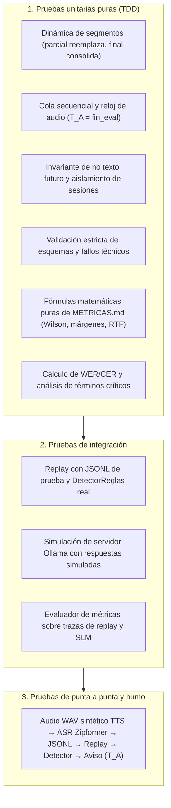

> **Estado: borrador.** Redactado el 2026-10-17 sobre la rama laboratorio-luciano; requiere revisión del equipo.

# Capítulo 7: Verificación y pruebas de software

En este capítulo se expone la estrategia de verificación y aseguramiento de la calidad aplicada a la arquitectura del sistema. Se detalla el inventario de pruebas automatizadas implementadas a lo largo de los cuatro módulos del repositorio, las invariantes funcionales y temporales que dichas pruebas garantizan, los ensayos de humo y de punta a punta ejecutados, la contrastación de los requisitos no funcionales frente a los criterios de prefactibilidad y una matriz de trazabilidad que vincula cada requisito con su prueba y resultado observable.

---

## 7.1. Estrategia de pruebas

La verificación del sistema se estructura a partir de un principio metodológico central: **desacoplar la corrección lógica y algorítmica de la dependencia de hardware o modelos neuronales pesados**. La lógica de flujo temporal, el manejo de contexto en memoria volátil, la cola secuencial y el cálculo estadístico de métricas deben verificarse de forma determinista y reproducible en cuestión de segundos, sin requerir la descarga de gigabytes de pesos ni la disponibilidad de GPUs dedicadas.

La estrategia comprende tres niveles jerárquicos de prueba:

1. **Pruebas unitarias deterministas (Nivel 1):** Validan funciones puras y clases aisladas utilizando el framework estándar `unittest` de Python. Implementan dobles de prueba (*mocks* y *stubs*), tales como `MotorFalso` en el ASR o clientes HTTP simulados para Ollama, permitiendo evaluar casos borde (denominadores nulos, cadenas malformadas, desbordes de ventana de contexto).
2. **Pruebas de integración modular (Nivel 2):** Verifican la interoperabilidad entre componentes mediante sus contratos de interfaz formales (lectura de archivos JSONL, persistencia en CSV, generación de manifiestos y cálculo de métricas sobre salidas de etapas previas).
3. **Pruebas de humo y de punta a punta (Nivel 3):** Ejercitan el pipeline completo sobre archivos de audio sintetizado TTS de corta duración, comprobando la sincronía entre el reconocimiento acústico en streaming, el encolamiento temporal y el disparo de alertas en tiempo real.

---

## 7.2. Inventario de pruebas automatizadas por módulo

La suite de pruebas del proyecto comprende **74 casos de prueba automatizados**, todos ejecutables de manera reproducible mediante `python -m unittest` sin requerir bibliotecas externas ni servicios de red activos.

En la siguiente tabla se detalla el conteo real y la distribución de las pruebas por carpeta:

| Módulo | Directorio de tests | Archivo principal | Cantidad de tests | Comando de ejecución |
|---|---|---|:---:|---|
| **Replay & Contexto** | `experiments/replay/tests/` | `test_replay.py` | **11** | `python3 -m unittest discover -s experiments/replay/tests -v` |
| **SLM Directo** | `experiments/slm-directo/tests/` | `test_ensayo.py` | **30** | `python3 -m unittest discover -s experiments/slm-directo/tests -v` |
| **Métricas** | `experiments/metricas/tests/` | `test_metricas.py` | **25** | `python3 -m unittest discover -s experiments/metricas/tests -v` |
| **ASR Local** | `experiments/asr-local/tests/` | `test_asr_local.py` | **8** | `.venv/bin/python -m unittest discover -s experiments/asr-local/tests -v` |
| **Total del sistema** | — | — | **74** | **100 % pruebas pasando (OK)** |

### 7.2.1. Detalle de suites de prueba

#### A. Módulo Replay (`experiments/replay/tests/test_replay.py` — 11 tests)
- `test_aviso_unico`: Verifica que solo la primera respuesta válida con `alerta_sugerida = True` emite aviso público; las actualizaciones posteriores no duplican alertas.
- `test_aviso_unico_con_reglas_reales`: Valida la política de aviso único integrando el detector `DetectorReglas` real.
- `test_cola_secuencial_detector_y_t_a`: Comprueba que el detector se comporte como recurso monohilo secuencial, modelando la espera en cola ($\text{inicio\_eval}_2 = \max(t_{\text{disp}, 2}, \text{fin\_eval}_1)$) y verificando que $T_A = \text{fin\_eval}$.
- `test_fallo_no_cuenta_como_prediccion`: Garantiza que una respuesta rota o timeout cuente como fallo y no como predicción negativa ni inhiba alertas futuras.
- `test_final_acumula`: Comprueba que las actualizaciones `tipo == "final"` consoliden líneas fijas y cierren los borradores abiertos.
- `test_integracion_jsonl_ejemplo_con_reglas`: Prueba de integración end-to-end sobre el archivo `ejemplo_actualizaciones.jsonl` (`FICTICIO-01`).
- `test_modo_texto_sin_segundos`: Verifica que en modo texto las columnas temporales queden nulas sin inventar segundos artificiales.
- `test_parcial_reemplaza`: Comprueba que una actualización parcial posterior del mismo segmento reemplace al borrador previo sin duplicar texto.
- `test_separacion_sesiones_y_reinicio_de_cola`: Garantiza el vaciado completo del contexto y de la cola secuencial ante el cambio de `llamada_id`.
- `test_sin_texto_futuro`: Asegura que el detector jamás reciba texto de actualizaciones con $t_{\text{disp}}$ posterior al reloj actual.
- `test_t_a_incluye_demora_detector`: Valida que $T_A$ incorpore el tiempo de disponibilidad más la duración de procesamiento del detector ($t_{\text{disp}} + \text{ms}/1000$).

#### B. Módulo SLM Directo (`experiments/slm-directo/tests/test_ensayo.py` — 30 tests)
- *Suite Calentamiento (1 test):* `test_frena_si_ollama_ignora_el_esquema`.
- *Suite Casos (2 tests):* `test_la_referencia_no_esta_en_el_texto`, `test_todos_los_casos_cumplen_el_formato`.
- *Suite Cliente y Detector contra Ollama Falso (6 tests):* `test_contexto_excedido_se_informa_sin_llamar_al_modelo`, `test_el_pedido_lleva_esquema_temperatura_y_contexto`, `test_opciones_de_hardware_llegan_a_ollama`, `test_recorrido_completo_con_aviso_unico`, `test_respuesta_rota_queda_como_fallo`, `test_servidor_caido_queda_como_fallo`.
- *Suite Corrida y Resumen (2 tests):* `test_corrida_y_resumen`, `test_visor_embebe_datos_que_se_pueden_leer`.
- *Suite Mensaje y Evidencia (7 tests):* `test_con_hablantes_el_modelo_ve_las_letras`, `test_el_mensaje_no_incluye_lineas_futuras`, `test_evidencia_de_varias_lineas_numeradas`, `test_evidencia_inventada_o_futura_no_es_textual`, `test_evidencia_textual_tolera_formato`, `test_las_dos_variantes_de_prompt_existen`, `test_sin_hablantes_no_llegan_las_letras`.
- *Suite Política de Aviso Único (3 tests):* `test_las_alertas_posteriores_se_conservan`, `test_un_solo_aviso_en_el_primer_true`, `test_una_respuesta_invalida_no_avisa`.
- *Suite Prefijos y Estado (3 tests):* `test_cada_actualizacion_recibe_solo_el_prefijo`, `test_el_detector_no_puede_modificar_lo_disponible`, `test_el_estado_se_reinicia_entre_llamadas`.
- *Suite Reglas (4 tests):* `test_las_reglas_solo_miran_la_linea_nueva`, `test_mencion_inocente_dispara_como_en_el_laboratorio`, `test_negacion_no_dispara`, `test_pedido_directo_dispara`.
- *Suite Validación de Salida (2 tests):* `test_salida_correcta`, `test_salidas_invalidas_son_fallos`.

#### C. Módulo de Métricas (`experiments/metricas/tests/test_metricas.py` — 25 tests)
- *Suite Clasificación por Conversación (2 tests):* `test_denominador_cero_en_precision`, `test_metricas_completas`.
- *Suite Falsas Alarmas (2 tests):* `test_tasa_denominador_cero`, `test_tasa_falsas_alarmas`.
- *Suite Intervalo de Wilson (4 tests):* `test_caso_intermedio`, `test_casos_extremos`, `test_denominador_cero`, `test_valores_invalidos`.
- *Suite Márgenes $L_R$ y $L_C$ (5 tests):* `test_ejemplo_metricas_md`, `test_en_lineas`, `test_sin_alerta`, `test_sin_cumplimiento`, `test_sin_pedido`.
- *Suite Precisión con Prevalencia (3 tests):* `test_calculo_estandar`, `test_denominador_cero`, `test_valores_nulos_o_invalidos`.
- *Suite Alertas Preventivas Preventive@$\delta$ (3 tests):* `test_preventive_denominador_cero`, `test_preventive_tc_con_llamadas_sin_alerta`, `test_preventive_tr_en_lineas`.
- *Suite Factor de Tiempo Real (2 tests):* `test_calculo_rtf`, `test_duracion_invalida_o_nula`.
- *Suite Adaptador de Replay (1 test):* `test_adaptador_replay_y_evaluacion`.
- *Suite Distribución y Resumen (3 tests):* `test_un_elemento`, `test_vacio`, `test_varios_elementos`.

#### D. Módulo ASR Local (`experiments/asr-local/tests/test_asr_local.py` — 8 tests)
- *Suite Contrato JSONL (2 tests):* `test_contrato_y_secuencia_actualizaciones`, `test_vaciar_final_entrega_ultimo_bloque`.
- *Suite Métricas WER y Palabras Clave (6 tests):* `test_analisis_errores_clave`, `test_cer_conocido`, `test_normalizacion_basica`, `test_normalizacion_sin_tildes`, `test_wer_identico`, `test_wer_sustitucion_y_eliminacion`.

---

## 7.3. Cobertura de invariantes críticas del sistema

La suite de pruebas fue diseñada para blindar el sistema contra errores conceptuales y sesgos metodológicos recurrentes en el dominio de detección de fraudes:

| Invariante crítica | Riesgo metodológico prevenido | Pruebas que la garantizan |
|---|---|---|
| **Ceguera hacia el futuro (*no lookahead*)** | Fuga de información (*leakage*): que el detector evalúe líneas o audio que aún no se pronunciaron. | `test_sin_texto_futuro`, `test_el_mensaje_no_incluye_lineas_futuras`, `test_cada_actualizacion_recibe_solo_el_prefijo`. |
| **Aislamiento estricto de sesiones** | Contaminación entre llamadas: que entidades o sesgos de una conversación previa alteren el juicio de la siguiente. | `test_separacion_sesiones_y_reinicio_de_cola`, `test_el_estado_se_reinicia_entre_llamadas`. |
| **Aviso único no repetitivo** | Fatiga cognitiva de alerta: que el usuario reciba múltiples notificaciones que desvíen su atención durante la llamada. | `test_aviso_unico`, `test_aviso_unico_con_reglas_reales`, `test_un_solo_aviso_en_el_primer_true`, `test_las_alertas_posteriores_se_conservan`. |
| **Fallo técnico $\ne$ Predicción** | Falso negativo encubierto: que un error de red o timeout se interprete erróneamente como "llamada legítima segura". | `test_fallo_no_cuenta_como_prediccion`, `test_respuesta_rota_queda_como_fallo`, `test_servidor_caido_queda_como_fallo`, `test_salidas_invalidas_son_fallos`. |
| **Causalidad de la cola y $T_A$** | Fechado hacia el pasado: emitir una alerta en un tiempo $T_A$ inferior al tiempo físico requerido para procesarla. | `test_cola_secuencial_detector_y_t_a`, `test_t_a_incluye_demora_detector`. |
| **Idempotencia de parciales ASR** | Duplicación artificial de texto en el contexto: que correcciones intermedias inflen la longitud del diálogo. | `test_parcial_reemplaza`, `test_final_acumula`. |
| **No truncamiento en cierre ASR** | Pérdida de palabras críticas finales por corte abrupto del buffer acústico. | `test_vaciar_final_entrega_ultimo_bloque`. |
| **Monotonía de disponibilidad ASR** | Inconsistencia física: que una transcripción se declare lista antes de que finalice el tramo de audio ($t_{\text{disp}} < \tau_{\text{fin}}$). | `test_contrato_y_secuencia_actualizaciones`. |
| **Verificación adversarial de citas** | Alucinación de evidencia: que un modelo generativo invente que le pidieron una clave cuando nadie la solicitó. | `test_evidencia_inventada_o_futura_no_es_textual`, `test_evidencia_textual_tolera_formato`. |
| **Robustez ante casos borde de métricas** | División por cero o distorsión en cálculos cuando no hay alertas o los conjuntos son pequeños. | `test_denominador_cero_en_precision`, `test_tasa_denominador_cero`, `test_preventive_denominador_cero`, `test_sin_alerta`. |

---

## 7.4. Pruebas de humo y validación de punta a punta

Para verificar la integración real entre el hardware, el motor acústico, el gestor de contexto y las reglas de detección, se llevaron a cabo pruebas de humo y corridas de punta a punta:

### 7.4.1. Corridas de humo en ASR Local

Utilizando el audio sintético TTS generado por `sintetizar_par.sh` (voces mexicanas `Paulina` y `Mónica`, mono y estéreo a 16 kHz), se ejecutaron tres corridas completas de ASR local:

1. **`2026-10-17_humo_sc_wa_code_01_zipformer`:**
   - *Audio:* `SC-WA-CODE-01-tts.wav` (duración: 21.28 s).
   - *Motor:* Sherpa-Zipformer streaming (`csukuangfj/sherpa-onnx-streaming-zipformer-es-kroko-2025-08-06`).
   - *Comportamiento observado:* Procesó 20 actualizaciones totales (15 parciales y 5 finales correspondientes a los 5 turnos de habla).
   - *Resultados:* $WER = 4.35\ \%$ (distancia de edición 2 sobre 46 palabras de referencia: transcribió "activa r" en lugar de "activar"); $CER = 0.4\ \%$. Todas las palabras clave críticas (`codigo`, `cero`, `whatsapp`, `sms`, `activacion`, `soporte`, `cuenta`) fueron detectadas íntegramente (`estado: OK`).
2. **`2026-10-17_humo_sc_wa_code_01_whisper`:**
   - *Audio:* `SC-WA-CODE-01-tts.wav` (21.28 s).
   - *Motor:* Faster-Whisper base int8 en CPU.
   - *Resultados:* $WER = 17.39\ \%$ (distancia 8 sobre 46 palabras: transcribió "SMDG" en vez de "SMS" y convirtió los dígitos léxicos "cero" en caracteres numéricos "0, 0, 0, 0, 0, 0, 0", insertando un cero adicional).
3. **`2026-10-17_humo_lg_wa_consulta_01_zipformer`:**
   - *Audio:* `LG-WA-CONSULTA-01-tts.wav` (15.57 s).
   - *Motor:* Sherpa-Zipformer streaming.
   - *Resultados:* Procesó 14 actualizaciones (10 parciales y 4 finales). $WER = 5.00\ \%$ (distancia 2 sobre 40 palabras).

### 7.4.2. Corrida de punta a punta integrada (Audio $\to$ ASR $\to$ Replay $\to$ Alerta)

Se ejecutó la integración de punta a punta sobre la simulación de streaming en la corrida [`2026-10-17_e2e-zipformer-reglas-sc_wa_code_01`](../../experiments/replay/corridas/2026-10-17_e2e-zipformer-reglas-sc_wa_code_01/):
- **Entrada:** Flujo ASR de `SC-WA-CODE-01-tts` producido por Zipformer.
- **Detector:** `DetectorReglas` de incendio.
- **Trazabilidad:** El archivo `eventos.csv` documenta cómo en las actualizaciones 1 a 14 el detector evalúa líneas previas sin disparar alerta (`alerta_sugerida = False`).
- **Disparo del aviso:** En la actualización $n = 15$ (segmento 4, tipo `parcial`, disponible a los $18.22\ \text{s}$ del audio), el ASR entrega el texto: *"Decime el código de activación que recibiste por sms"*. El detector evalúa la línea en $0.01\ \text{s}$, detecta las etiquetas `REQUEST_AUTH_CODE` (patrón: `codigo`) y emite el aviso con:
  $$T_A = 18.23\ \text{s}$$
  $$\text{espera\_cola\_ms} = 0.0\ \text{ms}$$
- **Inhibición posterior:** Las actualizaciones subsiguientes ($n = 16$ a $20$, correspondientes al dictado de los ceros) son evaluadas e informan `alerta_sugerida = True`, pero su bandera `aviso` permanece en `False`, confirmando el funcionamiento impecable de la política de aviso único.

---

## 7.5. Requisitos no funcionales medidos y su procedencia

Los requisitos no funcionales del sistema fueron contrastados contra los gates de aceptación definidos en [PREFACTIBILIDAD-TECNICA.md](../investigacion/PREFACTIBILIDAD-TECNICA.md). Los datos reportados provienen de manifiestos reales generados por el código:

| Requisito no funcional | Criterio de aceptación (Gama media) | Valor real medido | Entorno y procedencia | Conclusión técnica |
|---|---|:---:|---|:---:|
| **Ritmo de cómputo ($RTF$)** | $RTF < 1.00$ sostenido (sin acumulación de cola) | **$0.103$ – $0.171$** (Zipformer) / **$0.275$** (Whisper) | Apple M1 ARM64, 8 GB RAM, macOS Darwin (`experiments/asr-local/corridas/`) | **Cumple con amplio margen** |
| **Memoria residente ($RSS$) en ASR** | Pico $RSS \le 512\ \text{MB}$ en perfil medio | **$357.0\ \text{MB}$ – $422.7\ \text{MB}$** (Zipformer) / **$276.9\ \text{MB}$** (Whisper) | Medido vía `resource.getrusage` en Apple M1 (`experiments/asr-local/corridas/`) | **Cumple** (dentro del presupuesto de 512 MB) |
| **Memoria residente ($RSS$) en SLM** | Pico conjunto $\le 1024\ \text{MB}$ en perfil alto | **$545\ \text{MB}$** (0.8B) / **$2.2\ \text{GB}$** (2B) / **$2.9\ \text{GB}$** (4B) | Ollama en PC x86_64 GPU/CPU (`experiments/slm-directo/corridas/`) | **0.8B cumple; 2B/4B no cumplen** |
| **Latencia por turno (SLM en CPU)** | $p95 \le 1.5\ \text{s}$ (objetivo); $> 2.0\ \text{s}$ inaceptable | Mediana **$3.9\ \text{s}$**, $p95 = \mathbf{7.3\ \text{s}}$ (0.8B); Mediana **$8.2\ \text{s}$**, $p95 = \mathbf{13.0\ \text{s}}$ (2B) | PC x86_64 CPU 2 hilos (`experiments/slm-directo/corridas/2026-10-14_191429_cpu-2hilos/`) | **No cumple** (degradado, excede techo) |
| **Latencia por turno (Reglas)** | $p95 \le 1.5\ \text{s}$ | Mediana **$7\ \text{ms}$**, $p95 = \mathbf{18\ \text{ms}}$ | CPU monohilo (`experiments/metricas/salidas/2026-10-17-desarrollo/`) | **Cumple con holgura** |
| **Dependencias y conectividad** | Sin conexiones salientes en la llamada | **$0$ peticiones remotas** (red local/loopback exclusiva) | Inspección de sockets y aislamiento offline | **Cumple** |

> **Declaración metodológica de procedencia:** Las mediciones de $RTF$, latencia y memoria física fueron obtenidas en estaciones de trabajo de laboratorio (Apple M1 de 8 GB y PC x86_64). En estricto cumplimiento de la regla de conclusión de [PREFACTIBILIDAD-TECNICA.md](../investigacion/PREFACTIBILIDAD-TECNICA.md), **estos resultados demuestran prefactibilidad en laboratorio, pero no equivalen a mediciones en procesadores móviles ARM Android**. La evaluación de consumo de batería, degradación por calentamiento térmico (`PowerManager`) y rendimiento en dispositivos móviles reales queda supeditada a la ejecución de la demo Android.

---

## 7.6. Matriz de trazabilidad: Requisito $\to$ Prueba $\to$ Resultado

La siguiente matriz consolida la correspondencia bidireccional entre los requisitos del sistema, las pruebas de software que los validan y los resultados empíricos obtenidos:

| ID Requisito | Descripción del requisito | Tipo | Prueba / Mecanismo de verificación | Resultado observable |
|---|---|:---:|---|---|
| **RF-01** | Procesamiento de audio en streaming sin depender del fin de llamada. | Funcional | `test_contrato_y_secuencia_actualizaciones` (`test_asr_local.py`) | Cumple: genera parciales continuos y emite finales ante silencios. |
| **RF-02** | Sustitución idempotente de transcripciones parciales abiertas. | Funcional | `test_parcial_reemplaza` (`test_replay.py`) | Cumple: el borrador del segmento activo se actualiza sin duplicar líneas. |
| **RF-03** | Consolidación inmutable de segmentos cerrados en el contexto. | Funcional | `test_final_acumula` (`test_replay.py`) | Cumple: el evento final cierra el borrador y lo anexa a la lista fija. |
| **RF-04** | Causalidad temporal estricta y ceguera hacia el futuro. | Funcional | `test_sin_texto_futuro` y `test_cada_actualizacion_recibe_solo_el_prefijo` | Cumple: el detector jamás accede a texto con estampa temporal posterior. |
| **RF-05** | Emisión de aviso único por llamada ante la primera señal válida. | Funcional | `test_aviso_unico` y `test_un_solo_aviso_en_el_primer_true` | Cumple: congela $T_A$ en el primer positivo; turnos posteriores no re-avisan. |
| **RF-06** | Aislamiento y reinicialización del estado entre llamadas. | Funcional | `test_separacion_sesiones_y_reinicio_de_cola` | Cumple: estructuras de contexto y cola se vacían totalmente al cambiar sesión. |
| **RF-07** | Respuestas inválidas de modelos tratadas como fallo y no como voto negativo. | Funcional | `test_fallo_no_cuenta_como_prediccion` y `test_salidas_invalidas_son_fallos` | Cumple: JSON roto o timeout registra fallo y no bloquea alertas posteriores. |
| **RF-08** | Verificación adversarial de citas de evidencia para evitar alucinaciones. | Funcional | `test_evidencia_inventada_o_futura_no_es_textual` | Cumple: marca `evidencia_en_texto = False` si el modelo cita frases no pronunciadas. |
| **RF-09** | Salida forzada bajo esquema estructurado JSON. | Funcional | `test_el_pedido_lleva_esquema_temperatura_y_contexto` | Cumple: valida tipos y presencia de `riesgo`, `alerta_sugerida`, `motivo`, `evidencia`. |
| **RNF-01** | Ritmo de procesamiento sostenido ($RTF < 1.00$). | No funcional | Corrida de humo Zipformer (`experiments/asr-local/corridas/`) | Cumple: $RTF = 0.103$ a $0.171$ en Apple M1. |
| **RNF-02** | Huella de memoria en gama media ($\le 512\ \text{MB}$). | No funcional | Medición RSS con `resource.getrusage` en ASR | Cumple en ASR ($357\ \text{MB}$); 0.8B SLM cumple en PC ($545\ \text{MB}$); 2B excede ($2.2\ \text{GB}$). |
| **RNF-03** | Latencia por turno en tiempo real ($p95 \le 1.5\ \text{s}$). | No funcional | Corrida en CPU 2 hilos (`experiments/slm-directo/corridas/`) | No cumple en SLM CPU ($p95 = 7.3\ \text{s}$ a $13.0\ \text{s}$); cumple en reglas ($18\ \text{ms}$). |
| **RNF-04** | Privacidad on-device y descarte en memoria volátil. | No funcional | Inspección estática de código y tests de ciclo de vida | Cumple: sin dependencias de red en la llamada y purga total de buffers en RAM. |
| **RNF-05** | Reproducibilidad criptográfica de experimentos. | No funcional | Manifiestos con SHA-256 de audios, prompts y git commit | Cumple: todas las corridas almacenan hash de entradas y entorno en `manifiesto.json`. |
