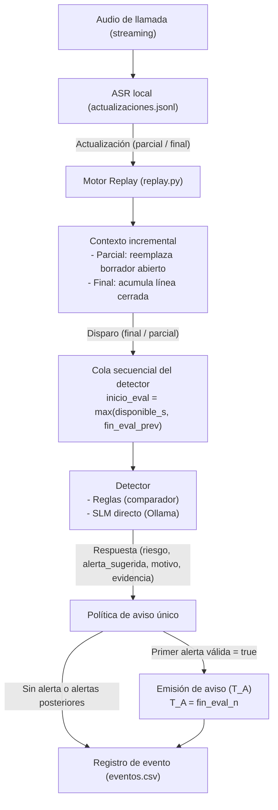

# Replay incremental: integración de ASR, contexto y detector (#28)

Herramienta de simulación de streaming para evaluar el pipeline completo de detección
incremental de vishing: consume actualizaciones de ASR (o casos de texto), mantiene el
contexto acumulado de la llamada, invoca el detector (reglas de laboratorio o SLM local)
y aplica la política de aviso único, midiendo el instante efectivo de aviso (`T_A`) en el reloj
de la llamada con modelado de cola secuencial.

---

## 1. Recorrido del flujo (Arquitectura)



---

## 2. Cómo correrlo

El script principal es `replay.py`. Acepta dos modos de entrada mutuamente excluyentes:
streaming de audio ASR (`--actualizaciones`) y casos de texto sin audio (`--texto`).

### A. Simulación de audio ASR (JSONL)

Con detector de reglas de laboratorio sobre el archivo de prueba ficticio `FICTICIO-01`:
```bash
python replay.py \
  --actualizaciones tests/datos/ejemplo_actualizaciones.jsonl \
  --detector reglas \
  --salida corridas/demo_reglas
```

Con SLM local (requiere Ollama activo con el modelo descargado):
```bash
python replay.py \
  --actualizaciones tests/datos/ejemplo_actualizaciones.jsonl \
  --detector slm \
  --modelo qwen3.5:2b \
  --prompt tarea \
  --hablantes ab \
  --disparo final \
  --salida corridas/demo_slm
```

> **Nota para macOS y modelos Qwen 3.5:** En macOS (Apple Silicon), las etiquetas de Ollama sin sufijo descargan la variante MLX, que no soporta salida estructurada (`format: json`) en Ollama 0.40.5; se deben usar etiquetas GGUF explícitas (p. ej. `qwen3.5:0.8b-q8_0` o `qwen3.5:2b-q8_0`). Asimismo, `replay.py` comparte la negociación de `pensar=False` (`think: false` vía `correr.calentar`) para evitar que el razonamiento interno de Qwen 3.5 consuma el límite de tokens y genere fallos por `salida_cortada`.

### B. Modo texto sin audio

Reproduce un caso de `experiments/slm-directo/casos/texto/`:
```bash
python replay.py \
  --texto ../slm-directo/casos/texto/LAB-whatsapp-codigo.txt \
  --detector reglas \
  --salida corridas/demo_texto
```

### Parámetros principales

| Parámetro | Valores | Por defecto | Descripción |
|---|---|---|---|
| `--actualizaciones` | ruta `.jsonl` | — | Flujo de actualizaciones del contrato ASR. |
| `--texto` | ruta `.txt` | — | Caso de texto de diálogo directo. |
| `--detector` | `reglas`, `slm` | Obligatorio | Detector a evaluar. |
| `--modelo` | texto | `qwen3.5:2b` | Modelo SLM para Ollama. |
| `--prompt` | `tarea`, `tarea+base` | `tarea` | Variante del prompt del sistema. |
| `--hablantes` | `ab`, `sin` | `ab` | Con etiquetas A/B o texto ciego. Acepta canales A/B anteriores o roles `protegida`/`otra` del registro en vivo: A es el primer rol con texto, incluidos parciales, y la asignación se reinicia por llamada. Si el audio no tiene canal, conmuta automáticamente a `sin`. |
| `--disparo` | `final`, `parcial` | `final` | Invoca el detector solo en segmentos cerrados (`final`) o en cada actualización (`parcial`). |
| `--salida` | ruta directorio | Obligatorio | Carpeta donde se guardan los artefactos. |
| `--seed` | entero | `42` | Semilla para SLM (`no-aplica` para reglas). |

---

## 3. Política de aviso único y cola del detector

> **Estado: propuesta sin discutir.** Ver [D08](../../docs/gestion/MAPA-DECISIONES.md#d08--congelar-protocolo-experimental).

En este ensayo se aplica la política `aviso_unico_primer_true_valido` con un detector modelado como único recurso secuencial:
1. El detector evalúa lo disponible hasta el instante actual `disponible_s`.
2. Una evaluación no puede comenzar antes de que finalice la anterior. En el reloj de audio:
   $$\text{inicio\_eval}_n = \max(\text{disponible\_s}_n, \text{fin\_eval}_{n-1})$$
   $$\text{fin\_eval}_n = \text{inicio\_eval}_n + \frac{\text{ms}_n}{1000}$$
   $$\text{espera\_cola\_ms} = (\text{inicio\_eval}_n - \text{disponible\_s}_n) \times 1000$$
3. El primer resultado válido con `alerta_sugerida = True` emite el aviso de la llamada en su instante de fin de cómputo:
   $$T_A = \text{fin\_eval}_n$$
4. Respuestas inválidas (error de JSON, recorte de contexto o timeout) cuentan como **fallos**, nunca como predicción, y no impiden que una actualización posterior válida genere el aviso.
5. Una vez emitido el aviso, las actualizaciones posteriores se siguen registrando pero tienen `aviso = false`.
6. En modo texto, no hay reloj de audio: las columnas de tiempo quedan vacías y el aviso informa el turno/línea correspondiente.
7. La cola de procesamiento se reinicia completamente entre llamadas distintas.

---

## 4. Qué registra cada corrida

Cada ejecución en `--salida <dir>` produce tres archivos:

1. **`eventos.csv`**: traza fila a fila de cada actualización:
   - `llamada_id`, `n`, `tipo` (`parcial`/`final`), `segmento`, `canal`, `texto`.
   - `texto_disponible_resumido`: texto acumulado disponible en ese instante exacto.
   - `inicio_audio_s`, `fin_audio_s`, `disponible_s`.
   - `inicio_eval_s`, `fin_eval_s`, `espera_cola_ms`: modelado temporal de la cola secuencial.
   - `ms_detector`, `riesgo`, `alerta_sugerida`, `motivo`, `evidencia`, `valida`, `error`.
   - `aviso` (`true`/`false`), `t_a` (segundos del audio si emite aviso).
2. **`manifiesto.json`**: procedencia técnica completa:
   - Hash SHA-256 del archivo de entrada y tamaño en bytes.
   - Configuración completa (detector, modelo, prompt, hablantes, disparo, seed o no-aplica).
   - Metadatos de ASR (`asr_meta`) si venían en la cabecera del JSONL.
   - Hash de commit git y estado de cambios en el repositorio.
   - Datos de hardware de la máquina de ejecución (SO, CPU, núcleos, RAM, versión de Python).
3. **`resumen.md`**: reporte sintetizado:
   - Si hubo aviso, instante `T_A`, motivo, evidencia y actualización desencadenante.
   - Transcripción completa disponible al momento exacto del aviso (permite auditar qué información provocó la alerta).
   - Espera máxima en cola y atraso del detector respecto del flujo de audio.
   - Total de actualizaciones, evaluaciones, fallos y tiempos de respuesta.

---

## 5. Límites y alcance metodológico

- **Datos de prueba ficticios:** el archivo `tests/datos/ejemplo_actualizaciones.jsonl` contiene la llamada sintética `FICTICIO-01` escrita a mano para pruebas unitarias y de humo, no audio real de ASR.
- **Sin etiquetas de referencia en runtime:** el runner jamás recibe clases (`vishing`/`legítima`), escenarios, roles ni marcas humanas (`T_R`/`T_C`). La evaluación contra referencia humana se realiza en etapas posteriores de análisis.
- **Sin segundos inventados en texto:** en modo `--texto` los tiempos quedan en blanco; no se asumen duraciones artificiales por palabra ni silencios.
- **Garantía temporal incremental:** el contexto disponible solo contiene segmentos entregados hasta `disponible_s`.
