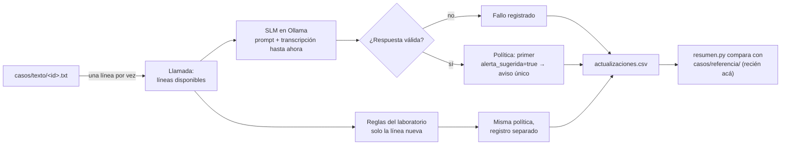

# Ensayo #50 — SLM local directo sobre texto incremental

> **Estado: propuesta sin discutir.** Material de desarrollo para
> [#50](https://github.com/Corchets/bitacora_tesis/issues/50). No elige modelo
> ([D09](../../docs/gestion/MAPA-DECISIONES.md#d09--elegir-asr-y-detector)), no congela
> la política de alerta ([D08](../../docs/gestion/MAPA-DECISIONES.md#d08--congelar-protocolo-experimental))
> ni valida la referencia humana ([D07](../../docs/gestion/MAPA-DECISIONES.md#d07--aprobar-taxonomía-y-evento-crítico)).

## 1. Qué queremos saber

1. Si un SLM local que lee la llamada **línea por línea**, con todo lo dicho hasta
   ese momento, avisa en las conversaciones fraudulentas y no en las legítimas difíciles.
2. **Cuándo** avisa: antes del pedido peligroso, en el pedido, después o recién
   cuando la víctima ya cumplió.
3. **Desde qué tamaño de modelo** funciona y cuánto cuesta (tiempo y memoria), para
   argumentar en qué gama de celular podría correr (sección 6).
4. Cómo le va, sobre los mismos casos, a las **reglas de palabras** del laboratorio.

## 2. Cómo funciona



En cada actualización el SLM recibe un prompt fijo y la transcripción disponible
numerada, y responde un JSON:

```json
{"riesgo": 0.93, "alerta_sugerida": true,
 "motivo": "Te están pidiendo un código que da acceso a tu cuenta",
 "evidencia": "Decime el código de activación que recibiste por SMS."}
```

- La respuesta se **valida**. Si el JSON está roto, falta un campo, el riesgo está
  fuera de 0–1, hay alerta sin motivo, se pasa el tiempo o el texto no entra en el
  contexto, queda como **fallo**. Nunca se toma un fallo como «sin riesgo».
- El **aviso es único**: sale en la primera respuesta válida con `alerta_sugerida`
  verdadera. Las respuestas siguientes se registran, pero no vuelven a avisar.
- `riesgo` **no está calibrado**: no es una probabilidad de fraude.
- `evidencia` es un agregado de este ensayo a lo que pide #50. Permite controlar si
  el modelo cita algo que realmente se dijo o si lo inventa (`evidencia_en_texto`).
- El estado se reinicia en cada llamada. El detector nunca recibe la clase, el
  escenario, las marcas ni el nombre del caso.

## 3. Qué se compara

| Variable | Valores | Pregunta |
|---|---|---|
| Modelo (`--modelos`) | Escalera de tamaños, sección 6 | ¿Desde qué tamaño funciona? ¿Cuánto tarda y ocupa? |
| Prompt (`--prompts`) | `tarea`, `tarea+base`, `v2` | ¿Ayuda darle la «base institucional» del #27? ¿Corrige el v2 los errores del v1? ([prompts](prompts/README.md)) |
| Hablantes (`--hablantes`) | `ab`, `sin` | ¿Cambia el resultado si sabe quién dice cada línea? |
| Reglas | Fijas, siempre incluidas | ¿Qué agrega el SLM frente a buscar palabras? |

**Sobre los hablantes.** El SLM no distingue voces: solo sabe quién habla si se lo
decimos en el texto. Que lo reciba o no depende de la captura de audio: con VoIP
propia cada lado de la llamada llega por un canal separado y se sabe qué dijo cada
uno sin adivinar; con una grabación mezclada habría que separar voces, que es otro
problema. Este ensayo mide cuánto importa esa información antes de decidir. Las
letras A/B son neutras: A es quien habla primero, sin indicar quién llamó ni quién
es sospechoso. Lo que nunca recibe es «atacante» o «víctima», porque eso es la
respuesta.

## 4. Casos

Formato y reglas en [casos/README.md](casos/README.md). Cuatro grupos:

- **`piloto_escrito`:** versión escrita de los 7 pares del
  [piloto](../../docs/corpus/METODO-CREACION-CORPUS.md#selección-inicial-del-piloto).
  Sirve también como insumo para preparar las fichas de grabación de
  [#39](https://github.com/Corchets/bitacora_tesis/issues/39).
- **`trampa`:** lo que pide #50: pedidos indirectos, menciones legítimas parecidas,
  negaciones, pedidos partidos como los entregaría un ASR, evidencia separada por
  mucho texto y conversaciones largas.
- **`laboratorio`:** los guiones del laboratorio de Ignacio convertidos al formato,
  para comparar con lo que se midió ahí.
- **`corpus_v2`:** 297 conversaciones nuevas, con datos y transferencias legítimas,
  cotidianas, pedidos indirectos y variantes de transcripción. El inventario total
  tiene 150 de desarrollo (75/75) y 200 reservadas (100/100). Ver
  [diseño y límites](casos/DISENO-CORPUS-V2.md) y [qué grabar para ASR](casos/GRABACIONES-ASR.md).

> **Estado: propuesta sin discutir.** El runner usa desarrollo por defecto y el
> panel excluye los textos reservados. La independencia de semillas y la evaluación
> final siguen pendientes de D08; las referencias siguen pendientes de D07.

`python casos.py --listar` muestra todos. Fueron redactados con asistencia y
**ninguno tiene revisión humana todavía** (`revision_humana: false`).

## 5. Cómo correrlo en tu PC

### Con un solo comando

Desde la raíz del repositorio, en la rama del ensayo:

| Sistema | Comando |
|---|---|
| Windows (PowerShell) | `powershell -ExecutionPolicy Bypass -File experiments\slm-directo\demo.ps1` |
| macOS o Linux | `bash experiments/slm-directo/demo.sh` |

El script hace todo en orden y frena con un mensaje claro si algo falla:

1. Busca Python 3.9 o posterior y, si falta, pregunta antes de instalarlo
   (winget en Windows, Homebrew en macOS, apt en Linux).
2. Busca [Ollama](https://ollama.com), el programa que corre los modelos en tu PC; si
   falta, pregunta antes de instalarlo y lo deja funcionando.
3. Descarga el modelo (por defecto `qwen3.5:2b`, o `qwen3.5:2b-q8_0` en macOS porque el runner MLX por defecto no soporta salida estructurada; la primera vez tarda).
4. Corre los tests, que no necesitan modelo.
5. Corre el detector sobre 8 conversaciones elegidas para la demo y muestra en la
   terminal cada línea y lo que respondió el modelo.
6. Escribe `resumen.md` y abre `visor.html` en el navegador.

Opciones: `-Modelo qwen3.5:0.8b` / `--modelo qwen3.5:0.8b` para otro modelo (conviene
si la PC tiene menos de 8 GB de RAM), `-Completo` / `--completo` para las 150
conversaciones de desarrollo, `-Si` / `--si` para que no pregunte antes de instalar.

### El visor

`visor.html` reproduce la llamada línea por línea: lo que se dijo hasta ese momento,
lo que devolvió el detector (riesgo, alerta, motivo, evidencia y la respuesta cruda
del modelo), un gráfico del riesgo y el aviso cuando sale. Permite cambiar de
conversación y de detector, comparar cómo le fue a cada uno con la misma
conversación y ocultar la referencia humana. Es un archivo autocontenido: se puede
mandar al equipo. Para armarlo con cualquier conjunto de corridas:

```bash
python visor.py corridas/<una> corridas/<otra> --abrir
```

### El panel

`analisis/tablero/panel.html` junta en una página el estado del proyecto, el plan de
trabajo, las corridas históricas sobre los 53 antecedentes, los 150 casos de desarrollo
y un probador en vivo contra Ollama. En
«Afinar» recalcula estafas con aviso y falsas alarmas al mover el umbral de `riesgo` y
la persistencia, sin volver a correr nada. Se arma desde la raíz del repositorio:

```bash
python3 experiments/slm-directo/analisis/tablero/armar_panel.py --servir
```

`--servir` hace falta porque Ollama rechaza páginas abiertas como archivo. Las reglas del
probador son una copia en JavaScript de `reglas.py`; las corridas que se hacen ahí son
exploratorias y no escriben manifiesto.

### Paso a paso, sin el script

```bash
cd experiments/slm-directo

# 1. Verificar que el código y los casos están bien (no necesita Ollama)
python -m unittest discover -s tests
python casos.py --listar

# 2. Línea base: solo reglas, tarda segundos
python correr.py --solo-reglas
python resumen.py corridas/<carpeta-que-imprime>

# 3. Bajar un modelo y hacer la demo con el par de WhatsApp
ollama pull qwen3.5:2b
python correr.py --modelos qwen3.5:2b --casos SC-WA-CODE-01-e01,LG-WA-CONSULTA-01-e01 --detalle
python visor.py corridas/<carpeta-que-imprime> --abrir
```

`--detalle` muestra cada línea y la respuesta del modelo a medida que «avanza la
llamada».

**Orden sugerido para no tardar horas.** Cada configuración procesa todas las
líneas de todos los casos, y un modelo en CPU puede tardar segundos por línea.
Conviene avanzar por etapas y anotar cada corrida en la sección 8:

| Etapa | Comando | Para qué |
|---|---|---|
| 1 | `python correr.py --solo-reglas` | Línea base. |
| 2 | `python correr.py --modelos qwen3.5:2b --grupo piloto_escrito` | Ver que funciona y cuánto tarda por línea en tu PC. |
| 3 | `python correr.py --modelos qwen3.5:0.8b,qwen3.5:2b,qwen3.5:4b` | Escalera completa con `tarea` y `ab`, sobre todos los casos. |
| 4 | `python correr.py --modelos <mejor>,<más chico que sirva> --prompts tarea,tarea+base --hablantes ab,sin` | Efecto del prompt y de los hablantes. |
| 5 | `python correr.py --modelos llama3.2:1b` | Comparar con el modelo que probó el laboratorio. |

Cada corrida queda en `corridas/<fecha>_<hora>/` con `manifiesto.json` (modelo y
digest, prompts completos con hash, casos con hash, commit, máquina, versión de
Ollama y memoria informada) y `actualizaciones.csv` (una fila por línea, con la
respuesta cruda). `resumen.py` agrega `resumen.md` en la misma carpeta. Con
`--etiqueta` se le pone un nombre a la carpeta. Si se corta con Ctrl+C, lo
procesado queda guardado.

### Filtro Tito→SLM con modelos simulados (#69)

Primera entrega funcional del experimento
[#68](https://github.com/Corchets/bitacora_tesis/issues/68): demuestra una
conversación completa que pasa por el filtro de consulta al SLM, con Tito y
SLM simulados. Reutiliza el recorrido incremental existente con la adaptación
mínima: el comparador directo (`slm|…`) sigue corriendo igual y por cada SLM
se agrega su variante filtrada (`tito-slm|…`).

```bash
cd experiments/slm-directo
bash demo_tito_slm.sh   # levanta slm_falso.py, corre el par de WhatsApp y resume
```

Equivale a correr a mano (Tito simulado deriva en la línea 4 de cada caso):

```bash
python slm_falso.py --puerto 11439 &
python correr.py --modelos falso-demo:1b --url http://127.0.0.1:11439 \
  --casos SC-WA-CODE-01-e01,LG-WA-CONSULTA-01-e01 \
  --filtro-tito --tito-puntajes "4=0.9" --etiqueta demo-tito-slm-simulado --detalle
python resumen.py corridas/*_demo-tito-slm-simulado --trayectorias
```

Reglas del flujo filtrado: Tito puntúa cada fragmento nuevo; el primer puntaje
≥ 0,5 (igualdad incluida) deriva al SLM en esa misma línea y lo mantiene activo
después, aunque el puntaje caiga. Si Tito falla técnicamente (`--tito-fallo-en`),
también deriva, sin inventar puntaje ni sospecha. El SLM recibe todo el historial
disponible más el indicio de la primera activación (línea, texto y puntaje),
declarado como sospecha falible que puede descartarse. El aviso sigue siendo
único ante el primer resultado verdadero válido. Cada actualización deja su fila:
`consulta` distingue `omitida` (sin costo SLM) de `slm_valida` y `slm_fallo`; una
conversación completa nunca derivada conserva su denominador (vishing sin aviso,
legítima sin aviso correcto). El reporte agrega la sección «Filtro Tito→SLM
(derivación y ahorro)» con primera derivación, consultas evitadas y costo
Tito+SLM. Corrida de referencia:
[`corridas/2026-10-26_125526_demo-tito-slm-simulado`](corridas/2026-10-26_125526_demo-tito-slm-simulado/resumen.md).
Límites: Tito y SLM son simulados con tiempos deterministas de juguete; el umbral
0,5 es convención exploratoria, no probabilidad ni umbral validado; el Tito real
(RoBERTuito + regresión) llega con #70. No cierra D07, D08 ni D09.

### Tito real entrenado una vez y reutilizado (#70)

`entrenar_tito.py` ajusta UNA regresión logística (seed 42, `C=1,0`, `lbfgs`)
sobre los 5.520 textos aceptados de 276 familias del banco histórico
(`nacho1706/feature-training-data`, commit
`bb542e130e7a67a82e376a75a0438a15de32f4a6`; 480 apartados excluidos, sin
solapes literales con los 8 casos, test reservado intacto). RoBERTuito
(revisión `20cb399e…`, tokenizador verificado por hash) queda congelado con
promedio enmascarado y límite 128 tokens (0 truncamientos). Sin fine-tuning,
sin búsqueda y sin calibración sobre las 8 conversaciones. El artefacto
[`tito_logreg.json`](tito_logreg.json) guarda pesos, configuración, clases,
versiones, hashes, datos/split, librerías, hardware, revisiones y tiempos;
`sha256sum tito_logreg.json` da
`fb601eaa8ecb8d51e0d37f1d5af00ec4ca41706ef638fe2780ae276e5098eccd`.

`tito_real.py` (`TitoReal`) carga ese artefacto una vez por proceso y lo
reutiliza para todas las conversaciones y SLM sin reentrenar; `puntuar` es sin
estado y un fallo técnico deriva al SLM sin fabricar puntaje.

Repetir el entrenamiento y las trazas (desde la raíz, con `.venv`):

```bash
source .venv/bin/activate
python experiments/slm-directo/entrenar_tito.py  # verifica hashes, incrusta, ajusta, persiste
cd experiments/slm-directo
python tests/test_tito_real.py   # 9 tests: carga, reutilización, anti-contaminación (sin descargas)
python slm_falso.py --puerto 11439 &
python correr.py --modelos falso-demo:1b --url http://127.0.0.1:11439 \
  --casos TR-04-pedido-tras-charla-larga,TR-06-banco-alerta-legitima,TR-07-pedido-partido-en-dos-lineas,TR-08-frase-cortada-candado,SC-SOPORTE-REMOTO-01-e01,LG-SUPPORT-INFO-01-e02,SC-FAMILIAR-DINERO-01-e01,TR-11-familiar-real-pide-plata \
  --filtro-tito --tito-real --etiqueta tito-real-8casos --detalle
python resumen.py corridas/*_tito-real-8casos --trayectorias
```

Corrida de referencia (Tito real + SLM simulado, umbral 0,5, 8 casos, 105
líneas, 316 filas = 105×3 + cabecera):
[`corridas/2026-10-26_132027_tito-real-8casos`](corridas/2026-10-26_132027_tito-real-8casos/resumen.md).
Tito puntuó solo hasta la activación de cada caso: 43 puntajes en la variante
filtrada (no 105; corrección #97). Hubo 35 actualizaciones con consulta omitida
y 70 consultas al SLM; ocho de esas consultas ocurrieron en la misma
actualización que activó Tito, por lo que ambos componentes trabajaron allí.
El `manifiesto.json` de la corrida registra comando, código y diff, máquina,
semilla, filtro (artefacto + sha + encoder) y casos; cada fila conserva
`tito_puntaje`, `consulta`, `indicio_*` y costo Tito+SLM incluso si la llamada
nunca deriva. Límites: el SLM sigue simulado (el falso solo avisa ante pedido
explícito de código) y la muestra sigue siendo de desarrollo; no elige detector
ni cierra D07, D08 ni D09.

### Actualizar el código

Cuando una corrida tuya ya se subió al repositorio, `git pull` se frena con
«untracked working tree files would be overwritten by merge»: tu copia local de esa
carpeta choca con la que trae el repositorio, aunque sean iguales. Guardá lo local
aparte y actualizá:

```bash
git stash push --include-untracked -m "corridas locales antes de actualizar"
git pull
```

Lo guardado queda en `git stash list` por si hace falta recuperarlo.

### Verificación sin modelos ni corridas históricas (#97)

**Verificación del 2026-10-28:** 89 pruebas dirigidas aprobadas con
`python -m unittest tests.test_primer_aviso tests.test_ensayo tests.test_filtro_tito tests.test_comparar tests.test_tito_real -v`
(7,979 s), más compilación de los seis módulos indicados abajo. Incluyen
recorridos de punta a punta que generan resumen y comparación, corte por aviso
válido y falsa alarma, llamadas sin aviso o sin derivación, reinicio de estado,
fallos y salida inválida, preparación separada, costos sin doble conteo,
duraciones ausentes con unidad explícita cuando existen y diagnóstico separado.
Sin descargas, entrenamiento ni inferencia de modelos reales. Verificación
sobre el commit `0a95968b7de9ed1a689cecb4a88a3e8e9f373f8e`, con los cambios
locales de curación y documentación de #96 presentes.

El [informe de #97 del 2026-10-27](CIERRE-97.md) conserva el estado histórico
de #96. El usuario aprobó y cerró #96 el 2026-10-28, según el
[registro vigente](CURACION-TITO-2026-10-28.md#aprobación-del-usuario--2026-10-28).
La verificación técnica de #97 es conforme; el usuario indicó cerrarlo el
2026-10-28. [Registro del cierre](https://github.com/Corchets/bitacora_tesis/issues/97).
No requiere reentrenamiento para verificarse.
El diagnóstico de calidad del Tito actual corresponde a #98.

Todo lo de abajo corre con dobles deterministas (Tito guionado, SLM falso):
no descarga modelos, no entrena y no toca `corridas/` ni crea carpetas en el
repositorio (la salida va a un temporal fuera del repo).

```bash
cd experiments/slm-directo

# 1. Sintaxis de runner, instrumentación y reportes
python -m py_compile correr.py resumen.py comparar.py detectores.py filtro_tito.py tito_real.py

# 2. Tests dirigidos (operativo, diagnóstico, histórico interrumpido y
#    costos por componentes/fallos/ausencias)
python -m unittest tests.test_primer_aviso tests.test_ensayo tests.test_filtro_tito -v

# 3. Punta a punta operativo + diagnóstico, con salida a /tmp
SALIDA=$(mktemp -d)
python slm_falso.py --puerto 11439 &
python correr.py --modelos falso-demo:1b --url http://127.0.0.1:11439 \
  --casos SC-WA-CODE-01-e01,LG-WA-CONSULTA-01-e01 \
  --filtro-tito --tito-puntajes "4=0.9" --etiqueta demo --salida "$SALIDA" --detalle
python correr.py --modelos falso-demo:1b --url http://127.0.0.1:11439 \
  --casos SC-WA-CODE-01-e01 --filtro-tito --tito-puntajes "4=0.9" \
  --seguir-tras-aviso --etiqueta demo-diag --salida "$SALIDA"
python resumen.py "$SALIDA"/*_demo --trayectorias
python comparar.py "$SALIDA"/*_demo
rm -rf "$SALIDA"
```

El modo operativo (por defecto) termina cada llamada en su primer aviso
válido; `--seguir-tras-aviso` conserva el diagnóstico de conversación
completa, separado del costo operativo hasta el aviso. Las corridas
históricas (conversación completa) no se reescriben ni se presentan como
nuevas mediciones operativas.

### Diagnóstico del Tito histórico (#98)

Recorrido real del artefacto histórico sin modificar sobre la partición de
diagnóstico: 10 conversaciones no usadas en el ajuste (2 vishing / 8 legítimas
comunes), 246 líneas/prefijos puntuados con entrada aislada y umbral 0,5.
Evidencia en [DIAGNOSTICO-TITO-2026-10-29.md](DIAGNOSTICO-TITO-2026-10-29.md),
generada desde [DIAGNOSTICO-TITO-2026-10-29.json](DIAGNOSTICO-TITO-2026-10-29.json)
con `diagnosticar_tito.py` (14 pruebas en `tests/test_diagnosticar_tito.py`).

- Artefacto intacto: `tito_logreg.json`, sha256
  `fb601eaa8ecb8d51e0d37f1d5af00ec4ca41706ef638fe2780ae276e5098eccd`
  (idéntico antes/después); encoder RoBERTuito congelado, clasificador
  regresión logística C=1,0, semilla 42.
- Derivación: 2/2 vishing derivan en o antes de `T_R` (L5 con `T_R`=19, L16 con
  `T_R`=16); 4/8 legítimas derivadas (tasa 0,5), sin marcas `T_R` que las
  respalden. Derivación ≠ alerta: Tito solo deriva al SLM.
- Comparador recargable para #101: `tito_real.cargar_artefacto` + `puntuar`
  reproduce 246/246 puntajes (fallos 0, distintos 0, tolerancia absoluta 5e-05).
- Exposición histórica: el ajuste vio 5520 frases aceptadas del banco
  (inventario 6000, 480 excluidas); ninguna conversación entera estuvo en el
  ajuste. Solapamiento léxico banco↔diagnóstico: Jaccard máximo 0,318 (cota
  inferior, no prueba de independencia; la auditoría semántica completa es
  ownership de #99).
- Marcas provisionales sin revisión humana: describe el desarrollo, no
  generaliza a producción; no cierra D07/D08/D09 ni #51.

```bash
cd experiments/slm-directo
../../.venv/bin/python -m unittest tests.test_diagnosticar_tito -v
```

## 6. Escalera de modelos y gamas de celular

La **escalera** es probar el mismo detector, con el mismo prompt y los mismos casos,
con modelos de **una misma familia** en tamaños crecientes. Al cambiar solo el
tamaño, la diferencia de resultados se debe al tamaño y no a otra familia o a otro
entrenamiento.

> **Estado: propuesta sin discutir.** Candidatos consultados el 2026-10-13; verificar
> las etiquetas con `ollama pull` antes de usarlas.

| Escalón | Etiqueta de Ollama | Por qué |
|---|---|---|
| 1 | `qwen3.5:0.8b` | El más chico de la familia. |
| 2 | `qwen3.5:2b` | Intermedio; buen primer candidato. |
| 3 | `qwen3.5:4b` | Techo razonable para una PC común. |
| 4 | `qwen3.5:9b` | Solo si la PC lo soporta; marca el techo de calidad. |
| Ref. | `llama3.2:1b` | El que usó el laboratorio ([contraste](../../docs/investigacion/CONTRASTE-NLP-TEORIA-Y-LABORATORIO.md)). |

Qwen 3.5 razona antes de responder por defecto. Eso lo vuelve mucho más lento y puede agotar el límite de tokens generando fallos por `salida_cortada`, así que `correr.py` (y también el módulo `replay` a través de `correr.calentar`) le envía `think: false` (`pensar=False`) cuando el modelo lo acepta; el manifiesto registra si se aplicó.

En macOS con Ollama 0.40.5, las etiquetas de Qwen 3.5 sin sufijo descargan la variante MLX, la cual no soporta salida estructurada JSON; por ello se deben usar etiquetas GGUF explícitas (`qwen3.5:0.8b-q8_0`, `qwen3.5:2b-q8_0`, `qwen3.5:4b-q4_K_M`). El script `demo.sh` utiliza `qwen3.5:2b-q8_0` por defecto en macOS.

**Cómo se usa para la tesis.** La escalera responde «desde qué tamaño la tarea
funciona». Con ese tamaño y la memoria medida se compara contra los presupuestos de
[PREFACTIBILIDAD-TECNICA.md](../../docs/investigacion/PREFACTIBILIDAD-TECNICA.md):
256, 512 y 1024 MB para **todo** el pipeline, ASR incluido, en gamas baja, media y
alta. El laboratorio midió Llama 3.2 1B en ~860 MB de RAM y ~3,9 s por turno en una
PC x86. Con eso hay tres conclusiones posibles, todas defendibles si están medidas:

- funciona con un modelo que entra en el presupuesto de alguna gama;
- funciona solo con modelos más grandes: se argumenta qué gama haría falta o que
  hoy no corre en un celular promedio;
- no funciona en ningún tamaño probado sin ajuste: la evidencia apunta a entrenar o
  a otra arquitectura.

**Velocidad parecida a un celular.** Con placa de video, una PC responde mucho más
rápido que un teléfono. Para acercarse a los presupuestos de gama, se puede correr
solo con la CPU y pocos hilos (la gama alta reserva 2 hilos al detector):

```bash
python correr.py --modelos qwen3.5:0.8b --grupo piloto_escrito --solo-cpu --hilos 2 --etiqueta cpu-2hilos
```

El manifiesto registra esas opciones en `parametros_slm.hardware`. Sigue siendo una
PC x86, no un ARM; sirve como cota, no como medición del teléfono.

Primera medición (2026-10-14, [`cpu-2hilos`](corridas/2026-10-14_191429_cpu-2hilos/resumen.md),
0.8B y 2B sobre el piloto escrito): los totales no cambian, pero la mediana por línea
sube unas 15 veces (3,9 s y 8,2 s) y el p95 unas 11 (7,3 s y 13,0 s). Ninguno cumple el
gate de latencia por turno de PREFACTIBILIDAD-TECNICA (p95 ≤ 1,5 s).

**En la MacBook M1 de 8 GB** las corridas pendientes (v2 con 0.8B y 2B, 4B completo y
`qwen3.5:9b-q4_K_M`, 5,6 GB más 0,9 GB de proyector) se corren de a una con
`bash cola_m1.sh`, con Docker cerrado: corta cada corrida si el swap pasa de 6 GB y lo
procesado queda guardado. `--num-batch 32` hace que Ollama reutilice la transcripción
ya procesada ([caché](analisis/2026-10-21-cache-prefijo/README.md)).

Lo medido en una PC con Ollama **no es una medición en Android**
([R13](../../docs/gestion/REGISTRO-RIESGOS.md)): sirve para ordenar candidatos, no para
afirmar rendimiento móvil.

## 7. Cómo leer el resumen

- **Vishing con aviso:** llamadas fraudulentas en las que hubo aviso.
- **Antes del pedido / en el pedido / después / en o después del cumplimiento:**
  dónde cayó el aviso respecto de `T_R` y `T_C` de la referencia. Es el equivalente
  en líneas de los márgenes de [METRICAS.md](../../docs/evaluacion/METRICAS.md#2-margen-de-la-alerta).
  Avisar recién en el cumplimiento llega tarde.
- **Falsas alarmas:** legítimas con aviso. Descartar un aviso no convierte una
  llamada en legítima de referencia.
- **Fallos:** actualizaciones sin respuesta válida, sobre el total.
- **ms p50 / p95:** tiempo por actualización en esa PC, sin contar la carga del modelo.
  Incluye procesar la parte de la transcripción que Ollama no reutilice de la caché.
- **Sin evaluar:** conversaciones que la corrida no terminó (se cortó con Ctrl+C) o en
  las que fallaron todas las respuestas. No cuentan como aciertos ni como errores.
  Una conversación filtrada completa nunca derivada **sí** se evalúa: vishing sin
  aviso o legítima sin aviso correcto, con sus denominadores intactos.
- **Filtro (`tito-slm|…`):** la marca `o` es actualización procesada sin consultar
  al SLM (no es fallo). Las columnas `consulta`, `tito_puntaje`, `tito_error` e
  `indicio_*` reconstruyen qué decidió Tito y qué indicio falible recibió el SLM.
  La sección «Filtro Tito→SLM (derivación y ahorro)» informa primera derivación,
  consultas evitadas y costo Tito+SLM por conversación.
- **Evidencia textual:** avisos cuya cita aparece en lo que realmente se dijo.
- **Para revisar:** cada falsa alarma con su motivo y cada vishing sin aviso. Es lo
  que conviene mirar en equipo: #50 pide revisar al menos un aviso y un error.

## 8. Registro del proceso

| Fecha | Qué se hizo | Resultado |
|---|---|---|
| 2026-10-13 | Armado del ensayo: formato de casos, 53 casos escritos (14 del piloto, 13 trampas, 26 del laboratorio) con revisión adversarial automatizada, prompts v1, cliente de Ollama, reglas del laboratorio como comparador, `correr.py`, `resumen.py` y tests. | Tests pasan sin modelo, con un Ollama falso. **Todavía no se corrió ningún modelo real**: el entorno donde se armó no permite descargar modelos. |
| 2026-10-13 | Línea base de reglas sobre los 53 casos: [`corridas/2026-10-13_224418_linea-base-reglas`](corridas/2026-10-13_224418_linea-base-reglas/resumen.md). | Aviso en 23 de 29 vishing y **falsa alarma en 14 de 24 legítimas**. Los 5 avisos «antes del pedido» no son anticipación: son palabras sueltas en el contexto (`plata`, `pago`, `verificacion`; `plata` incluso dentro de «plataforma»). No avisan en pedidos sin palabra clave (`TR-01`, `LAB-digitos-sin-palabra`, `LAB-pantalla-sin-programa`) ni en `SC-PREMIO-01-e01`. Es la vara que el SLM tiene que superar: distinguir mención de pedido. |
| 2026-10-14 | **Primera corrida real del SLM**: `qwen3.5:2b`, prompt `tarea`, hablantes `ab`, las 8 conversaciones de la demo, en una PC con Windows 11 (12 núcleos, 32 GB de RAM, modelo en GPU) y Ollama 0.40.4. Carpeta `2026-10-14_172248_demo-qwen3.5-2b`, todavía en esa PC. | 73 respuestas válidas, ninguna fallida. Avisó en 2 de 4 vishing, las dos en la línea del pedido (`SC-WA-CODE-01-e01` L4, `SC-SOPORTE-CLAVE-01-e01` L6), y en **0 de 4 legítimas**; las reglas dieron falsa alarma en esas 4 (`LG-WA-CONSULTA-01-e01`, `LG-SUPPORT-INFO-01-e01`, `TR-02`, `TR-08`, este último por «Pasame el código» antes de «del candado»). No avisó en el pedido indirecto `TR-01` (riesgo 0,65 en el pedido, sin alerta) ni en `TR-12`, que no tiene pedido: el prompt v1 solo alerta por pedidos. Avisar por «riesgo ≥ 0,6» en vez de `alerta_sugerida` sumaría `TR-01` y una falsa alarma en `LG-SUPPORT-INFO-01-e01` L9 (D08). La alerta va y viene entre líneas con el mismo riesgo y el motivo de `SC-SOPORTE-CLAVE` menciona un «código de verificación» que nadie pidió. 0,53 s por línea (p50) con GPU y 2,2 GB de memoria: más del doble del presupuesto de gama alta. Son 8 casos escritos: no mide rendimiento. La corrida mostró un error del verificador de citas con varias líneas numeradas, corregido el mismo día. |
| 2026-10-14 | `qwen3.5:0.8b` sobre los 53 casos (prompt `tarea`, hablantes `ab`), en la misma PC: [`corridas/2026-10-14_173532_demo-qwen3.5-0.8b`](corridas/2026-10-14_173532_demo-qwen3.5-0.8b/resumen.md). El resumen se reprodujo idéntico a partir de los datos crudos. | 464 respuestas válidas. Aviso en 26 de 29 vishing y falsa alarma en 8 de 24 legítimas (reglas: 23/29 y 14/24). Mejor que las reglas en piloto y trampas (falsas alarmas 2/7 y 2/7, contra 7/7 y 6/7) y peor en las legítimas del laboratorio (4/10 contra 1/10). Pero **el riesgo es binario** (solo 0 o 1) y **el modelo inventa pedidos**: los 7 avisos «antes del pedido» y las falsas alarmas en llamadas de banco dicen «te están pidiendo un código» cuando nadie lo pidió todavía. Reacciona al contexto (banco + urgencia), no al pedido, así que esos avisos tempranos no son anticipación. 545 MB de memoria y 0,28 s por línea (p50) con GPU: el único tamaño probado cerca del presupuesto de gama alta. |
| 2026-10-14 | `qwen3.5:2b` sobre los 53 casos, **dos veces con la misma configuración**: [`172930`](corridas/2026-10-14_172930_demo-qwen3.5-2b/resumen.md) y [`175451`](corridas/2026-10-14_175451_demo-qwen3.5-2b/resumen.md). Se suma el `manifiesto.json` de la primera demo ([`172248`](corridas/2026-10-14_172248_demo-qwen3.5-2b/resumen.md)). | Aviso en 20 y 21 de 29 vishing y falsa alarma en **2 de 24** legítimas (`TR-03`, consejo lleno de negaciones; `TR-05`, transferencia entre amigos). Riesgo graduado (13 valores distintos). Falla en pedidos indirectos y en varios guiones del laboratorio (`LAB-arca-deuda`, `LAB-giro-sin-plata`, `LAB-digitos-sin-palabra`). **Las dos corridas iguales no dieron lo mismo**: difieren 60 de 464 respuestas y el resultado de 2 casos (`LAB-pantalla-sin-programa` avisa en una y no en la otra; `TR-09` avisa en L7 o L6). Con temperatura 0 y semilla fija, en esta PC con GPU no hay determinismo: hay que repetir cada configuración e informar la variación. 2,2 GB y 0,52 s por línea. |
| 2026-10-14 | `qwen3.5:4b` sobre los 53 casos ([`174602`](corridas/2026-10-14_174602_demo-qwen3.5-4b/resumen.md)) y demo de 8 ([`182137`](corridas/2026-10-14_182137_demo-qwen3.5-4b/resumen.md)). | Aviso en **29 de 29** vishing, pero falsa alarma en **15 de 24** (más que las reglas) y 17 avisos antes del pedido. Marca alerta en 220 de 464 líneas: avisa por sospecha de suplantación («te están simulando ser soporte») y trata pedidos relatados como actuales («me llamaron para que baje un programa»). 2,9 GB y 0,90 s por línea. Con el prompt v1, más grande no fue mejor: fue más alarmista. |
| 2026-10-14 | **Solo CPU, 2 hilos**: `qwen3.5:0.8b` y `qwen3.5:2b` con `--solo-cpu --hilos 2` sobre las 14 conversaciones del piloto escrito, en la misma PC: [`corridas/2026-10-14_191429_cpu-2hilos`](corridas/2026-10-14_191429_cpu-2hilos/resumen.md). El manifiesto registra `num_gpu: 0` y `num_thread: 2`, y Ollama informa 0 MB en GPU. | 322 respuestas del SLM (161 por modelo), todas válidas. **Los totales no cambian**: el 2B dio el mismo resultado que las dos corridas con GPU en las 14 conversaciones (contra la primera, 13 de 161 líneas con otro riesgo y 1 con otra alerta). El 0.8B mantuvo 7/7 y 2/7, pero pasó a avisar antes del pedido en `SC-FAMILIAR-DINERO-01-e01` (L8 en vez de L9) y `SC-PREMIO-01-e01` (L6 en vez de L8), las dos veces diciendo que piden un «código» que nadie pidió: no es anticipación. **El tiempo sí**: mediana de 3,9 s por línea con el 0.8B y 8,2 s con el 2B (con GPU, 0,27 y 0,52 s en esas mismas conversaciones), p95 de 7,3 s y 13,0 s, máximo de 9,1 s y 20,9 s. Las líneas con alerta tardan casi el doble que las otras (el modelo escribe motivo y cita), pero las otras ya tardan 3,4 s y 7,6 s de mediana y ninguna bajó de 2 s. El aviso del 2B llegaría al menos 11,7 s después de la frase del pedido (mediana de esas líneas), y más si las líneas se encolan. Ambos quedan muy lejos del gate de latencia de [PREFACTIBILIDAD-TECNICA](../../docs/investigacion/PREFACTIBILIDAD-TECNICA.md) (p95 ≤ 1,5 s; más de 2,0 s no es aceptable). La memoria es casi la misma: 547 MB y 2,2 GB. Las reglas, que corren en la misma tanda, dieron idéntico a la línea base. Es una PC x86 de escritorio, no un teléfono. |
| 2026-10-17 | Línea base de reglas en Apple M1 (8 núcleos, 8 GB RAM): [`corridas/2026-10-17_150455_m1-reglas`](corridas/2026-10-17_150455_m1-reglas/resumen.md). | Aviso en 23 de 29 vishing y falsa alarma en 14 de 24 legítimas (idéntico a la línea base en Windows). Latencia p50 de 5 ms y p95 de 13 ms. |
| 2026-10-17 | Escalera en Apple M1 (GPU Metal GGUF) con Ollama 0.40.5 sobre 53 casos: [`corridas/2026-10-17_150516_m1-gguf`](corridas/2026-10-17_150516_m1-gguf/resumen.md). Modelos `qwen3.5:0.8b-q8_0`, `2b-q8_0` y `4b-q4_K_M`. | 0.8B y 2B completaron los 53 casos. 0.8B: 27/29 vishing con aviso, 9/24 falsas alarmas, p50 de 1282 ms y p95 de 3462 ms. 2B: 20/29 vishing con aviso, 2/24 falsas alarmas, p50 de 2646 ms y p95 de 6036 ms. El 4B completó 42 casos (24/24 vishing, 9/18 falsas alarmas, p50 6606 ms) y fue interrumpido por el coordinador a las 16:21 por presión severa de memoria (swap de 15 GB, 3.5 GB libres en disco y VM Docker activa en 8 GB de RAM). |
| 2026-10-17 | Comparación de reproducibilidad M1 vs Windows 11 sobre casos válidos comunes en ambas plataformas: [`analisis/2026-10-17-m1-vs-windows/`](analisis/2026-10-17-m1-vs-windows/README.md) (`comparar_m1_windows.py`). | Acuerdo en decisión de aviso de 51/53 (96.2%) en 0.8B, 52/53 (98.1%) en 2B y 40/42 (95.2%) en 4B evaluados. Acuerdo en línea exacta de 90.6% (0.8B), 96.2% (2B) y 88.1% (4B). Latencias en M1 fueron ~4.6x mayores en 0.8B y ~5.0x en 2B respecto de Windows con GPU. |
| 2026-10-21 | **Caché del prefijo** en M1 con `qwen3.5:0.8b-q8_0` y `TR-04`: [`analisis/2026-10-21-cache-prefijo/`](analisis/2026-10-21-cache-prefijo/README.md). | Qwen 3.5 es híbrido y Ollama 0.40.5 solo retoma desde puntos guardados: cada línea vuelve a procesar ~530–630 tokens (480–1150 ms), no solo la línea nueva. Con `--num-batch 32`, 51–153 tokens (100–175 ms). Sobre los 53 casos, 453 de 464 respuestas idénticas y el mismo aviso en 52 de 53; p50 de 1282 a 1017 ms y p95 de 3465 a 2993 ms. |
| 2026-10-21 | Análisis de errores del prompt v1 y **prompt v2** (`--prompts v2`): [`analisis/2026-10-21-errores-y-prompt-v2/`](analisis/2026-10-21-errores-y-prompt-v2/README.md). Corrida [`2026-10-21_182201_m1-0.8b-v1v2-nb32`](corridas/2026-10-21_182201_m1-0.8b-v1v2-nb32/resumen.md). | El 2B pierde siempre las mismas estafas: pedidos de dinero con razón creíble o sin palabra clave y pedidos indirectos de código; deja 49 líneas con riesgo ≥ 0,6 sin alerta. Exigir que la cita esté en el texto no ayuda. El v2 con el 0.8B quedó en los 24 casos del laboratorio, cortado por memoria con Docker abierto (el swap llegó a 9,4 GB porque el primer vigilante no podía cortar; corregido): 11/14 estafas y 2/10 falsas alarmas contra 13/14 y 4/10 del v1, sin motivos de «código» inventados. No alcanza para comparar. |
| 2026-10-26 | Recorrido Tito→SLM con modelos simulados ([#69](https://github.com/Corchets/bitacora_tesis/issues/69)): `filtro_tito.py`, flags `--filtro-tito/--tito-puntajes/--tito-fallo-en/--tito-umbral`, `slm_falso.py`, `demo_tito_slm.sh`, `tests/test_filtro_tito.py` y corrida [`2026-10-26_125526_demo-tito-slm-simulado`](corridas/2026-10-26_125526_demo-tito-slm-simulado/resumen.md). | El par de WhatsApp pasa de punta a punta: Tito simulado deriva en L4, el SLM avisa en L4 del vishing (`=R`) y no avisa en la legítima; 3 consultas y 6 evitadas por configuración. 14 tests nuevos (umbral con igualdad, persistencia, historial íntegro, indicio falible, fallos, aviso único, reinicio, costo y denominadores) y 54 previos en verde. Sin modelos reales: no elige detector ni cierra D07/D08/D09. |

Cada corrida real se anota acá: fecha, quién, máquina, comando, carpeta y una línea
con lo observado. Las conclusiones van en `resumen.md` de esa corrida y, cuando
correspondan, en los documentos de decisión.

## 9. Decisiones de este ensayo

> **Estado: propuesta sin discutir.** Todas se pueden cambiar; las corridas guardan
> con qué configuración se hicieron.

| Decisión | Alternativa descartada por ahora | Motivo |
|---|---|---|
| Una línea = una actualización (turno cerrado). | Fragmentos de ASR o ventanas de tiempo. | Es lo que fija #50 y la [arquitectura §6](https://github.com/Corchets/bitacora_tesis/blob/feat/ayuda-memoria/docs/ingenieria/ARQUITECTURA.md#6-dirección-del-detector-y-visualización-consolidada). |
| Prefijo completo en cada actualización; fallo si no entra en `num_ctx` (4096). | Recortar historial (el laboratorio usaba 1024 tokens y 300 caracteres por turno). | #50 pide no recortar en silencio. |
| Temperatura 0 y `seed` 42. | Muestreo con temperatura. | Repetibilidad. |
| Salida forzada con esquema JSON y validada. | Texto libre. | El laboratorio vio respuestas en prosa sin forzar el formato. |
| Antes de medir, un pedido de prueba comprueba que Ollama respete el esquema; si no, la corrida frena. | Confiar en la versión instalada. | Algunas versiones de Ollama ignoran el esquema cuando el modelo razona. |
| Tope de 512 tokens por respuesta; si se alcanza, la actualización queda como fallo `salida_cortada`. | Sin tope. | Un modelo en bucle tardaría minutos en llegar al timeout. |
| Reglas del laboratorio sin cambios, solo sobre la línea nueva. | Ajustar las reglas a estos casos. | Comparar contra lo que ya existía, sin sobreajustar. |
| `A`/`B` = quien habla primero. | Etiquetar por rol o por canal local/remoto. | Neutral; el rol es la respuesta y el canal depende de la captura. |

## 10. Límites

- Casos **escritos con asistencia y sin revisión humana**. Casos y prompt salieron
  del mismo trabajo asistido: sirven para encontrar errores, no para medir
  rendimiento. Ajustar el prompt mirando estos casos lo sobreajusta: la evaluación
  final necesita casos reservados
  ([#55](https://github.com/Corchets/bitacora_tesis/issues/55)).
- Texto **revisado**, sin errores de ASR, salvo los casos del laboratorio, que están
  en minúsculas y sin acentos. El efecto del ASR se mide aparte
  ([#52](https://github.com/Corchets/bitacora_tesis/issues/52)).
- Posiciones en **líneas**, no en segundos: no se calculan `L_R` ni `L_C`.
- **Atajo por el saludo.** En los casos escritos, «la entidad atiende» abre 5 legítimas
  y ningún fraude, y «quien llama pregunta por la persona» abre 7 fraudes y una
  legítima. Viene del catálogo: las legítimas del piloto son consultas que inicia la
  persona. Un detector puede acertar por el saludo y no por el pedido; con `--hablantes ab`
  la letra A suma la misma pista. Antes de sacar conclusiones conviene revisar los
  aciertos que dependan del comienzo de la llamada y agregar legítimas en las que la
  entidad llama (como `TR-06`).
- **Legítimas didácticas.** Muchas incluyen consejos de seguridad («no te vamos a pedir
  la clave»), que una llamada real no siempre trae y que pueden facilitar la detección.
- Los casos del laboratorio conservan el texto original: minúsculas, sin acentos y,
  en algunos, nombres de entidades reales.
- PC con Ollama ≠ Android. La memoria es la que informa Ollama, no un RSS medido.
- **Filtro simulado (#69).** El `TitoGuion` puntúa por número de línea: la misma
  especificación se aplica a todos los casos de la corrida, así que solo sirve
  para demostraciones chicas y controladas. Los tiempos del SLM falso son de
  juguete (100/10 tokens fijos, ms de red local): el costo real se mide con
  modelos de verdad en #68 completo.

## 11. Estado frente a lo que pide #50

| #50 pide | Estado |
|---|---|
| Comando que procesa actualizaciones sin texto futuro, sin recorte silencioso y con estado reiniciado entre llamadas. | ☑ Implementado y probado (`tests/`). |
| Salida validada con puntaje 0–1, `alerta_sugerida` y `motivo`; inválida o timeout = fallo. | ☑ Implementado y probado. |
| Aviso único ante el primer true válido; conserva predicciones posteriores. | ☑ Implementado y probado. |
| SLM y reglas por separado sobre el par y casos de desarrollo difíciles. | ☑ Corridas completas ejecutadas en Windows 11 y Apple M1 (GGUF). |
| Datos, modelo, prompt, configuración, código, hardware, seed y salidas para repetir. | ☑ En `manifiesto.json` y `actualizaciones.csv`. |
| Otra persona ejecuta la prueba y revisa un aviso y un error. | ☐ Pendiente. |

## 12. Preguntas para el equipo

Surgieron al escribir y revisar los casos. Ninguna se resolvió acá: cada caso afectado
deja la duda en `notas` de su referencia. Las de anotación corresponden a
[#32](https://github.com/Corchets/bitacora_tesis/issues/32) (D07) y las de política a
[#33](https://github.com/Corchets/bitacora_tesis/issues/33) (D08).

| Pregunta | Casos | Decisión |
|---|---|---|
| Pedido partido en dos líneas: ¿`T_R` donde empieza o donde se vuelve explícito? | `TR-07` | D07 |
| Pedido indirecto o inducido sin la palabra «código»: ¿dónde va `T_R`? | `TR-01`, `TR-10` | D07 |
| Confirmar un dato que la entidad dice tener (domicilio): ¿es pedido de datos? | `TR-04`, `SC-ORG-BENEFICIO-01-e01` | D07 |
| ¿El usuario solo ya es credencial, o `T_C` espera la contraseña? | `SC-SOPORTE-CLAVE-01-e01` | D07 |
| Cumplimiento por otro canal, solo anunciado en la llamada: ¿cuenta como `T_C`? | `SC-PREMIO-01-e01` | D07 |
| `AUTHORITY_CLAIM` dicho por quien atiende, no por quien llama. | Legítimas del piloto | D07 |
| Vishing que termina antes de cualquier pedido: ¿un aviso cuenta como detección? | `TR-12` | D07/D08 |
| Aviso por un fragmento que la línea siguiente aclara: ¿falsa alarma? | `TR-08` | D08 |
| Familiar que pide dinero sin presión y propone verificar: ¿un aviso es falsa alarma? | `TR-11` | D08 |
| ¿Cuántos consejos de seguridad se toleran en las legítimas? ¿Puede quien atiende pedir un dato de bajo riesgo? | Legítimas del piloto | Fichas (#39) |

## 13. Primera escalera (2026-10-14)

> **Estado: propuesta sin discutir.** Casos escritos de desarrollo, prompt v1 y una
> sola PC, con GPU y una prueba solo con CPU. Describe conductas y tiempos en esa PC; no
> mide rendimiento en un teléfono ni elige modelo.

| Detector | Vishing con aviso | Falsas alarmas | Avisos apoyados en un pedido real | Memoria | Tiempo por línea (GPU) |
|---|---|---|---|---|---|
| Reglas | 23/29 | 14/24 | — | — | — |
| `qwen3.5:0.8b` | 26/29 | 8/24 | 21 de 34 (12 inventan el pedido) | 545 MB | 0,28 s |
| `qwen3.5:2b` (dos corridas) | 20 y 21/29 | **2/24** | **19 de 22** | 2,2 GB | 0,52 s |
| `qwen3.5:4b` | **29/29** | 15/24 | 15 de 44 (21 avisan por sospecha) | 2,9 GB | 0,90 s |

La columna «apoyados en un pedido real» sale de una
[clasificación a ciegas](analisis/2026-10-14-fundamento-de-avisos/README.md) de cada
primer aviso, hecha por dos revisores automáticos que coincidieron en 99 de 100.

- **Más grande no fue mejor.** El 2B es el único que avisa casi siempre por un pedido
  real y con pocas falsas alarmas. El 0.8B inventa pedidos y el 4B avisa por sospecha,
  incluso ante pedidos que alguien solo cuenta.
- **Pedido o sospecha.** El 2B avisa en el pedido; el 4B anticipa por suplantación o
  presión, pero con muchas falsas alarmas. Qué debe provocar el aviso es una decisión
  de [D08](../../docs/gestion/MAPA-DECISIONES.md#d08--congelar-protocolo-experimental).
- **Memoria contra criterio.** Solo el 0.8B queda cerca del presupuesto de gama alta
  (1024 MB para todo el pipeline, ASR incluido), y es el que peor razona. El 2B, que
  razona mejor, ocupa más del doble.
- **Sin determinismo.** Dos corridas iguales del 2B difirieron en 2 de 53 casos:
  cada configuración se tiene que repetir e informar con su variación.
- **El prompt v1 sesga los motivos** hacia «código» por su ejemplo. El prompt v2
  (2026-10-21) lo saca y aclara que un pedido relatado o negado no cuenta
  ([análisis](analisis/2026-10-21-errores-y-prompt-v2/README.md)).

- **Sin placa de video no llega a tiempo.** Solo con CPU y 2 hilos, en las 14
  conversaciones del piloto escrito, los totales no cambian, pero el 95% de las líneas
  tarda hasta 7,3 s con el 0.8B y 13,0 s con el 2B, contra un objetivo de 1,5 s (gate de
  [PREFACTIBILIDAD-TECNICA](../../docs/investigacion/PREFACTIBILIDAD-TECNICA.md),
  aprobado por el equipo en #24). Esta configuración (un SLM consultado en cada línea con
  todo lo dicho antes) falla la latencia en esta PC aun sin el reconocimiento de voz, y
  achicar la salida no alcanza: las líneas sin alerta ya tardan 3,4 s y 7,6 s de mediana.
  Según la regla de ese documento, eso descarta la configuración, no necesariamente la
  arquitectura.

**Tablero.** Los gráficos, las estadísticas (intervalos del 95% y comparaciones de a
pares), el paso a paso y las preguntas abiertas están en
[`analisis/tablero/`](analisis/tablero/): `python analisis/tablero/armar_datos.py`
regenera los datos desde las corridas y la clasificación de avisos, e `index.html` es
la página que los dibuja.
