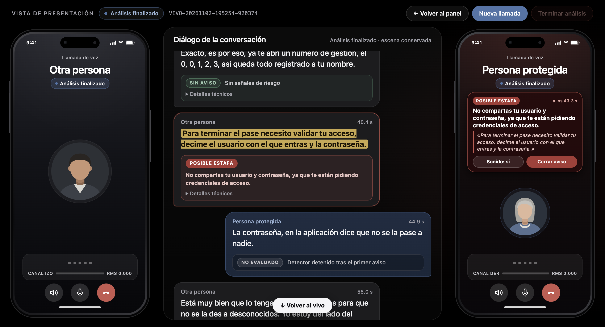

# Corrida con voz real por Meet (2026-11-02)

Cubre [#84](https://github.com/Corchets/bitacora_tesis/issues/84), [#85](https://github.com/Corchets/bitacora_tesis/issues/85),
[#86](https://github.com/Corchets/bitacora_tesis/issues/86) y [#94](https://github.com/Corchets/bitacora_tesis/issues/94),
según el [checklist](../PRUEBA-VOZ-REAL-MEET.md).

> Son nueve llamadas guionadas con dos voces en una notebook: muestran si el recorrido anda con voz real.
> **No son rendimiento del detector ni resuelven [D09](../../../docs/gestion/MAPA-DECISIONES.md#d09--elegir-asr-y-detector).**
> **Decisión de Luciano (2026-11-02):** opción B. Nada de esto se publicó.

## Condiciones

- **Datos:** diálogos D1 a D4 de [`dialogos.json`](../../asr-local/voz-real/dialogos.json), fuera de `corpus_v2`. Filas en [`pruebas.csv`](../../asr-local/voz-real/pruebas.csv), toma 5. Voces: `luciano` y `otra`; consentimiento firmado de la otra persona, del equipo, informado por Luciano con fecha 2026-11-02.
- **Máquina:** Apple M1 con 8 GB; Chrome y Meet abiertos en las llamadas.
- **Fijo:** Gemma 4 E2B `gemma4:e2b-it-q4_K_M` (digest `b37049369adf…`), Tito viejo con umbral 0,5 (`fb601eaa…`), prompt `tarea`, `num_ctx` 4096, seed 42, disparo al cerrar la frase, Meet por pestaña, micrófono con «Cancelar eco», modelo caliente desde la llamada 1.
- **Opción B:** `parakeet-filtro`, corte 0,8 s, RMS 0,008, Silero 0,5 solo filtra.
- **Opción A:** `parakeet-silero`, corte 0,3 s, Silero 0,9; el RMS no se usa.
- **Código:** llamadas `8f613be`; la otra opción y la medición del ASR `abe825e`; #84 y comprobación del cierre `5980acf`; replay `f3a047c`.
- **Salidas:** [`llamadas/`](2026-11-02-voz-real-meet/llamadas), [`otra-opcion-a/`](2026-11-02-voz-real-meet/otra-opcion-a), [`otra-opcion-b/`](2026-11-02-voz-real-meet/otra-opcion-b), [`plan-b/`](2026-11-02-voz-real-meet/plan-b), [`cierre/`](2026-11-02-voz-real-meet/cierre) y [`replay-llamada-1/`](2026-11-02-voz-real-meet/replay-llamada-1), sin WAV. El audio queda fuera de Git.

**Desvíos del plan.** La tele estuvo muy fuerte en las llamadas 5 y 6, no solo en la 5: A no tiene un D1 en vivo sin tele. Quedaron fuera de resultados el ensayo `190242-539305` (en frío), el plan B fallido `185218-730116` y tres tomas cortadas: `191250-736197`, `191338-353002` y `192339-246848`. Luciano confirmó que se salieron del guion y las reiniciaron.

## Resultados en vivo y con la otra opción

Cada audio pasó por la opción que la llamada no usó, a ritmo real y con el mismo Gemma. Son demoras en vivo contra repetición, no medidas idénticas. «Pedido» es la primera frase de la otra persona con el pedido, ubicada por palabras clave.

| Llamada | Diálogo | Opción en vivo | T_A en vivo (s) | Respecto del pedido (s) | T_A con la otra opción (s) | Respecto del pedido (s) | Consultas en vivo |
|---|---|---|---|---|---|---|---|
| 1 | D1 | B | 28,5 | −5,1 | 33,2 | +2,3 | 1 |
| 2 | D2 | B | 34,5 | +3,2 | 32,7 | +2,3 | 5 |
| 3 | D3 | B | sin aviso | | sin aviso | | 11 |
| 4 | D4 | B | 19,7 | +4,8 | 17,6 | +3,0 | 1 |
| 5 | D1 tele | B | 32,6 | +4,0 | 30,5 | +2,4 | 2 |
| 6 | D1 tele | A | 20,8 | −4,2 | 22,3 | −3,4 | 3 |
| 7 | D2 | A | 34,7 | +2,1 | 37,7 | +2,5 | 4 |
| 8 | D3 | A | sin aviso | | sin aviso | | 17 |
| 9 | D4 | A | 24,2 | +6,9 | 25,2 | +4,8 | 6 |

- **Aviso:** en todas las estafas y en ninguna legítima, con las dos opciones. Sin fallos del detector. Una sola frase salteada en las 18 pasadas (llamada 4 con A).
- **A avisa antes sobre el mismo audio:** en 6 de 7 estafas, con una mediana de 1,8 s. La excepción es la llamada 1, donde B avisó antes porque citó el débito.
- **En D1 el aviso puede llegar antes del pedido del código:** tres veces, siempre citando el débito. Por eso no alcanza con leer T_A: hay que mirar qué frase cita.
- **A consulta más:** en D3, 17 y 22 consultas contra 11 y 9 de B, porque parte más las frases.
- **Consultas en vivo:** medianas de 1,4 a 5,6 s por llamada. Son pocas por llamada; la medición de la demora es la de abajo.

## A contra B en el ASR (#94)

[Medición completa](../../asr-local/corridas/2026-11-02_voz-real_dialogos-a-contra-b/resumen.md). Mismo audio, 18 canales, 129 frases de referencia. Es offline, con el criterio de [§12.9](../../asr-local/PLAN-VOZ-REAL.md#129-dos-candidatos-para-comparar-en-diálogos-reales-2026-10-30) en orden:

| Criterio | B | A |
|---|---|---|
| Frases con las etiquetas correctas | 121 de 129 | 120 de 129 |
| Etiquetas nuevas en negativas | 0 | 0 |
| Demora de la frase final, mediana (p95) | 1,01 s (1,10) | 0,26 s (0,52) |
| WER / CER | 25,6 % / 15,5 % | 32,8 % / 20,0 % |
| Segmentos finales | 127 | 205 |

| Canal y condición | WER B | WER A | Segmentos B | Segmentos A | Recall críticos B | Recall críticos A |
|---|---|---|---|---|---|---|
| Luciano, sin tele | 21,4 % | 23,2 % | 47 | 56 | 0 de 2 | 2 de 2 |
| Luciano, con tele | 19,2 % | 18,3 % | 12 | 17 | — | — |
| Otra persona, sin tele | 32,9 % | 41,0 % | 51 | 105 | 67,4 % | 79,1 % |
| Otra persona, con tele | 12,0 % | 31,0 % | 17 | 27 | 100 % | 60,0 % |

**Otro idioma, sobre el mismo audio:** 4 de 129 frases de referencia con palabras en inglés o portugués con B, contra 25 con A («For this loss amount», «Sorry in town», «Caminha número»). Conteo con una expresión regular y revisión a mano, con 2 dudosas en A; no es una métrica del plan. En vivo fueron 1 de 71 frases finales enteras en otro idioma con B y 17 de 94 con A, 15 de ellas en el canal de Meet.

**Decisión de Luciano (2026-11-02): opción B** para la demo. No cierra D09 y, por ahora, no cambia los valores por defecto del panel.

**Lectura.**

- **Coincide con lo que Luciano vio en la llamada:** A mete inglés y portugués y parte las frases.
- **Causa probable, sin probar:** Silero no transcribe; es Parakeet, que no permite fijar el idioma, el que recibe pedazos de 0,3 s y adivina mal, como ya se vio con los borradores en [§9.1](../../asr-local/PLAN-VOZ-REAL.md#91-el-borrador-sale-en-inglés-y-después-se-corrige-2026-10-29). B usa el mismo Parakeet, con Silero solo como filtro.
- **Lo que A hace mejor:** la demora de la frase final y los términos críticos sin tele. Con las etiquetas empatadas, §12.9 hace desempatar la demora y el ruido: la demora favorece a A y el ruido a B.
- **B tampoco queda limpio:** las etiquetas que pierde vienen de «toque» por «token» y «CBB» o «CBO» por «CVV» y «CBU». Los dos canales tienen esos errores.
- **Límite del WER:** la referencia es el guion y hubo palabras cambiadas al hablar, así que puede estar inflado. Sirve para comparar A con B, no como valor absoluto.

## Demora de E2B (#84)

**Resultado: NO CUMPLE el criterio de < 2 s.** Protocolo de [la propuesta](2026-11-02-pendientes-tito-gemma.md#propuesta-medir-la-demora-de-e2b), con el servidor de 8765 cerrado y sin usar el panel: una corrida de calentamiento descartada y 5 válidas con `SC-WA-CODE-01`, en [`2026-11-02-medicion-84-e2b/`](2026-11-02-medicion-84-e2b).

| Dato | Valor |
|---|---|
| Consultas | 15 (todas válidas, 0 sin consulta) |
| **Mediana** | **3,74 s** |
| Mínimo / p95 / máximo | 2,04 / 4,53 / 4,53 s |
| Primera consulta de cada llamada | 3,18 a 4,13 s |
| Salteadas / fallos | 0 / 0 |
| Aviso respecto del fin del pedido | −0,45 a +0,40 s, en las 5 |

Ninguna consulta bajó de 2 s, aunque el aviso llega a tiempo. `medir.py` usa Zipformer, no Parakeet, y sin Chrome ni Meet. Memoria libre entre 28 % y 30 %; swap entre 4,5 y 4,7 GB. **Desvío del protocolo:** el paso «una llamada por el panel, con Chrome» se hizo mandando al servidor el mismo inicio que manda el panel, sin Chrome, para que Luciano no tuviera que usarlo: consultas de 3,76, 2,42 y 4,11 s, aviso a los 18,0 s (`cierre/…202214-721227`).

El criterio de #84 todavía nombra a Qwen en la M4; cambiarlo es decisión de Luciano. La M4 no se midió, así que no se sabe cuánto más rápida sería. El valor por defecto de `medir.py` también es un Qwen ya borrado de Ollama, así que hay que pasar `--modelo`.

## Replay de la llamada 1 (#85)

Sobre `191055-519549` con `replay.py`, en [`replay-llamada-1/`](2026-11-02-voz-real-meet/replay-llamada-1):

| | Tito activó en | Consultas | Frase citada | Demora de la consulta | T_A |
|---|---|---|---|---|---|
| En vivo | frase 4 | 1 | «Detectamos un débito de 85 mil pesos…» | 5,58 s | 28,48 s |
| Replay | frase 4 | 1 | la misma | 3,70 s | 26,59 s |

Mismo disparo y misma frase; la diferencia de 1,9 s en T_A es la demora de la consulta. El replay registraba `modelo: null` para `tito-slm`: se corrigió y se repitió (`f3a047c`).

## Plan B sin red (#86)

**Decisión de Luciano (2026-11-02):** `195254-920374` queda como evidencia del plan B y el ejemplo del soporte, como plan B de la demo. Luciano aclaró que igual la demo va a ser un video. Que estuviera sin Wi-Fi lo informó Luciano: los registros no lo prueban.

| Llamada | Ejemplo | Resultado |
|---|---|---|
| [`195254-920374`](2026-11-02-voz-real-meet/plan-b/2026-11-02_195254-920374) | `SC-SOPORTE-CLAVE-01`, completa | Aviso a los 43,3 s, cita el pedido de usuario y contraseña; 2 sin consulta, 4 consultas (mediana 2,46 s) |
| `195228-140499` | El mismo, cortada a los 17 s | Sin aviso; no se copió |
| [`195151-581577`](2026-11-02-voz-real-meet/plan-b/2026-11-02_195151-581577) | `SC-WA-CODE-01`, con micrófono en lugar de «Voz del ejemplo» | Sin aviso |



La captura muestra el aviso. La marca de Tito (frase 3) y las dos frases «Sin consulta» quedaron arriba de lo visible; están en `detector.jsonl`.

**Por qué el ejemplo corto no avisaba.** No era solo el modelo frío, como se creía. Al cortar, `cerrar_llamada` cancelaba la consulta en curso y descartaba lo pendiente. En `195151` el pedido del código termina a los 18,4 s, la llamada se cerró a los 20,2 s y esa frase nunca llegó a evaluarse. En `185218` la consulta en frío tardó 16,3 s y la siguiente también se perdió.

**Corrección (`7e6b971`):** antes de cerrar se evalúa lo pendiente, con un tope de 30 s. Comprobado con el mismo inicio de `195151` y corte a los 20,24 s:

| Llamada en `cierre/` | Caso | Resultado |
|---|---|---|
| `202649-915674` | Corte tras el pedido | Aviso a los 21,82 s, después del corte, citando el pedido del código |
| `202715-856416` | Lo mismo | Aviso a los 21,49 s, igual |
| `202518-748886` | Modelo descargado antes de empezar (11,8 s la primera consulta) | Aviso a los 20,18 s, antes de que terminara el ejemplo |
| `202618-152063` | Primera llamada tras arrancar el servidor | **No sirve para comprobar:** con la Mac trabada, a los 20 s solo se habían procesado 10,8 s de audio y el corte llegó antes del pedido |

El cierre no cambió ningún resultado de las 18 pasadas: las estafas ya habían avisado y en D3 se evaluaron todas las frases.

## Lo que queda a la vista

- **Riesgo nuevo:** el caso `202618` muestra que con swap la Mac puede atrasar el audio unos 10 s justo después de arrancar el servidor. Es un solo caso, sin causa comprobada. Conviene hacer una llamada de calentamiento antes de la demo.
- **Modelo frío:** Ollama descarga el modelo a los 10 min sin consultas y el panel no lo recalienta. Sigue sin resolverse.
- **Cita del detector:** arrastra numeración y rol del prompt («7. …», «13. Transferme al área», «8. A: …»). No es una cita textual de la conversación.
- **`<unk>`** llegó a una frase final en `191250-736197`, una toma interrumpida.
- **Swap:** entre 4,1 y 4,8 GB sin frenar las consultas. Solo hubo una frase salteada.
- **Historial:** según el código, en una llamada muestra detector, corte, riesgo y aviso, pero no el ASR ni el RMS; A y B se distinguen por el corte. Los registros sí guardan todo.
- **Siguen sin decidir:** #102 y `CIERRE-97.md`.

## Borradores de cierre

Para publicar solo con el ok de Luciano. Hay que resolver lo que está entre corchetes.

### #84

> **Estado: propuesta sin discutir.** Cambiar el criterio a E2B en la notebook de la demo y cerrar con el resultado registrado. Borrar el issue perdería el rastro, como pasó con #102.

```markdown
**Resumen:** `medir.py` corre sin panel, deja la corrida en `corridas/` e informa en una línea si cumple. Con Gemma 4 E2B y Tito viejo en el M1 de 8 GB, **NO CUMPLE** el criterio de < 2 s.

**Evidencia observable:** 5 corridas válidas de `SC-WA-CODE-01` tras una de calentamiento, 15 consultas: mediana 3,74 s, mínimo 2,04 s, máximo 4,53 s, 0 salteadas, 0 fallos. Aviso entre −0,45 y +0,40 s del fin del pedido, en las 5. [enlace a la corrida]

**Cambio de criterio:** pedía Qwen en la M4; los Qwen se borraron de Ollama y la demo usa Gemma 4 E2B en el M1. El criterio pasa a ser correrlo con E2B en la notebook de la demo. Si se llega a usar la M4, se repite la medición: tarda unos 3 minutos.

**Decisiones:** ninguna sobre el detector. D09 sigue abierta.
```

### #85

```markdown
Closes #85

**Resumen:** `--detector tito-slm` funciona en la llamada en vivo con `gemma4:e2b-it-q4_K_M`. El panel y Presentación distinguen las frases sin consulta y marcan dónde Tito activó al modelo.

**Criterios**
- [x] El servidor arranca con `--detector tito-slm` y el panel muestra nombre y configuración.
- [x] Las frases sin consulta se ven distintas de las evaluadas y la activación se marca en la conversación (consola y Presentación).
- [x] Llamada en vivo registrada y repetida con `replay.py`: `191055-519549`, misma activación y misma frase citada; T_A 28,48 s en vivo y 26,59 s en el replay.
- [x] Pruebas con Tito y SLM simulados: `test_servidor.py`, `conversacion.test.mjs`, `presentacion_ui.py` (44/44).

**Evidencia observable:** [enlace a la corrida]. 9 llamadas por Meet: aviso en las 7 estafas, ninguno en las 2 legítimas. [Captura con la marca de Tito, si Luciano la saca.]

**Decisiones:** ninguna nueva. La elección de E2B es para la demo; D09 sigue abierta. Estas llamadas no son rendimiento del detector.

**Próxima acción:** lo que quede de #84, #86 y #94.
```

### #86

Su título sigue con la fecha 2026-10-28: conviene cambiarlo por «Ensayar la demo en la notebook que se va a usar». Figura bloqueado por #84.

```markdown
Closes #86

**Resumen:** demo ensayada en la notebook con dos personas por Meet y con plan B sin red. Al ensayarla apareció y se corrigió que cortar la llamada descartaba la última consulta.

**Criterios**
- [x] Llamadas de estafa y legítimas por Meet, en `corridas/` sin el WAV.
- [x] Plan B en la misma notebook sin red (informado por Luciano): `SC-SOPORTE-CLAVE-01`, aviso a los 43,3 s.
- [x] README y checklist con comandos.
- [x] Problemas registrados en R23, R06 y en la corrida.

**Evidencia observable:** [enlace a la corrida]. Con la corrección, el ejemplo corto avisa a los 21,5 y 21,8 s aunque se corte a los 20,2 s.

**Decisiones:** Luciano: el ejemplo del soporte es el plan B, y la demo igual va a ser un video.

**Próxima acción:** [si #84 sigue abierto, aclarar que este cierre no depende de su criterio.] Una llamada de calentamiento antes de la demo.
```

### #94

```markdown
Closes #94

**Resumen:** A y B comparadas en 9 llamadas guionadas por Meet con dos voces, sobre el mismo audio y con Gemma 4 E2B. Consentimiento de la otra persona firmado el 2026-11-02; audio fuera de Git.

**Evidencia observable** (B / A): etiquetas correctas 121 / 120 de 129; etiquetas nuevas en negativas 0 / 0; demora de la frase final 1,01 / 0,26 s; WER 25,6 / 32,8 %; CER 15,5 / 20,0 %; segmentos 127 / 205. Con tele, canal de la otra persona: WER 12,0 / 31,0 %. Frases con palabras en otro idioma: 4 / 25. Aviso en todas las estafas y ninguno en D3, con las dos. [enlace a la corrida]

**Decisiones:** Luciano elige la opción B (Parakeet, corte 0,8 s, RMS 0,008, Silero 0,5 como filtro) para la demo. D09 sigue abierta: son dos voces guionadas.

**Próxima acción:** [valores por defecto del panel, según lo que decida Luciano.]
```
